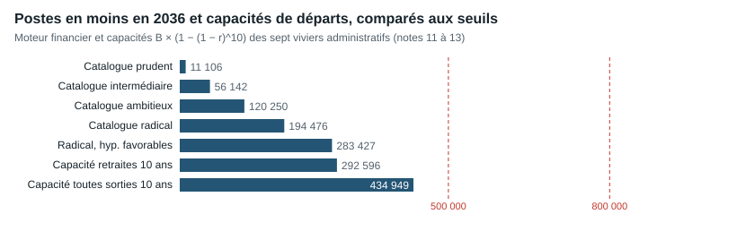

# 1. Résumé exécutif

**Mission d'audit indépendante — rapport arrêté au 30 octobre 2026.**

## La question

Combien de postes et combien de milliards d'euros la France pourrait-elle réellement économiser en réorganisant, simplifiant et automatisant ses administrations, à qualité de service comparable, et que faudrait-il changer concrètement pour y parvenir ?

## La réponse en une phrase

**Entre 5 000 et 23 000 postes en moins d'ici 2036, pour 0,3 à 1,1 milliard d'euros d'économie nette par an, est défendable ; jusqu'à 56 000 postes et 2,5 milliards si toutes les réformes réussissent ; 500 000 postes ou plus sont incompatibles avec les départs disponibles dans les fonctions administratives.**

## Dix constats

1. **La France compte 5,85 millions d'agents publics** fin 2024 (2,58 millions à l'État, 2,02 millions dans les collectivités, 1,25 million dans les hôpitaux), et 6,53 millions de salariés des administrations au sens des comptes nationaux. Ces chiffres ne mesurent pas l'administration au sens courant : la majorité des agents enseignent, soignent ou protègent.
2. **L'emploi public représente 20,9 % de l'emploi**, plus qu'en Allemagne (11,8 %) mais moins qu'en Suède (28,1 %). L'écart reflète surtout le choix de produire les services plutôt que de les acheter : la dépense de production publique (salaires + achats + prestations en nature) est de 24,1 % du PIB en France, 22,7 % en Allemagne, 25,2 % aux Pays-Bas.
3. **Fonction par fonction, la France n'est pas en excès** pour la fiscalité (0,56 ETP fiscal pour 1 000 habitants contre 1,33 en Allemagne), la justice ou la police. Ses frais de gestion de la protection sociale sont dans la moyenne européenne.
4. **Les fonctions administratives identifiables représentent environ 1,15 million d'ETP** : corps administratifs et techniques de l'État, filières administratives territoriale et hospitalière, organismes de protection sociale, France Travail. Environ 33 000 de ces agents partent à la retraite chaque année.
5. **Les « 2,3 millions de départs naturels » ne sont pas un vivier administratif** : il s'agit de toutes les sorties de la fonction publique sur cinq ans, dont plus de la moitié de contractuels souvent remplacés, tous métiers confondus.
6. **Les réformes passées ont produit des économies nettes réelles mais partielles.** Sous la RGPP, environ un tiers de l'économie brute de masse salariale est resté après rétrocession aux agents. Les contractions étrangères ont souvent été suivies de rebonds (Royaume-Uni : −20 % puis +36 %).
7. **L'IA fait gagner du temps sur des tâches, pas encore des postes.** France Travail estime à 767 ETP le temps libéré par trois outils, sans aucune baisse d'effectifs. Les études internationales vont de −40 % de temps sur la rédaction à +19 % pour des développeurs expérimentés ; les registres danois ne montrent pas d'effet supérieur à 2 % sur les heures travaillées.
8. **La simplification allège surtout les usagers et les entreprises** ; ses gains pour les effectifs publics ne sont mesurés nulle part.
9. **Le plan à 140 Md€ audité additionne des objets différents** (prestations, interventions, recettes, cessions). Ses 800 000 non-remplacements en cinq ans représentent 5 fois la capacité de départs à la retraite des fonctions administratives ; le « rapport IGF-IGAS 2025 » qui fonde ses 5 Md€ d'IA n'a pas été identifié.
10. **Le projet de budget 2027 prévoit une baisse nette d'environ 1 000 ETP**, avec des créations dans certaines missions : sans commune mesure avec les annonces politiques.

## Les scénarios

| | Prudent | Intermédiaire | Ambitieux | Radical |
|---|---:|---:|---:|---:|
| Postes en moins en 2036 | 11 106 | 56 142 | 120 250 | 194 476 |
| Économie nette en 2036 (M€/an) | 618 | 2 517 | 5 280 | 8 430 |
| Cumul net 2027-2036 (M€) | 3 464 | 12 627 | 25 701 | 35 448 |
| Pondérés par la confiance : postes en 2036 | 5 449 | 22 863 | 47 460 | 86 050 |
| Pondérés par la confiance : M€/an en 2036 | 318 | 1 059 | 2 148 | 3 785 |

Les scénarios sont construits à partir de 30 fiches de réforme chiffrées par un modèle financier qui ne supprime des postes qu'au rythme des départs à la retraite, sans licenciement. 24 fiches sur 30 sont à confiance faible : la pondération traduit l'écart habituel entre économies annoncées et constatées.

| Seuil de postes | 50 000 | 100 000 | 200 000 | 500 000 | 800 000 | 1 million | 1,5 million |
|---|---|---|---|---|---|---|---|
| Verdict | conditionnel | conditionnel | non démontré | incompatible | incompatible | incompatible | incompatible |

## Ce qu'il faudrait changer

Mesurer l'activité avant de couper ; mutualiser les fonctions support (communes, opérateurs, caisses, hôpitaux) ; supprimer des missions et pas seulement des postes ; ne plus redemander les données que l'administration détient ; expérimenter l'IA avec un groupe témoin ; sécuriser les grands projets numériques ; protéger l'accès au service ; ne voter les baisses de crédits qu'à proportion des économies constatées.

## Fiabilité

308 chiffres ont été relus dans leurs sources primaires par quatre contre-vérifications indépendantes, sans écart non corrigé. Chaque chiffre du rapport renvoie à une source datée, et chaque calcul est reproductible à partir des données et scripts fournis. Les hypothèses sont signalées comme telles, et leur sensibilité est mesurée.

# 2. Méthodologie, définitions et limites

## 2.1 Question et démarche

La mission répond à une question précise : **combien de postes et combien de milliards d'euros la France pourrait-elle réellement économiser en réorganisant, simplifiant et automatisant ses administrations, à qualité de service comparable, et que faudrait-il changer concrètement ?**

Le travail a suivi six phases, dans l'ordre imposé par le cahier des charges : données (lot 1), diagnostic par fonction (lot 2), étude des réformes, des doublons, de la simplification et de l'IA (lot 3), chiffrage par un modèle ascendant (phases 3-4), contre-expertise (phase 5), puis rédaction. **Aucun objectif de suppressions n'a servi de point de départ** : les totaux résultent des fiches de réforme, et non l'inverse.

## 2.2 Protocole de preuve

Chaque affirmation chiffrée porte un statut, défini dans le [protocole commun](../recherche/00_PROTOCOLE.md) :

- **[FAIT]** : valeur lue dans une source primaire identifiée, avec page, tableau ou cellule ;
- **[EXTRAIT]** : valeur vue dans un extrait ou une recension, non relue dans l'original ;
- **[ESTIMATION]** : calcul reproductible à partir de faits, avec sa formule ;
- **[HYPOTHÈSE]** : paramètre choisi par la mission, justifié par un précédent mais non mesuré ;
- **[NON TROUVÉ]** : donnée cherchée et absente des sources accessibles. Une case vide documentée est préférée à un chiffre inventé.

Les sources primaires sont téléchargées et archivées avec leur URL, leur date de consultation et leur empreinte SHA-256 (`sources/registre_*.csv`). Un document qui n'a pas pu être ouvert n'est jamais présenté comme lu : c'est le cas, par exemple, du texte intégral du livre « Le Casse du siècle », du rapport 2023 de la CNEN ou du texte opposable de l'AI Omnibus.

## 2.3 Contre-vérifications

Quatre contre-vérifications indépendantes ont relu **308 chiffres** dans leurs sources primaires, sans réutiliser les scripts d'extraction des auteurs : 100 au lot 1, 63 au lot 2, 98 au lot 3 et 47 en phase 5. Aucune n'a laissé d'écart numérique non corrigé ; les corrections apportées (arrondis, formulations, localisations) sont tracées. Une seconde lecture d'un même document vérifie la transcription ; elle ne constitue pas une seconde mesure statistique indépendante. Le détail est au chapitre 17.

## 2.4 Définitions

| Notion | Définition retenue | Piège évité |
|---|---|---|
| Fonction publique (FP) | Agents des trois versants (État, territoriale, hospitalière) au sens de la DGAFP : 5 848 291 personnes fin 2024, hors contrats aidés | Confondre FP et administrations publiques (S13) |
| Administrations publiques (S13) | Secteur des comptes nationaux, incluant des organismes de droit privé non marchands : 6 531 025 salariés à titre principal fin 2024 | Comparer S13 d'un pays à FP d'un autre |
| Personnes physiques (PP), ETP, EQTP, ETPT | PP : personnes présentes à une date ; ETP/EQTP : volumes de travail ; ETPT : unité budgétaire annuelle | Additionner ou soustraire des unités différentes |
| Emploi administratif | Filières et corps administratifs (et techniques pour l'État), organismes de gestion de la protection sociale, France Travail | Assimiler tous les non-enseignants ou non-soignants à de l'administration |
| Coût d'un poste non remplacé | Coût d'entrée hors contribution aux pensions, croissant avec l'ancienneté jusqu'au coût moyen | Valoriser au salaire du partant ou au coût moyen |
| Économie nette | Écart à une trajectoire de référence qui remplace tous les départs, après investissements, coûts récurrents et recettes | Confondre dépense évitée et baisse par rapport au niveau actuel |
| Lecture consolidée APU | Économie après retour aux APU des cotisations, CSG et retenues prélevées sur les salaires | Présenter l'économie employeur comme une économie publique totale |

## 2.5 Ce que la mission ne fait pas

- **Elle ne convertit aucun écart international en sureffectif.** Une différence de ratio entre pays ne devient une piste qu'après correction du périmètre, des besoins et des résultats de service (chapitres 4 à 6).
- **Elle ne traite pas des métiers opérationnels** (enseignants, soignants, forces de sécurité, magistrats) comme gisements de suppression. Leur nombre relève de choix de politique publique et de niveau de service, pas d'une rationalisation administrative.
- **Elle ne chiffre pas ce qui n'est pas documenté.** Les cases manquantes restent vides et sont signalées.

## 2.6 Limites principales

1. **Les tâches réelles ne sont pas mesurées.** Les sources donnent des corps, des filières et des métiers, pas le temps consacré à chaque tâche. Le périmètre « administratif » repose donc sur des catégories statutaires.
2. **Les gisements sont des hypothèses.** Aucune réforme du catalogue ne s'appuie sur une mesure française de postes effectivement supprimés après une réforme comparable ; les taux sont rattachés à des précédents étrangers ou à des estimations déclarées.
3. **Les coûts territoriaux et hospitaliers sont des proxys** du coût de l'État, faute de coût d'entrée publié.
4. **Les comparaisons internationales ne sont que partiellement corrigées** : NACE/ISCO, heures, démographie et résultats de service n'ont pas pu être réunis pour tous les pays.
5. **Le travail est arrêté au 30 octobre 2026.** Les publications ultérieures ne sont pas intégrées.

# 3. Cartographie de l'emploi public français

Détail et sources cellule par cellule : [note 01](../recherche/01_emploi_public_france.md), [note 01b](../recherche/01b_flux_retraites.md), [note 01c](../recherche/01c_couts_entree_pensions.md).

## 3.1 Combien d'agents ?

| Ensemble | Effectif fin 2024 | Source |
|---|---:|---|
| Fonction publique, hors contrats aidés | **5 848 291** PP | DGAFP, rapport annuel 2026 |
| — dont État (FPE) | 2 581 870 | idem |
| — dont territoriale (FPT) | 2 017 830 | idem |
| — dont hospitalière (FPH) | 1 248 591 | idem |
| Contrats aidés | 25 797 | idem |
| Administrations publiques (S13), salariés à titre principal | 6 531 025 | DGAFP, d'après les comptes nationaux |
| Organismes privés à financement public prédominant | 627 947 | dont 162 623 dans la protection sociale |

**[FAIT]** Les 5,85 millions d'agents se répartissent en **3 745 836 fonctionnaires, 1 407 727 contractuels, 312 854 militaires et 381 874 autres statuts** (enseignants du privé sous contrat, médecins hospitaliers, ouvriers d'État, apprentis). Ces catégories décrivent un statut, pas une utilité ni un caractère administratif.

**[FAIT]** L'Insee Première n° 2094 publie une autre version des mêmes données (5 850 900 hors contrats aidés). L'écart de hausse annuelle entre l'Insee (+32 800) et la DGAFP (+37 036) se décompose en +3 000 de différence de champ et +1 236 d'écart entre publications, dont la cause reste **[NON TROUVÉ]**.

**[FAIT]** Le volume de travail annuel atteint **5 781 800 EQTP** hors contrats aidés en 2024 : un volume sur l'année, qu'il ne faut pas soustraire des personnes présentes au 31 décembre pour déduire des « postes vacants ».

## 3.2 Où travaillent-ils ?

- **État** : 2 058 555 agents dans les ministères et 523 315 dans les établissements publics administratifs. L'Éducation nationale, la Jeunesse, les Sports, l'Enseignement supérieur et la Recherche en emploient 1 501 101.
- **Territoriale** : 1 146 464 dans les organismes communaux, 401 402 dans l'intercommunalité, 358 826 dans les organismes départementaux, 98 916 dans les régions.
- **Hospitalière** : 1 118 560 dans les hôpitaux (dont 144 604 médecins), 92 510 dans les Ehpad non hospitaliers, 37 521 dans les autres établissements médico-sociaux.

## 3.3 Combien coûtent-ils ?

| Agrégat | Montant | Lecture |
|---|---:|---|
| Rémunérations des APU (D1), 2025 provisoire | **370,0 Md€** | 184,9 APUC, 97,0 APUL, 88,2 ASSO ; cotisations employeur incluses |
| Consommations intermédiaires des APU (P2), 2025 | 163,5 Md€ | Achats de biens et services, pas seulement de conseil |
| Titre 2 du budget général de l'État, 2025 | 156,2 Md€ | dont 49,2 Md€ de contribution d'équilibre au CAS Pensions |
| Salaire brut mensuel moyen par EQTP, 2024 | 3 738 € FPE, 2 858 € FPT, 3 560 € FPH | Hors charges employeur |

**[FAIT]** Le coût d'un recrutement n'est pas le salaire moyen. Les PAP 2026 publient des **coûts d'entrée chargés hors pensions** : à la DGFiP (programme 156), 55 611 € en catégorie A, 38 455 € en B et 34 425 € en C ; ils servent de base au modèle (chapitre 13).

**[FAIT]** La contribution employeur aux pensions (82,28 % de l'assiette pour l'État, 37,65 % pour la CNRACL en 2026) finance des pensions déjà liquidées : **elle ne disparaît pas quand un poste est supprimé**. Les économies du rapport sont donc calculées hors pensions.

**[FAIT]** La durée annuelle effective déclarée des agents à temps complet hors enseignants est de **1 623 heures** en 2025, contre 1 680 dans le privé du même tableau. L'écart n'est pas corrigé des professions et sujétions ; il ne se convertit pas directement en postes.

## 3.4 Combien partent ?

| Flux | Valeur | Source |
|---|---:|---|
| Sorties de la FP civile, 2024 | **481 598** personnes | DGAFP, entrants-sortants |
| — dont fonctionnaires | 174 655 | idem |
| — dont contractuels | 261 179 (54 %) | idem |
| Nouvelles pensions de fonctionnaires civils, 2025 | **108 796** | 39 146 FPE, 46 897 FPT, 22 753 FPH |
| Sorties civiles cumulées 2020-2024 | 2 339 789 occurrences | complément entrées-sorties |
| Agents de 50 ans ou plus, fin 2024 | 2 215 506 | dossier 50 ans ou plus |

**[ESTIMATION]** Les « 2,3 millions de départs naturels » invoqués dans le débat public correspondent à la somme des sorties civiles sur cinq ans. Mais **plus de la moitié sont des contractuels**, souvent remplacés à l'identique, et toutes les fonctions sont concernées (enseignement, soins, sécurité). Ce total n'est **pas un vivier de postes administratifs supprimables**. Les seules retraites de fonctionnaires civils représentent environ 109 000 départs par an, tous métiers confondus.

## 3.5 Ce qu'il faut retenir

1. La France compte 5,85 millions d'agents publics et 6,5 millions de salariés des administrations au sens des comptes nationaux. Ces deux chiffres ne mesurent pas l'administration au sens courant.
2. Les fonctions administratives identifiables par statut représentent environ **1,15 million d'ETP** dans les viviers retenus par la mission (chapitre 11) : corps administratifs et techniques de l'État, filières administratives territoriale et hospitalière, organismes de protection sociale, France Travail.
3. Les départs à la retraite de ces fonctions sont d'environ **33 000 par an** (bases des viviers × taux de départ à la retraite de chaque versant). C'est le premier déterminant du rythme possible de toute réduction sans licenciement.

# 4. Comparaison internationale étendue

Détail : [note 03](../recherche/03_comparaison_harmonisee.md), base de 3 859 lignes et 44 pays (`data/international/03_base_comparative.csv`).

## 4.1 La France emploie-t-elle plus d'agents publics ?


*Valeurs du Panorama des administrations publiques 2025 de l'OCDE. Les séries de l'API OCDE d'octobre 2026, utilisées dans le texte, diffèrent légèrement pour la même année (France 20,86 %, Allemagne 11,80 %). Le Japon exclut les fonds de sécurité sociale.*

**[ESTIMATION]** En 2023, l'emploi des administrations publiques (S13) représente **20,86 % de l'emploi intérieur** en France, soit **92,4 personnes pour 1 000 habitants**. C'est plus que l'Allemagne (11,80 %), l'Italie (13,53 %), l'Espagne (15,77 %) ou le Royaume-Uni (17,0 %), mais moins que la Suède (28,1 %), le Danemark (27,3 %) ou la Finlande (25,4 %). La moyenne OCDE publiée est de 18,4 %.

**Ce chiffre ne mesure pas la suradministration.** Le champ S13 inclut les enseignants, soignants, policiers et agents techniques ; il dépend de ce que chaque pays fait produire par le secteur public plutôt que par des entreprises ou des associations financées sur fonds publics. L'Allemagne, par exemple, confie une grande partie de ses hôpitaux et de ses services sociaux à des organismes non publics.

## 4.2 Ce que coûte la production publique

| Pays, 2023 | Rémunérations D1 (% PIB) | Achats P2 + transferts en nature D632 (% PIB) | Total D1 + P2 + D632 (% PIB) |
|---|---:|---:|---:|
| France | 12,22 | 11,85 | **24,07** |
| Allemagne | 8,01 | 14,68 | **22,69** |
| Pays-Bas | 8,49 | 16,66 | **25,15** |

**[ESTIMATION]** La masse salariale publique française est élevée, mais l'écart se réduit fortement une fois ajoutés les achats et les prestations en nature financés par les administrations : **un pays qui achète au lieu d'employer n'est pas moins coûteux pour autant**. Les Pays-Bas dépensent davantage que la France sur ce sous-total.

**[FAIT]** Les services généraux des administrations (COFOG GF01) représentent 6,2 % du PIB en France en 2023, dont 1,6 % de rémunérations et 1,9 % d'intérêts et transferts ; la part des intérêts de la dette n'a pas pu être isolée **[NON TROUVÉ]**.

## 4.3 Fiabilité des données

- **[FAIT]** Les rapprochements OCDE / Eurostat portent sur 224 couples pays-année-indicateur, sans écart supérieur à 0,15 point de PIB. Les deux diffuseurs reprennent souvent les mêmes comptes nationaux : c'est un contrôle de cohérence, pas une double mesure.
- **[FAIT]** Sept divergences d'emploi S13 subsistent entre deux tables OCDE (jusqu'à 38 554 personnes pour le Portugal en 2024) ; la France est concordante.
- **[FAIT]** Les millésimes changent : 20,74 % pour la France dans le Panorama 2025, 20,86 % dans les données d'octobre 2026, pour la même année d'observation.

## 4.4 Ce que les comparaisons ne disent pas

Les corrections nécessaires pour passer d'un écart brut à un sureffectif — structure par métier (NACE, ISCO), heures travaillées, démographie, part privée de la santé et de l'enseignement, décentralisation, résultats des services — n'ont été réunies que fonction par fonction (chapitre 5), pas pour l'ensemble. **Aucun écart international n'est donc converti en nombre de postes à supprimer** dans ce rapport.

Les expériences étrangères de réforme sont analysées au chapitre 7 ; elles montrent surtout que les réductions d'effectifs observées ont souvent été suivies de rebonds, et que les économies vérifiées ont été bien inférieures aux annonces.

# 5. Analyse des effectifs par métier et par fonction

Détail : [note 02](../recherche/02_metiers_classification.md) et les notes [04a](../recherche/04a_fiscalite_emploi.md), [04b](../recherche/04b_education_securite_justice.md), [04c](../recherche/04c_sante_protection_sociale.md), [04d](../recherche/04d_territoires_fonctions_support.md), synthèse [04](../recherche/04_synthese_fonctions.md).

## 5.1 Qui est « administratif » ?

**[FAIT]** Une partition exhaustive et vérifiée des 5,85 millions d'agents en tâches administratives et opérationnelles **n'existe pas** dans les sources publiques. Les données décrivent des corps, des filières et des métiers, pas le temps passé à chaque tâche.

| Groupe | Effectif | Source | Lecture |
|---|---:|---|---|
| Enseignants de la FPE (dont privé sous contrat) | 972 918 PP | DGAFP 2024 | Opérationnel |
| Militaires (gendarmerie comprise) | 312 854 PP | DGAFP 2024 | Opérationnel |
| Filière soignante non médicale de la FPH | 766 961 PP | DGAFP 2024 | Opérationnel |
| Médecins et internes FPH | 144 604 PP | DGAFP 2024 | Opérationnel |
| Corps administratifs et techniques FPE (fonctionnaires) | 378 909 PP | DGAFP 2024 | Administratif et technique mêlés |
| Filière administrative FPT | 453 224 PP (22,5 % de la FPT) | DGAFP 2024 | Administratif par statut |
| Filière administrative FPH | 121 829 PP (9,8 % de la FPH) | DGAFP 2024 | Administratif par statut |
| Filière administrative de l'Éducation nationale | 52 432 PP, 50 849 ETP | DEPP 2025 | Administratif |
| Non-enseignants de l'Éducation nationale | 320 779 PP, dont 224 785 en vie scolaire | DEPP 2025 | Majoritairement non administratif |

**[ESTIMATION]** Un panier homogène de groupes à dominante opérationnelle atteint **2 400 090 personnes**. La notion de « 2,2 millions de métiers essentiels » circulant dans le débat public additionne six familles (enseignants, militaires, police et gendarmerie, pompiers, magistrats, soignants) ; elle laisse de côté des métiers de terrain comme les AESH, les assistants d'éducation, les travailleurs sociaux ou les agents techniques. **Conclure que tous les autres agents « administrent l'administration » n'est pas fondé.**

## 5.2 Les comparaisons par fonction

La mission a comparé quatre ensembles de fonctions, à quatre niveaux d'écart successifs : brut, après correction du périmètre, après prise en compte des besoins, et potentiel net réalisable.

| Fonction | Constat principal | Potentiel net établi ? |
|---|---|---|
| **Fiscalité** | 0,562 ETP fiscal pour 1 000 habitants en France contre 1,328 en Allemagne et 0,857 au Royaume-Uni ; coût de collecte 0,671 % des recettes. 38 406 ETP fiscaux ISORA, distincts des 93 789 agents de l'organisme | Non : la France n'est pas en excès sur cet indicateur |
| **Service public de l'emploi** | 6 899 M€ de coûts de catégorie 1 en 2023, dont 75 % non ventilés ; profils internationaux d'effectifs non comparables | Non identifié |
| **Éducation** | 17,87 élèves par enseignant au primaire (13,71 OCDE), mais 11,48 au second cycle (12,78) ; 1,5 heure hebdomadaire de tâches administratives déclarées par les enseignants contre 3,0 OCDE | Non identifié |
| **Police et justice** | 37,3 ETP non-juges pour 100 000 habitants en France contre 62,8 en Allemagne ; la catégorie administrative ne compte que 3 424 des 25 388 ETP | Non : ratios inférieurs à l'Allemagne et à la médiane du Conseil de l'Europe (57,9) |
| **Gestion de la santé** | 5,02 % de la dépense de santé contre 4,41 % en Allemagne, mais l'écart s'inverse pour les seuls régimes publics (2,45 % contre 3,43 %) ; les complémentaires privées portent 52 % des frais de gestion | Scénarios historiques seulement |
| **Protection sociale** | Frais de gestion 3,83 % des dépenses en France, 3,60 % en Allemagne, 5,35 % aux Pays-Bas | Non identifié |
| **Territoires et supports** | 34 875 communes, mais 34 871 déjà en intercommunalité ; coordination valorisée à 7,4 Md€ par le rapport Ravignon, dont une part nécessaire | Hypothèses externes seulement |

**Le diagnostic par fonction ne confirme pas une suradministration générale.** Sur la fiscalité, l'éducation administrative, la police et la justice, la France n'apparaît pas en excès. Les écarts les plus nets concernent la gestion de la santé, mais ils tiennent surtout au poids des complémentaires privées, et la fragmentation territoriale, dont le coût de coordination est mal mesuré.

## 5.3 Conséquence pour la suite

Le potentiel de réforme est à chercher **dans les processus** (doublons d'instruction, fonctions support non mutualisées, pièces redemandées, gestion RH manuelle) plutôt que dans une comparaison globale des effectifs. C'est le parti du catalogue (chapitre 11), qui ne vise que les viviers administratifs et ne touche aucun métier opérationnel.

# 6. Analyse des dépenses et de l'efficacité des administrations

## 6.1 Coûts de gestion : où la France se situe

| Indicateur | France | Comparaison | Source |
|---|---:|---|---|
| Coût de collecte de l'impôt, % des recettes nettes (2023) | 0,671 % | Allemagne 1,253 %, Royaume-Uni 0,628 %, Pays-Bas 0,707 % | OCDE, ISORA |
| Gestion de la santé (HC7), % de la dépense de santé (2023) | 5,02 % | Allemagne 4,41 %, Pays-Bas 3,05 %, États-Unis 7,91 % | OCDE, SHA |
| Gestion de la santé par habitant, $ PPA (2023) | 360 | Allemagne 394, Suisse 412 | OCDE, SHA |
| Administration de la protection sociale, % des dépenses (2023) | 3,83 % | Allemagne 3,60 %, Danemark 4,24 %, Pays-Bas 5,35 % | Eurostat, ESSPROS |
| Frais de gestion de la santé (2025) | 17,6 Md€ | dont 7,2 régimes obligatoires, 9,2 complémentaires | DREES, comptes 2026 |
| Achats de l'État (2025) | 50,2 Md€ | dont 24,4 hors défense et sécurité | DAE |

**[FAIT]** Sur les indicateurs de coût de gestion disponibles, **la France est dans la moyenne de ses voisins**, sauf pour la gestion de la santé où l'écart provient principalement des organismes complémentaires privés. Réduire ces frais privés ne serait pas une économie de dépense publique ; transférer leur activité à l'assurance maladie (scénario HCAAM le plus intégré) éviterait 5,4 Md€ de charges mais ferait passer **22,5 Md€** de prise en charge vers les finances publiques.

## 6.2 Efficacité et résultats

Les indicateurs de résultat (délais, qualité des décisions, accès) n'ont été réunis que de façon partielle. Trois constats documentés :

- **[FAIT]** La dématérialisation fiscale est déjà avancée : 96,0 % des déclarations d'impôt sur les sociétés et 86,8 % des déclarations de revenus sont électroniques (2023).
- **[FAIT]** La publicité foncière a vu son délai de publication passer de 134 jours fin 2021 à 24,6 jours en juin 2024, avec 218 ETP de moins ; la Cour ne permet pas d'attribuer ce résultat au seul système d'information.
- **[FAIT]** Dans le panel DINUM, les démarches demandant au plus une information passent de 32,2 % à 55,2 % entre 2020 et 2023 ; le dénominateur change et l'évolution n'est pas pondérée par les volumes.

## 6.3 Où se trouvent les marges

Les marges documentées sont de trois natures :

1. **Des doublons de gestion entre structures** : 423 opérateurs et 537 organismes nationaux non opérateurs, chacun avec ses fonctions support ; chevauchements entre niveaux de collectivités.
2. **Des processus encore manuels** : pièces redemandées, ressaisies, actes RH instruits un par un.
3. **Des achats et de l'immobilier** : 412,5 M€ d'économies d'achats calculées par la DAE en 2025 (non budgétaires), un objectif de −25 % de surfaces de bureaux d'ici 2032 déjà engagé.

Aucune de ces marges n'est chiffrée de façon mesurée dans les sources : le catalogue (chapitre 11) leur attribue des hypothèses explicites, testées au chapitre 14.

# 7. Audit des chevauchements et doublons

Détail : [note 06](../recherche/06_doublons_structures.md), [note 05](../recherche/05_reformes_etrangeres.md), [note 04d](../recherche/04d_territoires_fonctions_support.md).

## 7.1 Les structures de l'État

| Constat | Valeur | Lecture |
|---|---:|---|
| Opérateurs de l'État, PLF 2027 | **423** (431 au PLF 2026) | Universités, organismes de recherche, agences : pas des sièges administratifs |
| Organismes nationaux non opérateurs, fin 2025 | 537 | Périmètre distinct, hors sécurité sociale |
| Concours publics aux opérateurs, PLF 2027 | **72,572 Md€** | dont 16,4 Md€ d'interventions et 21,9 Md€ de taxes affectées : missions et aides |
| Emplois rémunérés par les opérateurs, PLF 2027 | 481 336 ETPT | −674 sur un an |
| Baisse du plafond d'emplois des opérateurs | −4 107 ETPT | dont **−3 248 d'abattements techniques de vacance** (79 %) |
| Instances consultatives recensées, PLF 2025 | 317 | Coûts incomplets |

**[FAIT]** Les budgets des grandes agences financent d'abord des missions. Au budget initial 2026, l'Anah consacre **3 450,7 M€ d'interventions** sur 3 651,5 M€ de charges, pour 25 M€ de personnel ; l'Ademe 1 322,9 M€ d'interventions sur 1 603,6 M€. **Fermer une agence ne supprime pas ses interventions** : c'est une décision distincte, qui relève de la politique publique et non de la rationalisation administrative.

**[FAIT]** Les 2 Md€ d'économies d'agences annoncés en 2025 ne sont **pas validés** par le secrétariat général du Gouvernement, qui décrit en septembre 2026 une circulaire encore en préparation. L'Observatoire de la laïcité, souvent cité parmi les structures à supprimer, a vu ses missions reprises dès 2021.

## 7.2 L'État territorial et les collectivités

**[FAIT]** La Cour des comptes relève **11 763 ETPT de moins dans l'État territorial entre 2012 et 2020**, en partie compensés par des contrats courts, et juge certaines coupes irréalistes. Une baisse de titulaires peut donc déplacer les coûts ou dégrader le service.

**[FAIT]** 34 871 des 34 875 communes sont déjà membres d'une intercommunalité. La coopération existe ; ce qui manque, c'est la mutualisation effective des fonctions support (paie, achats, finances, RH). Le rapport Ravignon (2024) compte **31 040 agents RH** dans les collectivités et valorise l'enchevêtrement des compétences à **7,4 Md€ par an**, en précisant qu'une partie est de la coordination nécessaire ; ses gains RH de 102 à 205 M€ reposent sur des taux d'efficience supposés de 5 et 10 %.

## 7.3 Les précédents français

| Réforme | Annoncé | Constaté | Source |
|---|---|---|---|
| RGPP 2007-2012 | 12,3 Md€ ramenés à 11,9 Md€ (bruts) | Titre 2 : **808 M€ bruts → 264 M€ nets en 2010**, 935 → 373 M€ en 2011, après retour aux agents | Inspections 2012 ; AN 2012 |
| MAP 2012-2017 | 49 politiques couvrant 250 Md€ ; 3 Md€ au PLF 2014 | 325 M€ (LFI 2015), 156 M€ (LFI 2016), 90 M€ (LFSS 2016) de mesures rapportées | AN 2023, citant la Cour |
| DGFiP 2015-2025 | — | 107 202 → 91 064 ETPT (−15 %), attribution au numérique non établie | AN 2026 ; Cour 2025 |
| Timbre électronique | — | 2,65 M€ de coût total, retour sur investissement en deux ans | Cour 2025 |

**Les précédents français montrent des économies nettes réelles mais partielles** : sous la RGPP, environ un tiers de l'économie brute de masse salariale est resté après rétrocession.

## 7.4 Les précédents étrangers

| Pays | Réforme | Résultat mesuré |
|---|---|---|
| Royaume-Uni | Contraction 2010-2016 | −20,2 % d'ETP (481 000 → 384 000), puis **+36,2 %** jusqu'en 2026 |
| Irlande | Moratoire 2008-2014 | −9,6 % de WTE, puis remontée à 317 495 dès 2017 |
| Portugal | Programme 2010-2014 | ≈ −12 % de personnes, +1,2 % fin 2014-fin 2016 |
| Canada | Program Review 1994-1998 | ≈ 45 000 personnes en moins, dont 8 000 transferts ; 1 Md CAD de restructuration |
| Danemark | Fusion des communes, 2007 | −10,4 % de coûts administratifs relatifs en 2011, mais **pas d'économie sur la dépense municipale totale** |
| Danemark | Digital Post | 48 M DKK de crédits réduits, **19,7 % du potentiel annoncé** |
| Suède | Services partagés de support | Gains souvent réinvestis dans le support (audit 2021) |
| États-Unis | DOGE 2025 | 110,34 Md USD affichés **non certifiés** par le GAO ; 60,7 % des contrats déclarés aux méthodes indéterminées |
| Canada | Paie Phénix | 937,5 M CAD de dépenses en 2024-25 ; successeur estimé à plus de 4,2 Md CAD |

## 7.5 Conclusion du chapitre

Les doublons existent, surtout dans les fonctions support et les instructions partagées entre niveaux, mais **leur coût n'est mesuré nulle part de façon nette**. Les expériences étrangères enseignent trois règles reprises dans le catalogue : supprimer des missions et pas seulement des postes, prévoir les rebonds, et compter les coûts d'échec. Les huit pistes structurelles de la note 06 alimentent les fiches R04 à R12 et R14 à R17.

# 8. Simplification administrative et réglementaire

Détail : [note 07](../recherche/07_simplification_reglementaire.md).

## 8.1 Ce que la simplification a produit

| Dispositif | Constat | Nature du gain |
|---|---|---|
| Choc de simplification (2013-2017) | ≈ 460 mesures ; 5 Md€/an potentiels pour les entreprises selon le Sénat en 2017, jugés non vérifiables | Privé, annoncé |
| « Dites-le-nous une fois » | 320 M€/an pour l'État, annoncés **au conditionnel** en 2019 | Public, non constaté |
| Démarches en ligne (panel DINUM) | Démarches à au plus une information : 78/242 en 2020 → 137/248 en 2023 | Usager, non pondéré |
| Silence vaut accord | ≈ 1 200 procédures sur 3 600 en 2015, 42 décrets d'exceptions, délais de 2 à 12 mois | Usager |
| Loi ESSOC (DGFiP) | 116 500 régularisations en cours de contrôle sur 2019-2021 | Relation à l'usager |
| Loi de simplification n° 2026-403 | Promulguée le 26 mai 2026 ; application à suivre | À mesurer |
| Omnibus européens | 37,5 Md€/an visés pour les entreprises de l'UE en 2029 ; 17 Md€ présentés comme « achieved so far » | Privé, prospectif |
| Pays-Bas, Standard Cost Model | ≈ −20 % de charge d'information des entreprises entre 2002 et 2007 | Privé |

## 8.2 Trois enseignements

1. **La simplification allège surtout les usagers et les entreprises.** Les gains chiffrés sont majoritairement privés ; un allègement de charge privée ne finance pas une économie publique équivalente.
2. **Les gains publics sont rarement mesurés.** Aucune source ne publie de temps d'agent économisé par démarche simplifiée. Le coût récent et net des normes imposées aux collectivités n'a pas pu être vérifié : le rapport de la CNEN est resté inaccessible. Les saisines en urgence de la CNEN sont passées de 26 % des textes en 2022 à 5 % en 2025, selon le Premier ministre.
3. **Une méthode existe.** Le Standard Cost Model et l'outil 58 de la Commission (`prix = tarif × temps`, `quantité = population × fréquence`) permettent de mesurer obligation par obligation ; ils n'ont pas été appliqués au coût public français.

## 8.3 Traduction dans le catalogue

Les fiches **R07** (réutilisation des données), **R08** (suppression d'obligations sans usage) et **R16** (normes des collectivités) traduisent ces enseignements avec des taux modestes, de 0,5 à 3 % de leur vivier, et une confiance faible à moyenne. La simplification est surtout un **levier de qualité de service** ; sa contribution aux économies d'effectifs reste conditionnée à une mesure qui n'existe pas encore.

# 9. Potentiel de l'intelligence artificielle

Détail : [note 08](../recherche/08_ia_france.md) (France), [note 09](../recherche/09_ia_preuves_internationales.md) (preuves internationales), contre-vérification [08-09](../recherche/00_verification_08_09_lot3.md).

## 9.1 Ce que dit le rapport IGF–IGAS–IGA

Le rapport conjoint « Le déploiement de l'intelligence artificielle dans les administrations publiques », daté d'avril 2026 et publié le 2 juillet 2026 (709 pages, lu par passages localisés), établit notamment :

- **[FAIT sur une estimation]** **20 % des agents publics**, soit 1,13 million, sont « exposés » à l'IA au sens de l'OIT ; 13 % (plus de 700 000) dans les catégories les plus exposées. Le rapport précise que ce **n'est pas une estimation des gains de productivité**.
- **[FAIT]** 141 produits d'IA dans 80 entités ; de 0 à 74 preuves de concept et de 1 à 15 outils déployés selon les ministères.
- **[FAIT décisif]** À France Travail, les outils ChatFT, Panoptes et NEO représentent **226, 300 et 241 équivalents ETP** de temps gagné, mais ces chiffrages **« n'ont pas été traduits en pratique par une diminution des ETP »**.
- **[FAIT]** Les gains déclarés portent sur des tâches : 20 à 30 % sur des activités courtes à la CNAV, 5 % de productivité sur 100 développeurs à la CNAM, plus de 60 % sur certaines tâches d'achat (44 agents), 20 % du temps d'une équipe RH en Haute-Savoie, réinvesti dans le conseil.

Le « rapport IGF-IGAS 2025 » cité à l'appui des 5 Md€ d'économies par l'IA du plan audité au chapitre 10 **n'a pas pu être identifié**.

## 9.2 Ce que disent les études internationales

| Étude | Population | Effet mesuré | Portée |
|---|---|---|---|
| Brynjolfsson, Li, Raymond (QJE 2025) | 5 172 agents de support client | +15 % de dossiers résolus/heure (+30 % pour les novices) | Une entreprise, différences de différences |
| Noy, Zhang (Science 2023) | 453 professionnels | −40 % de temps, +18 % de qualité | Tâches rédactionnelles de 20-30 min |
| Dell'Acqua et al. (2026) | 758 consultants | −25,1 % de temps dans la frontière ; −19 points de bonnes réponses hors frontière | Tâches expérimentales |
| METR (2025) | 16 développeurs expérimentés, 246 tâches | **+19 % de temps** (IC +2 à +39 %) | Bases de code matures |
| Humlum, Vestergaard (2026) | 25 000 travailleurs danois | Effet sur heures et revenus totaux **< 2 %** à fin 2024 | Registres nationaux |
| Essai Copilot britannique (GDS) | 20 000 licences, 7 115 réponses | 26 min/jour **déclarées** | Enquête |
| Évaluation DBT (Royaume-Uni) | 1 000 licences | Pas de preuve d'une productivité globale accrue | Sans contrefactuel |
| Scribes ambiants (NEJM AI) | 238 médecins | −9,5 % du temps de note (Nabla) ; non significatif (DAX) | Temps médical |
| DraftOne (police, New Hampshire) | 85 agents, 755 rapports | Pas d'effet significatif sur la durée de rédaction | Police |
| L'Assistant (DITP) | ≈ 30 agents volontaires | −2,5 min sur un mail, −5,4 min sur une synthèse | Non généralisable |

## 9.3 Lecture

Les gains de l'IA sont **réels sur des tâches précises, hétérogènes, parfois négatifs**, et ils ne se sont pas traduits, dans les sources disponibles, par des réductions d'effectifs. La chaîne qui mène d'une exposition à une économie compte au moins six étapes : tâche éligible, usage réel, temps et qualité contrôlés, temps disponible après nouvelles charges, réorganisation de postes entiers, dépense évitée nette. Aucune n'est mesurée de bout en bout en France.

## 9.4 Traduction dans le catalogue

Six fiches portent sur l'IA (R03, R11, R18, R20, R24, R26). Leurs taux vont de 0 % (prudent) à 5 % (radical) du reliquat de leur vivier. En scénario intermédiaire, elles retirent environ **9 400 postes** en 2036, soit 17 % du total ; la sensibilité « aucune conversion » à « conversion doublée » fait varier le scénario intermédiaire de 46 759 à 65 524 postes (chapitre 14). **L'IA est un levier d'appoint, pas le moteur principal d'une réduction d'effectifs à horizon 2036.**

Les garde-fous juridiques restent contraignants : décisions exclusivement automatisées encadrées par l'article 22 du RGPD, obligations d'explication du CRPA, règles de l'AI Act sur les systèmes à haut risque de l'annexe III à partir du 2 décembre 2027.

# 10. Évaluation des propositions de réforme existantes

Détail : [note 10](../recherche/10_audit_propositions.md), contre-vérification [10](../recherche/00_verification_10_lot3.md).

## 10.1 Le plan à 140 Md€ (budget2027.fr)

Le site budget2027.fr présente **24 mesures** pour un objectif de **140 Md€ d'économies par an**. Son instantané du 28 octobre 2026 a été archivé et relu.

| Constat | Valeur | Statut |
|---|---|---|
| Somme des bornes basses / hautes affichées | 138,366 / 145,366 Md€ | [ESTIMATION] |
| Mesure 1 : non-remplacement de 800 000 départs sur le quinquennat | 40 Md€ | [FAIT sur l'annonce] |
| Coût implicite par poste | **50 000 € par an** | [ESTIMATION] 40 Md€ / 800 000 |
| 800 000 rapportés aux 2,3 millions de départs annoncés | 34,78 % | [ESTIMATION] |
| Mesure 2 : productivité de l'IA « d'après le rapport IGF-IGAS 2025 » | 5 Md€ | Référence non identifiée |
| Bandeau du site | « Budget 2026 » sur une adresse « 2027 » | Date et exercice non explicités |

**Le plan additionne des objets de nature différente** : suppressions d'institutions, baisses de prestations (nationalité et aides, RSA, AME), arrêts d'interventions (énergie, politique de la ville, aide au développement), recettes de tarification (étudiants étrangers, visas) et une cession d'actifs. Un euro de prestation supprimée n'est pas un euro d'économie administrative. Treize recouvrements possibles entre mesures ont été repérés.

### Ce que l'audit de la mission établit

1. **Le vivier.** 800 000 non-remplacements en cinq ans représentent **5,1 fois** la capacité de départs à la retraite des fonctions administratives sur cette période (157 142), et **3,3 fois** leur capacité en ne remplaçant aucune sortie de fonctionnaire (243 487). Le plan suppose donc de ne pas remplacer aussi des enseignants, des soignants ou des agents de sécurité, ce qu'il exclut par ailleurs.
2. **Le coût par poste.** 50 000 € par an est proche du coût moyen hors pension de l'État (49 k€), mais un poste non remplacé économise d'abord son **coût d'entrée** (34 à 44 k€ selon le versant), et les postes territoriaux et hospitaliers coûtent moins.
3. **Le calendrier.** Avec 160 000 postes évités par an, l'économie n'atteint 40 Md€ qu'en cinquième année ; le cumul sur cinq ans vaut 100 à 120 Md€ selon la convention, et non 200 Md€.


4. **Les agences.** Les montants affichés pour l'Anah (6 Md€), l'Ademe (3,4 Md€) ou le placement de France Travail (4 Md€) sont du même ordre que leurs budgets d'**intervention** ou de **personnel de mission**, pas que leurs frais de structure : à l'Anah, le personnel coûte 25 M€.
5. **L'IA.** Les 5 Md€ ne sont pas ventilés et se superposent au vivier des 800 000.

## 10.2 Les plans gouvernementaux

| Plan | Contenu | Lecture |
|---|---|---|
| Plan Bayrou, juillet 2025 | Effort de 43,8 Md€ | [EXTRAIT] : source directe inaccessible |
| Loi de finances 2026 | Promulguée le 19 février 2026 (loi 2026-103) | Référence budgétaire |
| PLF 2027 (1er octobre 2026) | 54 Md€ d'effort total, dont 43 Md€ de mesures | Projet, non exécuté |
| Schémas d'emplois PLF 2027 | +8 025 ETP État, −1 209 opérateurs ; **−1 076 ETP** au total retraité | dont −812 en administration centrale, +404 numériques réinternalisés |

**[FAIT]** Le projet de budget 2027 retient un ordre de grandeur sans commune mesure avec 800 000 postes : une baisse nette d'environ un millier d'ETP, avec des créations dans certaines missions.

## 10.3 Les propositions antérieures

**[FAIT sur des positions]** L'Institut Montaigne rappelle les objectifs de la campagne 2017 : **120 000 emplois** pour Emmanuel Macron, **500 000** pour François Fillon. Il chiffrait le premier à 3,17 Md€ à terme. L'iFRAP avance 430 000 emplois publics automatisables, part publique (53,7 %) d'une estimation Roland Berger de 800 000 emplois automatisables : une position, pas une mesure.

## 10.4 Verdict

| Proposition | Verdict de la mission |
|---|---|
| 800 000 non-remplacements administratifs en cinq ans | **Incompatible** avec les départs administratifs disponibles |
| 40 Md€ par an à terme pour ces postes | Non démontré : vivier, coût d'entrée et calendrier non établis |
| 5 Md€ de gains d'IA | Non démontré : référence introuvable, aucune conversion de temps en postes observée |
| Fermeture d'agences à hauteur de leurs budgets | Confond suppression d'une structure et suppression de ses interventions |
| Schémas d'emplois du PLF 2027 | Cohérents avec les capacités ; intégrés à la trajectoire de référence |

# 11. Catalogue détaillé des réformes

Trente fiches suivent la structure A à M du cahier des charges, avec un indicateur de validation à deux ou trois ans. Chaque fait cité provient d'une note contre-vérifiée ; chaque taux de réduction est une hypothèse rattachée à un précédent observé, et les économies de la rubrique G sont celles du moteur financier (chapitre 13). La méthode des viviers, les hypothèses nationales et les conventions sont détaillées dans la [note 11](../recherche/11_catalogue_reformes.md).

## 11.1 Vue d'ensemble

| Fiche | Confiance | Postes en moins 2036 (P / I / A / R) | Économie nette 2036, M€ (P / I / A / R) |
|---|---|---|---|
| R01 — Automatiser les contrôles de forme et supprimer les ressaisies fiscales | moyen | 520 / 1 039 / 2 078 / 3 117 | 23 / 45 / 90 / 136 |
| R02 — Mutualiser les fonctions RH et informatiques de la DGFiP | faible | 94 / 439 / 647 / 859 | 4 / 19 / 28 / 37 |
| R03 — Utiliser l'IA pour cibler le contrôle fiscal, à effectifs redéployés | faible | 0 / 0 / 0 / 0 | 0 / −1 / −1 / −1 |
| R04 — Revoir les missions des opérateurs et regrouper ceux qui se recouvrent | moyen | 927 / 2 780 / 5 560 / 11 120 | 44 / 131 / 263 / 525 |
| R05 — Allouer les effectifs de l'État territorial selon des besoins mesurés | faible | 0 / 2 282 / 4 494 / 8 710 | 0 / 107 / 210 / 407 |
| R06 — Resserrer les administrations centrales au-delà du PLF 2027 | faible | 0 / 2 259 / 4 404 / 8 362 | 0 / 106 / 207 / 392 |
| R07 — Réutiliser les données détenues et ne plus redemander les pièces | moyen | 1 153 / 2 236 / 4 316 / 6 021 | 54 / 106 / 204 / 278 |
| R08 — Supprimer les procédures et obligations d'information sans usage | faible | 0 / 1 107 / 3 172 / 5 840 | 0 / 52 / 148 / 263 |
| R09 — Créer des services partagés de gestion pour les opérateurs | faible | 1 147 / 3 304 / 6 250 / 7 553 | 54 / 155 / 292 / 312 |
| R10 — Industrialiser la gestion RH et la paie interministérielles | faible | 0 / 1 085 / 2 021 / 3 625 | 0 / 50 / 92 / 80 |
| R11 — Généraliser l'assistance IA aux tâches rédactionnelles de l'État | faible | 0 / 2 159 / 6 002 / 17 | 0 / 98 / 270 / −2 |
| R12 — Ne remplacer qu'un départ sur deux dans les fonctions administratives restantes de l'État | faible | 0 / 0 / 5 822 / 0 | 0 / 0 / 133 / 0 |
| R13 — Mutualiser et automatiser la gestion administrative des personnels de l'Éducation nationale | faible | 0 / 1 525 / 3 051 / 5 085 | 0 / 71 / 143 / 238 |
| R14 — Désigner un chef de file unique par politique cofinancée entre collectivités | faible | 0 / 4 448 / 8 896 / 17 793 | 0 / 159 / 318 / 636 |
| R15 — Supprimer un échelon d'administration territoriale (transformation radicale) | faible | 0 / 0 / 0 / 17 081 | 0 / 0 / 0 / 596 |
| R16 — Évaluer a posteriori et alléger les normes imposées aux collectivités | faible | 0 / 2 202 / 4 359 / 8 113 | 0 / 79 / 156 / 290 |
| R17 — Mutualiser les fonctions support entre communes et intercommunalités | moyen | 4 448 / 13 145 / 21 578 / 31 805 | 160 / 472 / 775 / 1 142 |
| R18 — Automatiser l'instruction des actes et la gestion RH des collectivités | faible | 0 / 4 250 / 12 299 / 18 288 | 0 / 147 / 433 / 639 |
| R19 — Mutualiser les fonctions administratives au sein des groupements hospitaliers | faible | 1 193 / 3 578 / 5 963 / 9 541 | 43 / 128 / 213 / 341 |
| R20 — Automatiser le codage, la facturation et le secrétariat hospitaliers | faible | 0 / 1 157 / 3 399 / 5 486 | 0 / 40 / 120 / 194 |
| R21 — Simplifier le double circuit de remboursement assurance maladie et complémentaires | faible | 0 / 1 626 / 3 252 / 6 505 | 0 / 76 / 152 / 304 |
| R22 — Mutualiser les fonctions support des caisses de Sécurité sociale | faible | 1 626 / 3 220 / 6 375 / 9 367 | 76 / 151 / 298 / 438 |
| R23 — Réduire les indus et payer à bon droit | moyen | 0 / 0 / 0 / 0 | 100 / 100 / 100 / 100 |
| R24 — Automatiser le traitement des dossiers de prestations | faible | 0 / 1 578 / 4 590 / 7 338 | 0 / 72 / 212 / 338 |
| R25 — Un dossier unique pour les parcours d'emploi et d'insertion | faible | 0 / 482 / 965 / 1 447 | 0 / 23 / 45 / 68 |
| R26 — Convertir en postes le temps libéré par les outils d'IA de France Travail | faible | 0 / 239 / 756 / 1 404 | 0 / 11 / 35 / 66 |
| R27 — Externaliser l'accompagnement des demandeurs d'emploi (non retenue) | faible | 0 / 0 / 0 / 0 | 0 / 0 / 0 / 0 |
| R28 — Professionnaliser et mutualiser davantage les achats publics | moyen | 0 / 0 / 0 / 0 | 61 / 122 / 244 / 365 |
| R29 — Réduire les surfaces de bureaux au-delà de la foncière de l'État | faible | 0 / 0 / 0 / 0 | 0 / 0 / 100 / 250 |
| R30 — Réexaminer périodiquement les commissions et instances consultatives | faible | 0 / 0 / 0 / 0 | 0 / 0 / 0 / 0 |
| **Total** | | **11 106 / 56 142 / 120 250 / 194 476** | **618 / 2 517 / 5 280 / 8 430** |

P = prudent, I = intermédiaire, A = ambitieux, R = radical. Totaux non pondérés ; la contre-expertise (chapitre 14) les pondère par la confiance.

## 11.2 Les trente fiches

### Réforme R01 — Automatiser les contrôles de forme et supprimer les ressaisies fiscales

Vivier : **V_DGFIP** (DGFiP, titulaires et contractuels en fonction 2025) · ordre d'application **20** · début **2027**, durée **5 ans** · confiance **moyen**.

**A. Problème identifié.** **[FAIT]** ISORA déclare pour la France **10 356 ETP** dans la fonction « usagers, déclarations et paiements » en 2023, sur 38 406 ETP fiscaux. La déclaration électronique couvre déjà **96,0 %** des déclarations d'impôt sur les sociétés et **86,8 %** des déclarations de revenus. Le gisement restant porte donc sur les contrôles de forme, les rapprochements et les ressaisies, pas sur la dématérialisation elle-même.

**B. Organisation actuelle.** **[FAIT]** La DGFiP compte **88 659 titulaires et 5 910 contractuels** en 2025 (effectifs en fonction). Sa série d'emplois passe de **107 202 ETPT en 2015 à 91 064 en 2025**, soit **[ESTIMATION]** −15,05 % ; la Cour ne permet pas d'attribuer cette baisse au seul numérique. Les services de publicité foncière ont perdu 218 ETP entre fin 2021 et fin 2023, avec un délai de publication tombé de 134 à 24,6 jours.

**C. Comparaison internationale.** **[FAIT]** L'administration fiscale canadienne déclare avoir automatisé plus de **40 processus**, pour plus de **187 000 heures** cumulées libérées : une capacité, pas des postes supprimés (OCDE, Tax Administration 2025). Le ratio d'ETP fiscaux pour 1 000 habitants est de 0,562 en France contre 1,328 en Allemagne et 0,857 au Royaume-Uni : la France n'est pas suradministrée sur cet indicateur brut.

**D. Réforme proposée.** Cartographier les flux de la fonction « usagers et déclarations » par acte ; supprimer les pièces et données déjà détenues ; automatiser les contrôles de cohérence et les rapprochements avec vérification humaine sur exception ; ne pas remplacer les départs des postes de saisie et de contrôle de forme ainsi libérés.

**E. Effectifs concernés.** Vivier DGFiP : **94 468 ETP** (94 569 personnes physiques 2025 × 0,9989). Périmètre visé : les 10 356 ETP de la fonction usagers/déclarations/paiements.

**F. Réduction envisageable.** **[HYPOTHÈSE]** Réduction de **5 / 10 / 20 / 30 %** de la fonction visée (prudent, intermédiaire, ambitieux, radical), soit 0,55 % à 3,3 % du vivier, par non-remplacement. Repère : la DGFiP a réduit ses ETPT de 15 % en dix ans à périmètre non constant ; le scénario radical suppose que la tendance passée se prolonge sur ce seul segment. Taux appliqués au reliquat du vivier : 0,55 % / 1,10 % / 2,20 % / 3,30 % (prudent / intermédiaire / ambitieux / radical). Répartition : non-remplacement 100 %, redéploiement 0 %, suppression indemnisée 0 %, transfert 0 %.

**G. Économies.** Résultats du moteur financier (`modele/modele.py`), en M€ 2026 constants, par écart à une référence qui remplace tous les départs. Le non-remplacement est valorisé au coût d'entrée hors pension, croissant de 1 % par an jusqu'au coût moyen ; les postes ne disparaissent qu'au rythme des départs à la retraite du vivier.

| Indicateur | Prudent | Intermédiaire | Ambitieux | Radical |
|---|---:|---:|---:|---:|
| ETP visés (cible) | 520 | 1 039 | 2 078 | 3 117 |
| Postes en moins en 2036 | 520 | 1 039 | 2 078 | 3 117 |
| ETP redéployés | 0 | 0 | 0 | 0 |
| Cible non réalisée en 2036 (ETP) | 0 | 0 | 0 | 0 |
| Économie nette 2036 (M€) | 22,6 | 45,2 | 90,4 | 135,5 |
| Cumul net 2027-2031 (M€) | 11,4 | 22,8 | 45,5 | 68,3 |
| Cumul net 2027-2036 (M€) | 122,1 | 244,2 | 488,5 | 732,7 |
| Cumul consolidé APU 2027-2036 (M€) | 64,6 | 129,3 | 258,5 | 387,8 |
| Investissement total (M€) | 42,1 | 84,3 | 168,5 | 252,8 |
| Coût récurrent à terme (M€/an) | 0,0 | 0,0 | 0,0 | 0,0 |

**H. Investissements nécessaires.** **[HYPOTHÈSE de convention]** Investissement égal à deux années d'économie brute, sur le modèle du timbre électronique (2,65 M€, retour sur investissement en deux ans, selon la Cour). Coûts de licences et de maintenance non documentés.

**I. Conséquences sur le service.** Délais de traitement et taux d'erreur peuvent s'améliorer ; risque de rejets automatiques injustifiés et de report de charge sur l'accueil, en particulier pour les usagers en difficulté numérique (7 % des 16-74 ans en illectronisme en 2025).

**J. Contraintes.** Garantie d'intervention humaine pour les décisions individuelles (RGPD art. 22, CRPA) ; fiabilité des données tierces ; dialogue social sur les mobilités internes.

**K. Calendrier.** Court terme : cartographie et pilotes (2027). Moyen terme : généralisation sur cinq ans. Long terme : réexamen des pièces exigées par les textes.

**L. Niveau de confiance.** **Moyen.** Le problème et le précédent sont documentés ; le taux de conversion du temps libéré en postes ne l'est pas.

**Indicateur de validation à 2-3 ans.** ETP de la fonction usagers/déclarations dans ISORA ; délai et taux d'erreur par acte ; nombre de réclamations ; part des dossiers traités sans intervention, publiés chaque année à périmètre constant.

**M. Sources et calculs.**

- [Note 04a — fiscalité et emploi](../recherche/04a_fiscalite_emploi.md)
- [Note 06 — structures et précédents](../recherche/06_doublons_structures.md)
- [DGFiP, rapport d'activité 2025, cahier statistique, PDF p. 46-47](https://www.economie.gouv.fr/files/files/directions_services/dgfip/Rapport/2025/ra_2025_cahierstat.pdf)
- [PAP 2026 programme 156, p. 50](https://www.assemblee-nationale.fr/dyn/contenu/visualisation/1087984/file/PAP2026_BG_Gestion_finances_publiques_GA.pdf#page=50)

Calculs : taux_vivier = 10 356 × {0,05 ; 0,10 ; 0,20 ; 0,30} / 94 468. Coût d'entrée DGFiP 40,55 k€ (PAP 156, pondéré A/B/C). Paramètres nationaux : [hypotheses.json](../modele/hypotheses.json) ; ligne `R01` de [catalogue_reformes.csv](../data/reformes/catalogue_reformes.csv) ; vivier dans [registre_viviers.csv](../data/reformes/registre_viviers.csv). Reproduction : `python -I scripts/11_catalogue.py`.

### Réforme R02 — Mutualiser les fonctions RH et informatiques de la DGFiP

Vivier : **V_DGFIP** (DGFiP, titulaires et contractuels en fonction 2025) · ordre d'application **30** · début **2028**, durée **5 ans** · confiance **faible**.

**A. Problème identifié.** **[FAIT]** ISORA déclare **1 881 ETP de RH** et **2 536 ETP d'informatique** dans le champ fiscal français en 2023, soit 11,5 % des ETP fiscaux. Ces fonctions servent des réseaux distincts qui pourraient partager des outils et des centres de gestion.

**B. Organisation actuelle.** Gestion RH et informatique assurées par la DGFiP pour son propre réseau, à côté des services interministériels (DINUM, centres de services partagés). Répartition exacte par site non publiée.

**C. Comparaison internationale.** **[FAIT]** En Suède, l'audit de 2021 constate que les gains des services partagés de support ont souvent été **réinvestis dans le support** ; Statens servicecenter sert 171 agences clientes en 2025, sans bilan d'économies. Le rapport Ravignon retient des gains RH hypothétiques de **5 à 10 %** pour les collectivités.

**D. Réforme proposée.** Regrouper les actes de gestion RH répétitifs (paie, positions, actes collectifs) et les fonctions informatiques non spécifiques dans des centres partagés ; conserver la maîtrise d'ouvrage métier fiscale.

**E. Effectifs concernés.** Vivier DGFiP : 94 468 ETP. Périmètre visé : 4 417 ETP (RH 1 881 + informatique 2 536).

**F. Réduction envisageable.** **[HYPOTHÈSE]** Prudent : 5 % de la seule RH ; intermédiaire : 10 % de RH + informatique ; ambitieux 15 % ; radical 20 %, bornes du rapport Ravignon et de l'estimation sénatoriale jugée « très volontariste ». Taux appliqués au reliquat du vivier : 0,10 % / 0,47 % / 0,70 % / 0,94 % (prudent / intermédiaire / ambitieux / radical). Répartition : non-remplacement 100 %, redéploiement 0 %, suppression indemnisée 0 %, transfert 0 %.

**G. Économies.** Résultats du moteur financier (`modele/modele.py`), en M€ 2026 constants, par écart à une référence qui remplace tous les départs. Le non-remplacement est valorisé au coût d'entrée hors pension, croissant de 1 % par an jusqu'au coût moyen ; les postes ne disparaissent qu'au rythme des départs à la retraite du vivier.

| Indicateur | Prudent | Intermédiaire | Ambitieux | Radical |
|---|---:|---:|---:|---:|
| ETP visés (cible) | 94 | 439 | 647 | 859 |
| Postes en moins en 2036 | 94 | 439 | 647 | 859 |
| ETP redéployés | 0 | 0 | 0 | 0 |
| Cible non réalisée en 2036 (ETP) | 0 | 0 | 0 | 0 |
| Économie nette 2036 (M€) | 4,0 | 18,9 | 27,8 | 37,0 |
| Cumul net 2027-2031 (M€) | −1,4 | −6,8 | −10,0 | −13,2 |
| Cumul net 2027-2036 (M€) | 18,0 | 84,1 | 123,9 | 164,5 |
| Cumul consolidé APU 2027-2036 (M€) | 9,0 | 42,2 | 62,2 | 82,5 |
| Investissement total (M€) | 7,6 | 35,6 | 52,4 | 69,6 |
| Coût récurrent à terme (M€/an) | 0,0 | 0,0 | 0,0 | 0,0 |

**H. Investissements nécessaires.** **[HYPOTHÈSE de convention]** Deux années d'économie brute. Le précédent canadien Phénix (937,5 M CAD de dépenses en 2024-25) montre qu'un centre de paie mal conçu peut coûter bien davantage.

**I. Conséquences sur le service.** Risque de délais de gestion RH allongés pendant la migration ; continuité du service informatique fiscal critique pour le recouvrement.

**J. Contraintes.** Sécurité des systèmes fiscaux ; spécificités statutaires ; capacité des centres interministériels à absorber le volume.

**K. Calendrier.** Diagnostic 2027 ; migration progressive 2028-2032 ; réversibilité prévue en cas d'échec.

**L. Niveau de confiance.** **Faible.** Le précédent suédois montre des gains réinvestis ; aucun chiffrage français mesuré.

**Indicateur de validation à 2-3 ans.** Coût complet de gestion par agent géré et par poste de travail ; délais de paie et d'actes ; incidents informatiques ; ETP RH et SI dans ISORA.

**M. Sources et calculs.**

- [Note 04a](../recherche/04a_fiscalite_emploi.md)
- [Note 04d — territoires et supports](../recherche/04d_territoires_fonctions_support.md)
- [Note 05 — réformes étrangères](../recherche/05_reformes_etrangeres.md)
- [Riksrevisionen 2021:03](https://www.riksrevisionen.se/download/18.2008b69c18bd0f6ed3f2f2a7/1618300235879/RiR%202021_03_ENG.pdf)
- [Secrétariat du Conseil du Trésor, dépenses Phénix 2024-25](https://www.canada.ca/en/treasury-board-secretariat/corporate/reports/treasury-board-canada-secretariat-2024-25-departmental-results-report/phoenix-pay-system-expenditures.html)

Calculs : Prudent 1 881×0,05/94 468 = 0,0010 ; intermédiaire 4 417×0,10/94 468 = 0,0047 ; ambitieux 4 417×0,15/94 468 = 0,0070 ; radical 4 417×0,20/94 468 = 0,0094. Paramètres nationaux : [hypotheses.json](../modele/hypotheses.json) ; ligne `R02` de [catalogue_reformes.csv](../data/reformes/catalogue_reformes.csv) ; vivier dans [registre_viviers.csv](../data/reformes/registre_viviers.csv). Reproduction : `python -I scripts/11_catalogue.py`.

### Réforme R03 — Utiliser l'IA pour cibler le contrôle fiscal, à effectifs redéployés

Vivier : **V_DGFIP** (DGFiP, titulaires et contractuels en fonction 2025) · ordre d'application **40** · début **2028**, durée **5 ans** · confiance **faible**.

**A. Problème identifié.** **[FAIT]** ISORA déclare **10 153 ETP d'audit et vérification**, **6 302 de recouvrement forcé** et **4 933 de contentieux** en 2023. Ces fonctions rapportent des recettes : réduire leurs effectifs n'est pas une économie nette évidente.

**B. Organisation actuelle.** Contrôle fiscal et recouvrement assurés par les services de la DGFiP ; outils de ciblage par analyse de données déjà utilisés (non chiffrés dans les sources lues).

**C. Comparaison internationale.** **[FAIT]** Aucune étude ouverte dans ce dossier ne mesure l'effet causal de l'IA sur le rendement du contrôle fiscal. Les gains de tâche mesurés ailleurs portent sur la rédaction ou le support client (−40 % de temps chez Noy–Zhang ; +15 % de dossiers résolus par heure chez Brynjolfsson–Li–Raymond).

**D. Réforme proposée.** Déployer l'aide documentaire et la priorisation des dossiers ; **réaffecter** la capacité libérée vers les contrôles à meilleur rendement net, sans baisse d'effectifs.

**E. Effectifs concernés.** Vivier DGFiP : 94 468 ETP ; fonctions visées : 21 388 ETP (audit, recouvrement forcé, contentieux).

**F. Réduction envisageable.** **[HYPOTHÈSE]** 0 / 1 / 2 / 3 % du reliquat du vivier, **entièrement redéployés**. Cette fiche ne produit aucune économie de masse salariale ; elle documente l'usage du temps libéré. Taux appliqués au reliquat du vivier : 0,00 % / 1,00 % / 2,00 % / 3,00 % (prudent / intermédiaire / ambitieux / radical). Répartition : non-remplacement 0 %, redéploiement 100 %, suppression indemnisée 0 %, transfert 0 %.

**G. Économies.** Résultats du moteur financier (`modele/modele.py`), en M€ 2026 constants, par écart à une référence qui remplace tous les départs. Le non-remplacement est valorisé au coût d'entrée hors pension, croissant de 1 % par an jusqu'au coût moyen ; les postes ne disparaissent qu'au rythme des départs à la retraite du vivier.

| Indicateur | Prudent | Intermédiaire | Ambitieux | Radical |
|---|---:|---:|---:|---:|
| ETP visés (cible) | 0 | 930 | 1 835 | 2 715 |
| Postes en moins en 2036 | 0 | 0 | 0 | 0 |
| ETP redéployés | 0 | 930 | 1 835 | 2 715 |
| Cible non réalisée en 2036 (ETP) | 0 | 0 | 0 | 0 |
| Économie nette 2036 (M€) | 0,0 | −1,0 | −1,0 | −1,0 |
| Cumul net 2027-2031 (M€) | 0,0 | −27,2 | −27,2 | −27,2 |
| Cumul net 2027-2036 (M€) | 0,0 | −32,2 | −32,2 | −32,2 |
| Cumul consolidé APU 2027-2036 (M€) | 0,0 | −32,2 | −32,2 | −32,2 |
| Investissement total (M€) | 0,0 | 25,2 | 25,2 | 25,2 |
| Coût récurrent à terme (M€/an) | 0,0 | 1,0 | 1,0 | 1,0 |

**H. Investissements nécessaires.** **[ESTIMATION par analogie]** France Travail a investi 12,875 M€ en IA en 2025 pour environ 48 232 ETPT, soit 267 € par ETP ; appliqué au vivier sur trois ans. Coût de fonctionnement : 10,5 € par ETP et par an, même source (probablement sous-estimé).

**I. Conséquences sur le service.** Gain potentiel de recettes et d'équité si le ciblage est juste ; risque de biais et de contestation des contrôles fondés sur des scores.

**J. Contraintes.** Motivation des décisions, droit à l'explication (CRPA), RGPD art. 22, secret fiscal.

**K. Calendrier.** Pilotes 2028 ; évaluation à 24-36 mois ; extension conditionnée au rendement net mesuré.

**L. Niveau de confiance.** **Faible.** Aucune mesure française publique du rendement ; effet sur les recettes non chiffré, donc laissé à zéro.

**Indicateur de validation à 2-3 ans.** Rendement net par contrôle (droits et pénalités recouvrés moins coûts) ; taux de contentieux perdus ; part des dossiers ciblés par l'outil, comparée à un groupe témoin.

**M. Sources et calculs.**

- [Note 04a](../recherche/04a_fiscalite_emploi.md)
- [Note 09 — preuves internationales IA](../recherche/09_ia_preuves_internationales.md)
- [Rapport IGF–IGAS–IGA, avril 2026](https://igas.gouv.fr/sites/igas/files/2026-07/Rapport%20D%C3%A9ploiement%20IA%20(2026).pdf)

Calculs : Aucune économie salariale (redéploiement) ; effet recettes non chiffré = 0. Paramètres nationaux : [hypotheses.json](../modele/hypotheses.json) ; ligne `R03` de [catalogue_reformes.csv](../data/reformes/catalogue_reformes.csv) ; vivier dans [registre_viviers.csv](../data/reformes/registre_viviers.csv). Reproduction : `python -I scripts/11_catalogue.py`.

### Réforme R04 — Revoir les missions des opérateurs et regrouper ceux qui se recouvrent

Vivier : **V_FPE_AUTRES** (Autres corps administratifs et techniques de la FPE (ministères et EPA, dont opérateurs)) · ordre d'application **10** · début **2027**, durée **5 ans** · confiance **moyen**.

**A. Problème identifié.** **[FAIT]** Le jaune du PLF 2027 compte **423 opérateurs** (431 au PLF 2026), et **537 organismes nationaux non opérateurs**. Les concours publics atteignent **72,572 Md€**, dont l'essentiel finance des missions et des aides. Les opérateurs rémunèrent **481 336 ETPT** au total prévisionnel 2027.

**B. Organisation actuelle.** Opérateurs de statuts variés (universités, organismes de recherche, agences d'intervention, établissements de service). Leurs fonctions de gestion ne sont pas comptabilisées de façon homogène ; aucune base ne donne leurs effectifs administratifs par opérateur.

**C. Comparaison internationale.** **[FAIT]** Au Canada, la Program Review a réduit d'environ **45 000 personnes** l'emploi fédéral en cinq ans, dont **8 000 transferts** hors périmètre, avec 1 Md CAD de restructuration. En Nouvelle-Zélande, la baisse récente des ETP s'est accompagnée d'une hausse de **7,18 %** des dépenses externes.

**D. Réforme proposée.** Revue de chaque opérateur : missions, base légale, coûts de gestion, recouvrements avec d'autres organismes ; fusion ou réintégration lorsque deux organismes servent les mêmes usagers ; non-remplacement des postes de gestion devenus doubles, redéploiement des autres.

**E. Effectifs concernés.** Vivier « autres administratifs et techniques de l'État » : **231 659 ETP** (corps administratifs et techniques A/B/C de la FPE, 378 909 PP, moins DGFiP et administration scolaire, × 0,9989). Inclut les administratifs des opérateurs.

**F. Réduction envisageable.** **[HYPOTHÈSE]** 0,5 / 1,5 / 3 / 6 % du vivier, dont 80 % par non-remplacement et 20 % redéployés. Repère : le passage de 431 à 423 opérateurs s'est fait par regroupements et reprises de missions, sans économie nette publiée ; les 2 Md€ d'économies d'agences annoncés en 2025 ne sont pas validés par le SGG. Taux appliqués au reliquat du vivier : 0,50 % / 1,50 % / 3,00 % / 6,00 % (prudent / intermédiaire / ambitieux / radical). Répartition : non-remplacement 80 %, redéploiement 20 %, suppression indemnisée 0 %, transfert 0 %.

**G. Économies.** Résultats du moteur financier (`modele/modele.py`), en M€ 2026 constants, par écart à une référence qui remplace tous les départs. Le non-remplacement est valorisé au coût d'entrée hors pension, croissant de 1 % par an jusqu'au coût moyen ; les postes ne disparaissent qu'au rythme des départs à la retraite du vivier.

| Indicateur | Prudent | Intermédiaire | Ambitieux | Radical |
|---|---:|---:|---:|---:|
| ETP visés (cible) | 1 158 | 3 475 | 6 950 | 13 900 |
| Postes en moins en 2036 | 927 | 2 780 | 5 560 | 11 120 |
| ETP redéployés | 232 | 695 | 1 390 | 2 780 |
| Cible non réalisée en 2036 (ETP) | 0 | 0 | 0 | 0 |
| Économie nette 2036 (M€) | 43,8 | 131,3 | 262,6 | 525,2 |
| Cumul net 2027-2031 (M€) | 22,1 | 66,2 | 132,3 | 264,7 |
| Cumul net 2027-2036 (M€) | 236,6 | 709,8 | 1 419,6 | 2 839,2 |
| Cumul consolidé APU 2027-2036 (M€) | 125,2 | 375,6 | 751,3 | 1 502,6 |
| Investissement total (M€) | 81,6 | 244,9 | 489,8 | 979,6 |
| Coût récurrent à terme (M€/an) | 0,0 | 0,0 | 0,0 | 0,0 |

**H. Investissements nécessaires.** **[HYPOTHÈSE de convention]** Deux années d'économie brute (systèmes d'information, déménagements, harmonisation des statuts).

**I. Conséquences sur le service.** Risque de perte d'expertise et de rupture de service pendant les fusions ; amélioration possible de la lisibilité pour les usagers.

**J. Contraintes.** Lois constitutives des opérateurs ; statuts et rémunérations à harmoniser ; résistance des tutelles.

**K. Calendrier.** Revue 2027 ; décisions par vagues 2028-2031.

**L. Niveau de confiance.** **Moyen.** L'existence de recouvrements est documentée ; leur coût de gestion ne l'est pas.

**Indicateur de validation à 2-3 ans.** Nombre d'opérateurs et d'ETPT sous plafond, à périmètre de missions constant ; coût de gestion par euro d'intervention ; délais de traitement des usagers.

**M. Sources et calculs.**

- [Note 06](../recherche/06_doublons_structures.md)
- [Note 05](../recherche/05_reformes_etrangeres.md)
- [Jaune « Opérateurs de l'État », PLF 2027](https://www.budget.gouv.fr/documentation/file-download/34432)
- [DGAFP, rapport annuel 2026, caractéristiques des postes](https://www.fonction-publique.gouv.fr/files/files/publications/vue-rapport-annuel/2026/ra_2026_postes.zip)

Calculs : Base 378 909 − 94 569 (DGFiP) − 52 432 (scolaire) = 231 908 PP ; × 0,9989 (EQTP/PP FPE 2024) = 231 659 ETP. Paramètres nationaux : [hypotheses.json](../modele/hypotheses.json) ; ligne `R04` de [catalogue_reformes.csv](../data/reformes/catalogue_reformes.csv) ; vivier dans [registre_viviers.csv](../data/reformes/registre_viviers.csv). Reproduction : `python -I scripts/11_catalogue.py`.

### Réforme R05 — Allouer les effectifs de l'État territorial selon des besoins mesurés

Vivier : **V_FPE_AUTRES** (Autres corps administratifs et techniques de la FPE (ministères et EPA, dont opérateurs)) · ordre d'application **11** · début **2028**, durée **5 ans** · confiance **faible**.

**A. Problème identifié.** **[FAIT]** La Cour relève **11 763 ETPT de moins dans l'État territorial entre 2012 et 2020**, en partie compensés par des contrats courts, et juge certaines coupes irréalistes. Les allocations reposent largement sur des équilibres historiques.

**B. Organisation actuelle.** Préfectures, directions départementales interministérielles et services régionaux ; transferts de missions qui brouillent les comparaisons dans le temps.

**C. Comparaison internationale.** **[FAIT]** Au Royaume-Uni, la fonction publique centrale a baissé de **20,17 %** entre 2010 et 2016, puis a regagné **36,20 %** jusqu'en 2026. Des coupes non adossées aux missions n'ont pas été durables.

**D. Réforme proposée.** Construire un modèle d'allocation par activité (volumes de titres, contrôles, dossiers) ; réduire les effectifs là où la charge mesurée est inférieure à l'allocation ; supprimer les missions sans base légale actuelle.

**E. Effectifs concernés.** Vivier « autres administratifs et techniques de l'État » : 231 659 ETP, dont la part territoriale n'est pas isolée dans les sources.

**F. Réduction envisageable.** **[HYPOTHÈSE]** 0 % en prudent (la Cour juge les coupes passées irréalistes), 1 / 2 / 4 % ensuite, par non-remplacement. Taux appliqués au reliquat du vivier : 0,00 % / 1,00 % / 2,00 % / 4,00 % (prudent / intermédiaire / ambitieux / radical). Répartition : non-remplacement 100 %, redéploiement 0 %, suppression indemnisée 0 %, transfert 0 %.

**G. Économies.** Résultats du moteur financier (`modele/modele.py`), en M€ 2026 constants, par écart à une référence qui remplace tous les départs. Le non-remplacement est valorisé au coût d'entrée hors pension, croissant de 1 % par an jusqu'au coût moyen ; les postes ne disparaissent qu'au rythme des départs à la retraite du vivier.

| Indicateur | Prudent | Intermédiaire | Ambitieux | Radical |
|---|---:|---:|---:|---:|
| ETP visés (cible) | 0 | 2 282 | 4 494 | 8 710 |
| Postes en moins en 2036 | 0 | 2 282 | 4 494 | 8 710 |
| ETP redéployés | 0 | 0 | 0 | 0 |
| Cible non réalisée en 2036 (ETP) | 0 | 0 | 0 | 0 |
| Économie nette 2036 (M€) | 0,0 | 106,7 | 210,2 | 407,3 |
| Cumul net 2027-2031 (M€) | 0,0 | −38,2 | −75,2 | −145,8 |
| Cumul net 2027-2036 (M€) | 0,0 | 474,8 | 935,2 | 1 812,6 |
| Cumul consolidé APU 2027-2036 (M€) | 0,0 | 238,3 | 469,3 | 909,6 |
| Investissement total (M€) | 0,0 | 201,0 | 395,9 | 767,4 |
| Coût récurrent à terme (M€/an) | 0,0 | 0,0 | 0,0 | 0,0 |

**H. Investissements nécessaires.** **[HYPOTHÈSE de convention]** Deux années d'économie brute (outil d'allocation, comptabilité d'activité).

**I. Conséquences sur le service.** Risque de dégradation des délais en préfecture et des contrôles de terrain si l'outil sous-estime la charge.

**J. Contraintes.** Réorganisations par décret ; implantations territoriales politiquement sensibles.

**K. Calendrier.** Outil d'allocation 2027 ; application 2028-2032.

**L. Niveau de confiance.** **Faible.** Le précédent français montre des compensations par contrats courts.

**Indicateur de validation à 2-3 ans.** ETPT par activité mesurée (titres, contrôles) dans chaque département ; délais ; part des contrats courts.

**M. Sources et calculs.**

- [Note 06](../recherche/06_doublons_structures.md)
- [Note 05](../recherche/05_reformes_etrangeres.md)
- [ONS, série C9KQ](https://www.ons.gov.uk/generator?format=csv&uri=/employmentandlabourmarket/peopleinwork/publicsectorpersonnel/timeseries/c9kq/pse)

Calculs : Aucun calcul de base au-delà du vivier ; taux directement en part du reliquat. Paramètres nationaux : [hypotheses.json](../modele/hypotheses.json) ; ligne `R05` de [catalogue_reformes.csv](../data/reformes/catalogue_reformes.csv) ; vivier dans [registre_viviers.csv](../data/reformes/registre_viviers.csv). Reproduction : `python -I scripts/11_catalogue.py`.

### Réforme R06 — Resserrer les administrations centrales au-delà du PLF 2027

Vivier : **V_FPE_AUTRES** (Autres corps administratifs et techniques de la FPE (ministères et EPA, dont opérateurs)) · ordre d'application **12** · début **2028**, durée **4 ans** · confiance **faible**.

**A. Problème identifié.** **[FAIT]** Le PLF 2027 prévoit **−812 ETP d'administration centrale** et **+404 ETP numériques réinternalisés**, déjà inclus dans ses schémas d'emplois. Ces mouvements appartiennent à la trajectoire de référence et ne sont pas recomptés ici.

**B. Organisation actuelle.** Directions d'administration centrale des ministères ; effectif total des centrales non isolé dans les sources consultées.

**C. Comparaison internationale.** **[FAIT]** Le NAO mesure **2,49 Md£ de baisse salariale annualisée réelle** entre 2010 et 2014 dans l'administration centrale britannique, corrigée du périmètre ; la série ONS montre ensuite un rebond.

**D. Réforme proposée.** Supprimer les fonctions doublonnées entre centrales et opérateurs (tutelle, études, communication) ; réduire les niveaux hiérarchiques ; non-remplacement ciblé.

**E. Effectifs concernés.** Vivier « autres administratifs et techniques de l'État » : 231 659 ETP ; part des centrales non publiée.

**F. Réduction envisageable.** **[HYPOTHÈSE]** Au-delà du PLF 2027 : 0 / 1 / 2 / 4 % du reliquat. Prudent à zéro, la référence absorbant déjà −812 ETP. Taux appliqués au reliquat du vivier : 0,00 % / 1,00 % / 2,00 % / 4,00 % (prudent / intermédiaire / ambitieux / radical). Répartition : non-remplacement 100 %, redéploiement 0 %, suppression indemnisée 0 %, transfert 0 %.

**G. Économies.** Résultats du moteur financier (`modele/modele.py`), en M€ 2026 constants, par écart à une référence qui remplace tous les départs. Le non-remplacement est valorisé au coût d'entrée hors pension, croissant de 1 % par an jusqu'au coût moyen ; les postes ne disparaissent qu'au rythme des départs à la retraite du vivier.

| Indicateur | Prudent | Intermédiaire | Ambitieux | Radical |
|---|---:|---:|---:|---:|
| ETP visés (cible) | 0 | 2 259 | 4 404 | 8 362 |
| Postes en moins en 2036 | 0 | 2 259 | 4 404 | 8 362 |
| ETP redéployés | 0 | 0 | 0 | 0 |
| Cible non réalisée en 2036 (ETP) | 0 | 0 | 0 | 0 |
| Économie nette 2036 (M€) | 0,0 | 106,2 | 207,0 | 391,6 |
| Cumul net 2027-2031 (M€) | 0,0 | 2,5 | 4,9 | −86,1 |
| Cumul net 2027-2036 (M€) | 0,0 | 522,9 | 1 019,5 | 1 801,0 |
| Cumul consolidé APU 2027-2036 (M€) | 0,0 | 270,2 | 526,9 | 912,8 |
| Investissement total (M€) | 0,0 | 199,0 | 388,0 | 736,7 |
| Coût récurrent à terme (M€/an) | 0,0 | 0,0 | 0,0 | 0,0 |

**H. Investissements nécessaires.** **[HYPOTHÈSE de convention]** Deux années d'économie brute.

**I. Conséquences sur le service.** Risque de perte de capacité de pilotage et de recours accru au conseil externe (59,9 M€ d'AE de conseil en stratégie et organisation en 2025).

**J. Contraintes.** Décrets d'organisation ; risque de transfert de charge vers les opérateurs.

**K. Calendrier.** 2028-2031.

**L. Niveau de confiance.** **Faible.** Base et gisement non mesurés.

**Indicateur de validation à 2-3 ans.** ETP des centrales à périmètre constant ; dépenses de conseil ; délais de publication des textes d'application.

**M. Sources et calculs.**

- [Note 10 — audit des propositions](../recherche/10_audit_propositions.md)
- [Note 01c — coûts](../recherche/01c_couts_entree_pensions.md)
- [Dossier de presse PLF 2027, PDF p. 58-59](https://presse.economie.gouv.fr/download?n=1076%20-%20DP%20-%20Budget%202027-pdf&id=184723)
- [NAO, Central government staff costs, 2015](https://www.nao.org.uk/wp-content/uploads/2015/06/Central-government-staff-costs.pdf)

Calculs : Taux en part du reliquat ; mouvements du PLF 2027 exclus (référence). Paramètres nationaux : [hypotheses.json](../modele/hypotheses.json) ; ligne `R06` de [catalogue_reformes.csv](../data/reformes/catalogue_reformes.csv) ; vivier dans [registre_viviers.csv](../data/reformes/registre_viviers.csv). Reproduction : `python -I scripts/11_catalogue.py`.

### Réforme R07 — Réutiliser les données détenues et ne plus redemander les pièces

Vivier : **V_FPE_AUTRES** (Autres corps administratifs et techniques de la FPE (ministères et EPA, dont opérateurs)) · ordre d'application **20** · début **2027**, durée **5 ans** · confiance **moyen**.

**A. Problème identifié.** **[FAIT]** Dans le panel DINUM, les démarches demandant zéro ou une information passent de **78/242 en 2020 à 137/248 en 2023**. Les **320 M€/an** de gains pour l'État associés à « Dites-le-nous une fois » sont annoncés au conditionnel en 2019, sans bilan réalisé.

**B. Organisation actuelle.** Démarches instruites par les ministères et leurs opérateurs ; échanges de données (quotient familial CAF/MSA depuis 2024) encore partiels.

**C. Comparaison internationale.** **[ESTIMATION étrangère]** En Estonie, X-Road est crédité de **1 100 années de temps** en 2019, sur l'hypothèse de 15 minutes par requête humaine : ce ne sont pas 1 100 postes supprimés. Au Danemark, Digital Post n'a réduit les crédits que de **48 M DKK**, 19,67 % du potentiel annoncé.

**D. Réforme proposée.** Pour chaque démarche à fort volume, supprimer les pièces déjà détenues par une administration et automatiser leur vérification ; ne pas remplacer les postes d'instruction de pièces libérés.

**E. Effectifs concernés.** Vivier « autres administratifs et techniques de l'État » : 231 659 ETP.

**F. Réduction envisageable.** **[HYPOTHÈSE]** 0,5 / 1 / 2 / 3 %. Le repère danois incite à retenir une faible part du potentiel annoncé. Taux appliqués au reliquat du vivier : 0,50 % / 1,00 % / 2,00 % / 3,00 % (prudent / intermédiaire / ambitieux / radical). Répartition : non-remplacement 100 %, redéploiement 0 %, suppression indemnisée 0 %, transfert 0 %.

**G. Économies.** Résultats du moteur financier (`modele/modele.py`), en M€ 2026 constants, par écart à une référence qui remplace tous les départs. Le non-remplacement est valorisé au coût d'entrée hors pension, croissant de 1 % par an jusqu'au coût moyen ; les postes ne disparaissent qu'au rythme des départs à la retraite du vivier.

| Indicateur | Prudent | Intermédiaire | Ambitieux | Radical |
|---|---:|---:|---:|---:|
| ETP visés (cible) | 1 153 | 2 236 | 4 316 | 6 021 |
| Postes en moins en 2036 | 1 153 | 2 236 | 4 316 | 6 021 |
| ETP redéployés | 0 | 0 | 0 | 0 |
| Cible non réalisée en 2036 (ETP) | 0 | 0 | 0 | 0 |
| Économie nette 2036 (M€) | 54,4 | 105,6 | 203,9 | 277,5 |
| Cumul net 2027-2031 (M€) | 27,4 | 53,2 | 102,7 | −286,4 |
| Cumul net 2027-2036 (M€) | 294,3 | 571,0 | 1 102,1 | 847,7 |
| Cumul consolidé APU 2027-2036 (M€) | 155,7 | 302,2 | 583,3 | 365,4 |
| Investissement total (M€) | 101,5 | 197,0 | 380,3 | 530,4 |
| Coût récurrent à terme (M€/an) | 0,0 | 0,0 | 0,0 | 0,0 |

**H. Investissements nécessaires.** **[HYPOTHÈSE de convention]** Deux années d'économie brute (API, contrôles de qualité des données).

**I. Conséquences sur le service.** Moins de démarches et de délais pour les usagers ; risque d'erreurs propagées par des données fausses.

**J. Contraintes.** Base légale des échanges, RGPD, qualité des référentiels.

**K. Calendrier.** 2027-2031, démarche par démarche.

**L. Niveau de confiance.** **Moyen.** Mécanisme documenté ; conversion en postes non mesurée.

**Indicateur de validation à 2-3 ans.** Nombre de pièces demandées par démarche pondéré par les volumes ; temps d'instruction mesuré ; ETP d'instruction concernés.

**M. Sources et calculs.**

- [Note 07 — simplification](../recherche/07_simplification_reglementaire.md)
- [Note 05](../recherche/05_reformes_etrangeres.md)
- [Rigsrevisionen 9/2015](https://cdn.rigsrevisionen.dk/rigsrevisionen/Media/7/1/9-2015.pdf)

Calculs : Taux en part du reliquat. Paramètres nationaux : [hypotheses.json](../modele/hypotheses.json) ; ligne `R07` de [catalogue_reformes.csv](../data/reformes/catalogue_reformes.csv) ; vivier dans [registre_viviers.csv](../data/reformes/registre_viviers.csv). Reproduction : `python -I scripts/11_catalogue.py`.

### Réforme R08 — Supprimer les procédures et obligations d'information sans usage

Vivier : **V_FPE_AUTRES** (Autres corps administratifs et techniques de la FPE (ministères et EPA, dont opérateurs)) · ordre d'application **21** · début **2028**, durée **5 ans** · confiance **faible**.

**A. Problème identifié.** **[FAIT]** Le Sénat recensait en 2015 environ **1 200 procédures** en silence vaut accord sur 3 600, avec **42 décrets d'exceptions** et des délais de deux à douze mois. La loi de simplification n° 2026-403 a été promulguée le **26 mai 2026** ; son application reste à suivre.

**B. Organisation actuelle.** Procédures définies par les textes ; aucun inventaire national des obligations d'information avec leur coût public.

**C. Comparaison internationale.** **[FAIT]** Les Pays-Bas ont réduit d'environ **20 %** la charge d'information des entreprises entre 2002 et 2007 (cible −25 %) avec le Standard Cost Model : un gain privé, pas une baisse d'effectifs publics mesurée.

**D. Réforme proposée.** Mesurer le coût public de chaque obligation (temps × volume) ; supprimer celles dont l'information n'est pas utilisée ; étendre le silence vaut accord à des autorisations à faible risque.

**E. Effectifs concernés.** Vivier « autres administratifs et techniques de l'État » : 231 659 ETP.

**F. Réduction envisageable.** **[HYPOTHÈSE]** 0 / 0,5 / 1,5 / 3 %. Les gains publiés sont surtout privés ; la part publique est inconnue. Taux appliqués au reliquat du vivier : 0,00 % / 0,50 % / 1,50 % / 3,00 % (prudent / intermédiaire / ambitieux / radical). Répartition : non-remplacement 100 %, redéploiement 0 %, suppression indemnisée 0 %, transfert 0 %.

**G. Économies.** Résultats du moteur financier (`modele/modele.py`), en M€ 2026 constants, par écart à une référence qui remplace tous les départs. Le non-remplacement est valorisé au coût d'entrée hors pension, croissant de 1 % par an jusqu'au coût moyen ; les postes ne disparaissent qu'au rythme des départs à la retraite du vivier.

| Indicateur | Prudent | Intermédiaire | Ambitieux | Radical |
|---|---:|---:|---:|---:|
| ETP visés (cible) | 0 | 1 107 | 3 172 | 5 840 |
| Postes en moins en 2036 | 0 | 1 107 | 3 172 | 5 840 |
| ETP redéployés | 0 | 0 | 0 | 0 |
| Cible non réalisée en 2036 (ETP) | 0 | 0 | 0 | 0 |
| Économie nette 2036 (M€) | 0,0 | 51,8 | 148,4 | 263,5 |
| Cumul net 2027-2031 (M€) | 0,0 | −18,5 | −53,1 | −514,5 |
| Cumul net 2027-2036 (M€) | 0,0 | 230,4 | 660,2 | 244,7 |
| Cumul consolidé APU 2027-2036 (M€) | 0,0 | 115,6 | 331,3 | −21,0 |
| Investissement total (M€) | 0,0 | 97,5 | 279,5 | 514,5 |
| Coût récurrent à terme (M€/an) | 0,0 | 0,0 | 0,0 | 0,0 |

**H. Investissements nécessaires.** **[HYPOTHÈSE de convention]** Deux années d'économie brute (mesure, réécriture des textes).

**I. Conséquences sur le service.** Moins de charges pour usagers et entreprises ; risque juridique si un contrôle utile est supprimé.

**J. Contraintes.** Modifications législatives et réglementaires ; droit de l'UE.

**K. Calendrier.** Inventaire 2027 ; suppressions par vagues 2028-2032.

**L. Niveau de confiance.** **Faible.** Gain public non mesuré.

**Indicateur de validation à 2-3 ans.** Nombre d'obligations supprimées pondéré par leur volume ; temps public mesuré avant et après.

**M. Sources et calculs.**

- [Note 07](../recherche/07_simplification_reglementaire.md)
- [Note 05](../recherche/05_reformes_etrangeres.md)

Calculs : Taux en part du reliquat. Paramètres nationaux : [hypotheses.json](../modele/hypotheses.json) ; ligne `R08` de [catalogue_reformes.csv](../data/reformes/catalogue_reformes.csv) ; vivier dans [registre_viviers.csv](../data/reformes/registre_viviers.csv). Reproduction : `python -I scripts/11_catalogue.py`.

### Réforme R09 — Créer des services partagés de gestion pour les opérateurs

Vivier : **V_FPE_AUTRES** (Autres corps administratifs et techniques de la FPE (ministères et EPA, dont opérateurs)) · ordre d'application **30** · début **2028**, durée **5 ans** · confiance **faible**.

**A. Problème identifié.** **[HYPOTHÈSE externe]** Le Sénat évalue les fonctions support d'un sous-ensemble d'opérateurs à **2,7 Md€**, en supposant qu'elles pèsent 10 % des charges de personnel et de fonctionnement, et juge **très volontariste** une réduction de 20 % (540 M€).

**B. Organisation actuelle.** Chaque opérateur gère sa paie, ses achats et sa comptabilité ; quelques mutualisations existent sans recensement complet.

**C. Comparaison internationale.** **[FAIT]** En Suède, l'audit de 2021 trouve des gains de support souvent **réinvestis dans le support**. Au Canada, la centralisation de la paie (Phénix) a retiré 1 200 postes de conseillers mais coûte encore **937,5 M CAD** en 2024-25.

**D. Réforme proposée.** Centres de services partagés par réseau d'opérateurs proches (paie, achats, comptabilité), adhésion progressive, conventions de service et indicateurs de qualité ; non-remplacement des postes de gestion libérés.

**E. Effectifs concernés.** Vivier « autres administratifs et techniques de l'État » : 231 659 ETP ; part support des opérateurs inconnue (hypothèse sénatoriale de 10 % des charges).

**F. Réduction envisageable.** **[HYPOTHÈSE]** 0,5 / 1,5 / 3 / 4 %. Le scénario ambitieux correspond à peu près à l'hypothèse sénatoriale jugée très volontariste. Taux appliqués au reliquat du vivier : 0,50 % / 1,50 % / 3,00 % / 4,00 % (prudent / intermédiaire / ambitieux / radical). Répartition : non-remplacement 100 %, redéploiement 0 %, suppression indemnisée 0 %, transfert 0 %.

**G. Économies.** Résultats du moteur financier (`modele/modele.py`), en M€ 2026 constants, par écart à une référence qui remplace tous les départs. Le non-remplacement est valorisé au coût d'entrée hors pension, croissant de 1 % par an jusqu'au coût moyen ; les postes ne disparaissent qu'au rythme des départs à la retraite du vivier.

| Indicateur | Prudent | Intermédiaire | Ambitieux | Radical |
|---|---:|---:|---:|---:|
| ETP visés (cible) | 1 147 | 3 304 | 6 250 | 7 553 |
| Postes en moins en 2036 | 1 147 | 3 304 | 6 250 | 7 553 |
| ETP redéployés | 0 | 0 | 0 | 0 |
| Cible non réalisée en 2036 (ETP) | 0 | 0 | 0 | 0 |
| Économie nette 2036 (M€) | 53,6 | 154,5 | 291,9 | 311,8 |
| Cumul net 2027-2031 (M€) | −19,2 | −55,3 | −130,6 | −665,4 |
| Cumul net 2027-2036 (M€) | 238,6 | 687,7 | 1 259,3 | −142,4 |
| Cumul consolidé APU 2027-2036 (M€) | 119,8 | 345,1 | 625,8 | −325,5 |
| Investissement total (M€) | 101,0 | 291,1 | 550,6 | 665,4 |
| Coût récurrent à terme (M€/an) | 0,0 | 0,0 | 0,0 | 0,0 |

**H. Investissements nécessaires.** **[HYPOTHÈSE de convention]** Deux années d'économie brute ; risque de dépassement de type Phénix non intégré.

**I. Conséquences sur le service.** Délais de paie et de paiement fournisseurs à surveiller pendant la bascule.

**J. Contraintes.** Systèmes d'information hétérogènes ; autonomie juridique des opérateurs.

**K. Calendrier.** Pilote sur un réseau volontaire 2028 ; extension 2029-2032.

**L. Niveau de confiance.** **Faible.** Gisement supposé, précédents mitigés.

**Indicateur de validation à 2-3 ans.** Coût de gestion par agent et par facture ; délais de paiement ; erreurs de paie.

**M. Sources et calculs.**

- [Note 04d](../recherche/04d_territoires_fonctions_support.md)
- [Note 06](../recherche/06_doublons_structures.md)
- [Riksrevisionen 2021:03](https://www.riksrevisionen.se/download/18.2008b69c18bd0f6ed3f2f2a7/1618300235879/RiR%202021_03_ENG.pdf)
- [Vérificateur général du Canada, mars 2026](https://www.canada.ca/content/dam/oag-bvg/audit-reports/documents/ag-202603-modernizing-pay-system.pdf)

Calculs : Taux en part du reliquat. Paramètres nationaux : [hypotheses.json](../modele/hypotheses.json) ; ligne `R09` de [catalogue_reformes.csv](../data/reformes/catalogue_reformes.csv) ; vivier dans [registre_viviers.csv](../data/reformes/registre_viviers.csv). Reproduction : `python -I scripts/11_catalogue.py`.

### Réforme R10 — Industrialiser la gestion RH et la paie interministérielles

Vivier : **V_FPE_AUTRES** (Autres corps administratifs et techniques de la FPE (ministères et EPA, dont opérateurs)) · ordre d'application **31** · début **2029**, durée **5 ans** · confiance **faible**.

**A. Problème identifié.** **[ESTIMATION externe]** Le rapport Ravignon identifie **31 040 agents RH** dans les collectivités en 2021 et suppose 5 à 10 % de gains ; aucune mesure équivalente n'est disponible pour l'État dans les sources consultées. Les échecs Louvois, ONP et Sirhen (environ 480 M€ déclarés pour ce dernier) montrent le risque.

**B. Organisation actuelle.** Gestion RH par ministère, paie liquidée par la DGFiP ; systèmes d'information RH multiples.

**C. Comparaison internationale.** **[FAIT]** Phénix (Canada) : 233 000 transactions en retard fin septembre 2025, successeur estimé à plus de 4,2 Md CAD. Le Japon n'a réduit ses dépenses de SI que de **14 % après retraitement**, pour une cible de −30 %.

**D. Réforme proposée.** Socle commun de gestion RH, actes standard automatisés, centres de gestion mutualisés ; migration par lots avec double run.

**E. Effectifs concernés.** Vivier « autres administratifs et techniques de l'État » : 231 659 ETP.

**F. Réduction envisageable.** **[HYPOTHÈSE]** 0 / 0,5 / 1 / 2 %, démarrage 2029 après les services partagés des opérateurs. Taux appliqués au reliquat du vivier : 0,00 % / 0,50 % / 1,00 % / 2,00 % (prudent / intermédiaire / ambitieux / radical). Répartition : non-remplacement 100 %, redéploiement 0 %, suppression indemnisée 0 %, transfert 0 %.

**G. Économies.** Résultats du moteur financier (`modele/modele.py`), en M€ 2026 constants, par écart à une référence qui remplace tous les départs. Le non-remplacement est valorisé au coût d'entrée hors pension, croissant de 1 % par an jusqu'au coût moyen ; les postes ne disparaissent qu'au rythme des départs à la retraite du vivier.

| Indicateur | Prudent | Intermédiaire | Ambitieux | Radical |
|---|---:|---:|---:|---:|
| ETP visés (cible) | 0 | 1 085 | 2 021 | 3 625 |
| Postes en moins en 2036 | 0 | 1 085 | 2 021 | 3 625 |
| ETP redéployés | 0 | 0 | 0 | 0 |
| Cible non réalisée en 2036 (ETP) | 0 | 0 | 0 | 0 |
| Économie nette 2036 (M€) | 0,0 | 50,2 | 92,4 | 79,9 |
| Cumul net 2027-2031 (M€) | 0,0 | −100,0 | −267,0 | −479,1 |
| Cumul net 2027-2036 (M€) | 0,0 | 127,3 | 124,0 | −399,3 |
| Cumul consolidé APU 2027-2036 (M€) | 0,0 | 32,5 | −12,9 | −427,2 |
| Investissement total (M€) | 0,0 | 143,4 | 267,0 | 479,1 |
| Coût récurrent à terme (M€/an) | 0,0 | 0,0 | 0,0 | 0,0 |

**H. Investissements nécessaires.** **[HYPOTHÈSE de convention]** Trois années d'économie brute, vu les précédents d'échecs.

**I. Conséquences sur le service.** Risque majeur d'erreurs de paie en cas d'échec ; amélioration des délais si réussi.

**J. Contraintes.** Complexité statutaire et indemnitaire ; dépendance aux prestataires.

**K. Calendrier.** Conception 2027-2028 ; déploiement 2029-2033.

**L. Niveau de confiance.** **Faible.** Précédents d'échecs coûteux en France et au Canada.

**Indicateur de validation à 2-3 ans.** Coût complet de gestion RH par agent ; taux d'erreurs de paie ; délais des actes.

**M. Sources et calculs.**

- [Note 04d](../recherche/04d_territoires_fonctions_support.md)
- [Note 05](../recherche/05_reformes_etrangeres.md)
- [Note 08 — IA en France](../recherche/08_ia_france.md)
- [Vérificateur général du Canada, mars 2026](https://www.canada.ca/content/dam/oag-bvg/audit-reports/documents/ag-202603-modernizing-pay-system.pdf)

Calculs : Taux en part du reliquat ; investissement = 3 × économie brute annuelle visée. Paramètres nationaux : [hypotheses.json](../modele/hypotheses.json) ; ligne `R10` de [catalogue_reformes.csv](../data/reformes/catalogue_reformes.csv) ; vivier dans [registre_viviers.csv](../data/reformes/registre_viviers.csv). Reproduction : `python -I scripts/11_catalogue.py`.

### Réforme R11 — Généraliser l'assistance IA aux tâches rédactionnelles de l'État

Vivier : **V_FPE_AUTRES** (Autres corps administratifs et techniques de la FPE (ministères et EPA, dont opérateurs)) · ordre d'application **40** · début **2028**, durée **6 ans** · confiance **faible**.

**A. Problème identifié.** **[FAIT]** L'évaluation DITP de L'Assistant mesure **2,5 minutes** gagnées sur un mail et **5,4 minutes** sur une synthèse, sur environ 30 agents volontaires, sans possibilité de généraliser. Le rapport IGF–IGAS–IGA classe 20 % des agents comme exposés, sans y voir une estimation de gains.

**B. Organisation actuelle.** L'Assistant généralisé à tous les agents de l'État depuis juin 2026 après un pilote auprès de 10 000 agents ; usages réels et économies non mesurés.

**C. Comparaison internationale.** **[FAIT]** Gains de tâche hétérogènes : −40 % de temps en rédaction (Noy–Zhang), −25,1 % pour des consultants (Dell'Acqua), +19 % de temps pour des développeurs expérimentés (METR). Au Danemark, les registres excluent un effet moyen supérieur à **2 %** sur les heures totales à fin 2024.

**D. Réforme proposée.** Mesurer les temps par tâche dans des services pilotes, réorganiser les postes dont une part importante est rédactionnelle, ne pas remplacer les départs dans les équipes où le temps libéré est démontré.

**E. Effectifs concernés.** Vivier « autres administratifs et techniques de l'État » : 231 659 ETP.

**F. Réduction envisageable.** **[HYPOTHÈSE]** 0 / 1 / 3 / 5 % du reliquat. Le scénario ambitieux dépasse l'effet maximal compatible avec les registres danois ; le radical suppose une génération d'outils plus efficace. Taux appliqués au reliquat du vivier : 0,00 % / 1,00 % / 3,00 % / 5,00 % (prudent / intermédiaire / ambitieux / radical). Répartition : non-remplacement 100 %, redéploiement 0 %, suppression indemnisée 0 %, transfert 0 %.

**G. Économies.** Résultats du moteur financier (`modele/modele.py`), en M€ 2026 constants, par écart à une référence qui remplace tous les départs. Le non-remplacement est valorisé au coût d'entrée hors pension, croissant de 1 % par an jusqu'au coût moyen ; les postes ne disparaissent qu'au rythme des départs à la retraite du vivier.

| Indicateur | Prudent | Intermédiaire | Ambitieux | Radical |
|---|---:|---:|---:|---:|
| ETP visés (cible) | 0 | 2 159 | 6 002 | 8 882 |
| Postes en moins en 2036 | 0 | 2 159 | 6 002 | 17 |
| ETP redéployés | 0 | 0 | 0 | 0 |
| Cible non réalisée en 2036 (ETP) | 0 | 0 | 0 | 8 866 |
| Économie nette 2036 (M€) | 0,0 | 98,0 | 270,1 | −2,1 |
| Cumul net 2027-2031 (M€) | 0,0 | 62,5 | −47,0 | −65,9 |
| Cumul net 2027-2036 (M€) | 0,0 | 511,7 | 875,2 | −77,3 |
| Cumul consolidé APU 2027-2036 (M€) | 0,0 | 305,4 | 541,7 | −77,4 |
| Investissement total (M€) | 0,0 | 61,9 | 61,9 | 61,9 |
| Coût récurrent à terme (M€/an) | 0,0 | 2,4 | 2,4 | 2,4 |

**H. Investissements nécessaires.** **[ESTIMATION par analogie]** 267 € par ETP d'investissement (France Travail 2025) et 10,5 € par ETP et par an de fonctionnement, probablement sous-estimé (licences, inférence).

**I. Conséquences sur le service.** Gains de qualité possibles (+0,95 et +1,28 point sur 20 dans l'essai DITP) ; risque d'erreurs non détectées et de dépendance technologique.

**J. Contraintes.** Souveraineté, sécurité des données, AI Act (règles annexe III au 2 décembre 2027).

**K. Calendrier.** Mesures 2027 ; non-remplacement 2028-2033.

**L. Niveau de confiance.** **Faible.** Aucune preuve de conversion du temps en postes ; France Travail n'a pas réduit ses ETP.

**Indicateur de validation à 2-3 ans.** Temps par tâche mesuré contre groupe témoin ; ETP des services pilotes à volume constant ; qualité des productions.

**M. Sources et calculs.**

- [Note 08](../recherche/08_ia_france.md)
- [Note 09](../recherche/09_ia_preuves_internationales.md)
- [DITP, évaluation de L'Assistant, PDF p. 16-17](https://www.modernisation.gouv.fr/files/2026-06/Synthese-evaluation-experimentation-Assistant-IA.pdf)
- [Humlum–Vestergaard, révision 2026](https://www.nber.org/system/files/working_papers/w33777/w33777.pdf)
- [Rapport IGF–IGAS–IGA, avril 2026](https://igas.gouv.fr/sites/igas/files/2026-07/Rapport%20D%C3%A9ploiement%20IA%20(2026).pdf)

Calculs : Investissement = 0,267 k€ × ETP du vivier, sur 3 ans ; fonctionnement = 0,0105 k€ × ETP du vivier par an. Paramètres nationaux : [hypotheses.json](../modele/hypotheses.json) ; ligne `R11` de [catalogue_reformes.csv](../data/reformes/catalogue_reformes.csv) ; vivier dans [registre_viviers.csv](../data/reformes/registre_viviers.csv). Reproduction : `python -I scripts/11_catalogue.py`.

### Réforme R12 — Ne remplacer qu'un départ sur deux dans les fonctions administratives restantes de l'État

Vivier : **V_FPE_AUTRES** (Autres corps administratifs et techniques de la FPE (ministères et EPA, dont opérateurs)) · ordre d'application **50** · début **2029**, durée **5 ans** · confiance **faible**.

**A. Problème identifié.** **[FAIT]** La RGPP (2007-2012) appliquait une règle de non-remplacement d'un départ sur deux. Pour le titre 2, l'économie passe de **808 M€ bruts à 264 M€ nets en 2010**, et de **935 M€ à 373 M€ en 2011**, après retour catégoriel aux agents.

**B. Organisation actuelle.** Règle transversale appliquée après les réformes ciblées, sur le reliquat du vivier.

**C. Comparaison internationale.** **[FAIT]** Irlande : −9,60 % d'emploi public entre 2008 et 2014 par moratoire, puis rebond à 317 495 en 2017. Italie : quotas de remplacement de 25 % des dépenses des sortants en 2016-2018, revenus à 100 % en 2019.

**D. Réforme proposée.** Règle de non-remplacement partiel, appliquée seulement aux postes administratifs non couverts par les fiches précédentes, avec rétrocession de 50 % de l'économie aux agents restants comme sous la RGPP.

**E. Effectifs concernés.** Vivier « autres administratifs et techniques de l'État », reliquat après R04 à R11.

**F. Réduction envisageable.** **[HYPOTHÈSE]** 0 / 0 / 3 / 8 % du reliquat. Cette règle descendante n'est pas une réforme démontrée : elle sert à tester le scénario radical. Taux appliqués au reliquat du vivier : 0,00 % / 0,00 % / 3,00 % / 8,00 % (prudent / intermédiaire / ambitieux / radical). Répartition : non-remplacement 100 %, redéploiement 0 %, suppression indemnisée 0 %, transfert 0 %.

**G. Économies.** Résultats du moteur financier (`modele/modele.py`), en M€ 2026 constants, par écart à une référence qui remplace tous les départs. Le non-remplacement est valorisé au coût d'entrée hors pension, croissant de 1 % par an jusqu'au coût moyen ; les postes ne disparaissent qu'au rythme des départs à la retraite du vivier.

| Indicateur | Prudent | Intermédiaire | Ambitieux | Radical |
|---|---:|---:|---:|---:|
| ETP visés (cible) | 0 | 0 | 5 822 | 13 501 |
| Postes en moins en 2036 | 0 | 0 | 5 822 | 0 |
| ETP redéployés | 0 | 0 | 0 | 0 |
| Cible non réalisée en 2036 (ETP) | 0 | 0 | 0 | 13 501 |
| Économie nette 2036 (M€) | 0,0 | 0,0 | 132,7 | 0,0 |
| Cumul net 2027-2031 (M€) | 0,0 | 0,0 | 0,0 | 0,0 |
| Cumul net 2027-2036 (M€) | 0,0 | 0,0 | 294,7 | 0,0 |
| Cumul consolidé APU 2027-2036 (M€) | 0,0 | 0,0 | 90,7 | 0,0 |
| Investissement total (M€) | 0,0 | 0,0 | 0,0 | 0,0 |
| Coût récurrent à terme (M€/an) | 0,0 | 0,0 | 128,2 | 297,4 |

**H. Investissements nécessaires.** Pas d'investissement. **Coût récurrent** : rétrocession de 50 % de l'économie brute, sur le modèle de la RGPP.

**I. Conséquences sur le service.** Risque élevé de dégradation non ciblée du service et de recours à des contractuels ou prestataires, comme après 2012-2020 dans l'État territorial.

**J. Contraintes.** Acceptabilité sociale ; mécanique déjà éprouvée et abandonnée.

**K. Calendrier.** 2029-2033, après les réformes ciblées.

**L. Niveau de confiance.** **Faible.** Les précédents montrent des économies nettes partielles et des rebonds.

**Indicateur de validation à 2-3 ans.** Effectifs et dépenses de personnel nettes de rétrocession ; recours aux contractuels et prestataires ; délais des services.

**M. Sources et calculs.**

- [Note 06](../recherche/06_doublons_structures.md)
- [Note 05](../recherche/05_reformes_etrangeres.md)
- [Note 10](../recherche/10_audit_propositions.md)

Calculs : Coût récurrent = 0,5 × ETP visés × 44,05 k€ / 1 000 (rétrocession RGPP de 50 %). Paramètres nationaux : [hypotheses.json](../modele/hypotheses.json) ; ligne `R12` de [catalogue_reformes.csv](../data/reformes/catalogue_reformes.csv) ; vivier dans [registre_viviers.csv](../data/reformes/registre_viviers.csv). Reproduction : `python -I scripts/11_catalogue.py`.

### Réforme R13 — Mutualiser et automatiser la gestion administrative des personnels de l'Éducation nationale

Vivier : **V_MEN_ADM** (Filière administrative de l'Éducation nationale) · ordre d'application **30** · début **2028**, durée **5 ans** · confiance **faible**.

**A. Problème identifié.** **[FAIT]** La filière administrative scolaire compte **52 432 personnes et 50 849 ETP** au 30 novembre 2025, soit 16,35 % des non-enseignants. Le rapport IA cite Cassandre (gestion RH des enseignants à Versailles) : dossiers traités et deux heures gagnées par instruction optimisée.

**B. Organisation actuelle.** Rectorats, services départementaux et établissements ; gestion des personnels enseignants très largement manuelle selon les retours du rapport IA (non chiffrée nationalement).

**C. Comparaison internationale.** **[FAIT]** Aucun précédent étranger mesuré sur ce périmètre précis dans les sources ouvertes. Les hypothèses de gains RH de 5 à 10 % (Ravignon) sont le seul repère chiffré.

**D. Réforme proposée.** Généraliser les outils de type Cassandre, mutualiser la gestion des actes collectifs au niveau académique, ne pas remplacer les départs correspondants.

**E. Effectifs concernés.** Vivier administration scolaire : **50 849 ETP** (DEPP, 30 novembre 2025).

**F. Réduction envisageable.** **[HYPOTHÈSE]** 0 / 3 / 6 / 10 %. Les bornes Ravignon (5-10 %) encadrent l'intermédiaire et l'ambitieux. Taux appliqués au reliquat du vivier : 0,00 % / 3,00 % / 6,00 % / 10,00 % (prudent / intermédiaire / ambitieux / radical). Répartition : non-remplacement 100 %, redéploiement 0 %, suppression indemnisée 0 %, transfert 0 %.

**G. Économies.** Résultats du moteur financier (`modele/modele.py`), en M€ 2026 constants, par écart à une référence qui remplace tous les départs. Le non-remplacement est valorisé au coût d'entrée hors pension, croissant de 1 % par an jusqu'au coût moyen ; les postes ne disparaissent qu'au rythme des départs à la retraite du vivier.

| Indicateur | Prudent | Intermédiaire | Ambitieux | Radical |
|---|---:|---:|---:|---:|
| ETP visés (cible) | 0 | 1 525 | 3 051 | 5 085 |
| Postes en moins en 2036 | 0 | 1 525 | 3 051 | 5 085 |
| ETP redéployés | 0 | 0 | 0 | 0 |
| Cible non réalisée en 2036 (ETP) | 0 | 0 | 0 | 0 |
| Économie nette 2036 (M€) | 0,0 | 71,3 | 142,7 | 237,8 |
| Cumul net 2027-2031 (M€) | 0,0 | −25,5 | −51,1 | −85,1 |
| Cumul net 2027-2036 (M€) | 0,0 | 317,4 | 634,9 | 1 058,2 |
| Cumul consolidé APU 2027-2036 (M€) | 0,0 | 159,3 | 318,6 | 531,0 |
| Investissement total (M€) | 0,0 | 134,4 | 268,8 | 448,0 |
| Coût récurrent à terme (M€/an) | 0,0 | 0,0 | 0,0 | 0,0 |

**H. Investissements nécessaires.** **[HYPOTHÈSE de convention]** Deux années d'économie brute.

**I. Conséquences sur le service.** Délais de mutation et d'affectation des enseignants à surveiller ; recours des agents.

**J. Contraintes.** Calendrier scolaire ; volume des mouvements annuels ; dialogue social.

**K. Calendrier.** 2028-2032.

**L. Niveau de confiance.** **Faible.** Un seul retour d'expérience local.

**Indicateur de validation à 2-3 ans.** ETP de gestion par enseignant géré ; délais d'affectation ; recours.

**M. Sources et calculs.**

- [Note 02 — métiers](../recherche/02_metiers_classification.md)
- [Note 08](../recherche/08_ia_france.md)
- [Note 04d](../recherche/04d_territoires_fonctions_support.md)
- [DEPP, personnels non enseignants, tableau 3.1](https://www.education.gouv.fr/sites/default/files/document/chapitre-3-les-personnels-non-enseignants-520477.xlsx)

Calculs : Taux en part du vivier de 50 849 ETP. Paramètres nationaux : [hypotheses.json](../modele/hypotheses.json) ; ligne `R13` de [catalogue_reformes.csv](../data/reformes/catalogue_reformes.csv) ; vivier dans [registre_viviers.csv](../data/reformes/registre_viviers.csv). Reproduction : `python -I scripts/11_catalogue.py`.

### Réforme R14 — Désigner un chef de file unique par politique cofinancée entre collectivités

Vivier : **V_FPT_ADM** (Filière administrative de la fonction publique territoriale) · ordre d'application **10** · début **2028**, durée **5 ans** · confiance **faible**.

**A. Problème identifié.** **[ESTIMATION externe]** Le rapport Ravignon valorise l'enchevêtrement des compétences à **7,444 Md€ par an**, dont **1,857 Md€** pour patrimoine, RH et gestion financière. Ce montant inclut de la coordination nécessaire et ne mesure pas des crédits supprimables. Il repose sur 178 collectivités répondantes, dont 11 intercommunalités.

**B. Organisation actuelle.** Communes, EPCI, départements et régions interviennent ensemble sur de nombreux dispositifs, avec instructions et reportings parallèles. La DGCL recense 34 875 communes, 1 252 EPCI à fiscalité propre et 8 113 syndicats au 1er janvier 2026.

**C. Comparaison internationale.** **[ESTIMATION]** Au Danemark, la réforme de 2007 a ramené les communes de 271 à 98 et supprimé les comtés : l'économie administrative relative atteint **10,4 %** en 2011 selon une étude en différences de différences, mais une synthèse de 2016 ne trouve **pas d'économie sur les dépenses municipales totales**.

**D. Réforme proposée.** Pour chaque politique cofinancée, un seul instructeur, un seul dossier et un seul reporting ; les autres financeurs délèguent ou se retirent ; non-remplacement des postes d'instruction doublonnés.

**E. Effectifs concernés.** Vivier filière administrative FPT : **444 817 ETP** (453 224 PP × 0,9815, rapport EQTP/PP de la FPT 2024).

**F. Réduction envisageable.** **[HYPOTHÈSE]** 0 / 1 / 2 / 4 %. Le précédent danois montre que des gains administratifs peuvent être réaffectés plutôt qu'économisés. Taux appliqués au reliquat du vivier : 0,00 % / 1,00 % / 2,00 % / 4,00 % (prudent / intermédiaire / ambitieux / radical). Répartition : non-remplacement 100 %, redéploiement 0 %, suppression indemnisée 0 %, transfert 0 %.

**G. Économies.** Résultats du moteur financier (`modele/modele.py`), en M€ 2026 constants, par écart à une référence qui remplace tous les départs. Le non-remplacement est valorisé au coût d'entrée hors pension, croissant de 1 % par an jusqu'au coût moyen ; les postes ne disparaissent qu'au rythme des départs à la retraite du vivier.

| Indicateur | Prudent | Intermédiaire | Ambitieux | Radical |
|---|---:|---:|---:|---:|
| ETP visés (cible) | 0 | 4 448 | 8 896 | 17 793 |
| Postes en moins en 2036 | 0 | 4 448 | 8 896 | 17 793 |
| ETP redéployés | 0 | 0 | 0 | 0 |
| Cible non réalisée en 2036 (ETP) | 0 | 0 | 0 | 0 |
| Économie nette 2036 (M€) | 0,0 | 159,0 | 318,0 | 636,0 |
| Cumul net 2027-2031 (M€) | 0,0 | −56,9 | −113,8 | −227,6 |
| Cumul net 2027-2036 (M€) | 0,0 | 707,5 | 1 415,1 | 2 830,1 |
| Cumul consolidé APU 2027-2036 (M€) | 0,0 | 355,1 | 710,1 | 1 420,2 |
| Investissement total (M€) | 0,0 | 299,5 | 599,1 | 1 198,2 |
| Coût récurrent à terme (M€/an) | 0,0 | 0,0 | 0,0 | 0,0 |

**H. Investissements nécessaires.** **[HYPOTHÈSE de convention]** Deux années d'économie brute.

**I. Conséquences sur le service.** Lisibilité accrue pour les porteurs de projets ; risque de perte de compétences locales chez les financeurs qui se retirent.

**J. Contraintes.** Libre administration des collectivités ; loi nécessaire pour attribuer des chefs de file contraignants.

**K. Calendrier.** Loi 2027-2028 ; mise en œuvre 2028-2032.

**L. Niveau de confiance.** **Faible.** Montant externe déclaré, non mesuré.

**Indicateur de validation à 2-3 ans.** Nombre de financeurs et de dossiers par projet ; délais d'instruction ; ETP d'instruction par euro versé.

**M. Sources et calculs.**

- [Note 04d](../recherche/04d_territoires_fonctions_support.md)
- [Note 05](../recherche/05_reformes_etrangeres.md)
- [Blom-Hansen, Houlberg, Serritzlew, 2014, PDF 13](https://joeornstein.github.io/pols-4641/readings/Blom-Hansen%2C%20Houlberg%2C%20Serritzlew%20-%202014%20-%20Size%2C%20Democracy%2C%20and%20the%20Economic%20Costs%20of%20Running%20the%20Political%20System.pdf)
- [Houlberg, Politik, 2016](https://tidsskrift.dk/politik/article/view/27404)
- [DGAFP, rapport annuel 2026, caractéristiques des postes](https://www.fonction-publique.gouv.fr/files/files/publications/vue-rapport-annuel/2026/ra_2026_postes.zip)

Calculs : Base 453 224 × 1 980 400 / 2 017 830 = 444 817 ETP. Paramètres nationaux : [hypotheses.json](../modele/hypotheses.json) ; ligne `R14` de [catalogue_reformes.csv](../data/reformes/catalogue_reformes.csv) ; vivier dans [registre_viviers.csv](../data/reformes/registre_viviers.csv). Reproduction : `python -I scripts/11_catalogue.py`.

### Réforme R15 — Supprimer un échelon d'administration territoriale (transformation radicale)

Vivier : **V_FPT_ADM** (Filière administrative de la fonction publique territoriale) · ordre d'application **11** · début **2030**, durée **6 ans** · confiance **faible**.

**A. Problème identifié.** **[FAIT]** Les départements emploient **286 800 personnes** et les régions **98 916** fin 2024 (tous métiers). La taille municipale moyenne est de 1 928 habitants en France contre 59 504 au Danemark (OCDE, 2020).

**B. Organisation actuelle.** Quatre niveaux d'administration locale (commune, intercommunalité, département, région), plus l'État territorial.

**C. Comparaison internationale.** **[ESTIMATION]** Danemark 2007 : suppression des comtés et fusion des communes ; économie administrative de 10,4 % après quatre ans, réaffectée selon la synthèse de 2016. Aucun pays de l'échantillon n'a supprimé un échelon de cette taille avec un bilan net publié.

**D. Réforme proposée.** Fusion des départements dans les régions ou les métropoles, avec transfert des compétences sociales ; non-remplacement des fonctions de gestion doublonnées.

**E. Effectifs concernés.** Vivier filière administrative FPT : 444 817 ETP ; part départementale de la filière non isolée.

**F. Réduction envisageable.** **[HYPOTHÈSE]** Uniquement en scénario radical : **5 %** du reliquat, dont 80 % non remplacés et 20 % redéployés. Les autres scénarios retiennent zéro, faute de démonstration. Taux appliqués au reliquat du vivier : 0,00 % / 0,00 % / 0,00 % / 5,00 % (prudent / intermédiaire / ambitieux / radical). Répartition : non-remplacement 80 %, redéploiement 20 %, suppression indemnisée 0 %, transfert 0 %.

**G. Économies.** Résultats du moteur financier (`modele/modele.py`), en M€ 2026 constants, par écart à une référence qui remplace tous les départs. Le non-remplacement est valorisé au coût d'entrée hors pension, croissant de 1 % par an jusqu'au coût moyen ; les postes ne disparaissent qu'au rythme des départs à la retraite du vivier.

| Indicateur | Prudent | Intermédiaire | Ambitieux | Radical |
|---|---:|---:|---:|---:|
| ETP visés (cible) | 0 | 0 | 0 | 21 351 |
| Postes en moins en 2036 | 0 | 0 | 0 | 17 081 |
| ETP redéployés | 0 | 0 | 0 | 4 270 |
| Cible non réalisée en 2036 (ETP) | 0 | 0 | 0 | 0 |
| Économie nette 2036 (M€) | 0,0 | 0,0 | 0,0 | 595,6 |
| Cumul net 2027-2031 (M€) | 0,0 | 0,0 | 0,0 | −1 532,7 |
| Cumul net 2027-2036 (M€) | 0,0 | 0,0 | 0,0 | 629,5 |
| Cumul consolidé APU 2027-2036 (M€) | 0,0 | 0,0 | 0,0 | −194,7 |
| Investissement total (M€) | 0,0 | 0,0 | 0,0 | 1 725,3 |
| Coût récurrent à terme (M€/an) | 0,0 | 0,0 | 0,0 | 0,0 |

**H. Investissements nécessaires.** **[HYPOTHÈSE de convention]** Trois années d'économie brute (harmonisation des régimes indemnitaires, systèmes d'information, immobilier).

**I. Conséquences sur le service.** Risque de rupture des prestations sociales départementales (RSA, aide sociale à l'enfance) pendant la transition.

**J. Contraintes.** Révision constitutionnelle probable ; harmonisation des rémunérations à la hausse, qui peut annuler l'économie.

**K. Calendrier.** Réforme institutionnelle 2028-2030 ; mise en œuvre 2030-2035.

**L. Niveau de confiance.** **Faible.** Hors des précédents mesurés ; testée seulement en scénario radical.

**Indicateur de validation à 2-3 ans.** Dépenses de gestion des collectivités consolidées ; ETP administratifs par habitant ; délais des prestations sociales.

**M. Sources et calculs.**

- [Note 04d](../recherche/04d_territoires_fonctions_support.md)
- [Note 05](../recherche/05_reformes_etrangeres.md)
- [Note 01 — emploi public](../recherche/01_emploi_public_france.md)
- [Blom-Hansen, Houlberg, Serritzlew, 2014, PDF 13](https://joeornstein.github.io/pols-4641/readings/Blom-Hansen%2C%20Houlberg%2C%20Serritzlew%20-%202014%20-%20Size%2C%20Democracy%2C%20and%20the%20Economic%20Costs%20of%20Running%20the%20Political%20System.pdf)
- [Données 01 — effectifs par employeur fin 2024](../data/france/01_effectifs_employeurs.csv)

Calculs : Taux en part du reliquat ; investissement = 3 × économie brute annuelle visée. Paramètres nationaux : [hypotheses.json](../modele/hypotheses.json) ; ligne `R15` de [catalogue_reformes.csv](../data/reformes/catalogue_reformes.csv) ; vivier dans [registre_viviers.csv](../data/reformes/registre_viviers.csv). Reproduction : `python -I scripts/11_catalogue.py`.

### Réforme R16 — Évaluer a posteriori et alléger les normes imposées aux collectivités

Vivier : **V_FPT_ADM** (Filière administrative de la fonction publique territoriale) · ordre d'application **20** · début **2028**, durée **5 ans** · confiance **faible**.

**A. Problème identifié.** **[NON TROUVÉ]** Aucun coût récent, réalisé et net, des normes applicables aux collectivités n'a pu être vérifié : le rapport de la CNEN est inaccessible. Les saisines en urgence de la CNEN passent de **26 % en 2022 à 5 % en 2025** selon le Premier ministre.

**B. Organisation actuelle.** La CNEN examine les projets de normes ex ante ; aucun contrôle ex post systématique des coûts exécutés.

**C. Comparaison internationale.** **[FAIT]** Les Pays-Bas ont mesuré la charge d'information avec le Standard Cost Model ; la Commission européenne calcule le coût des obligations nouvelles moins celui des obligations retirées (outil 58). Ces méthodes visent surtout la charge privée.

**D. Réforme proposée.** Confronter les coûts annoncés des normes aux comptes exécutés sur un échantillon ; abroger ou simplifier les normes dont le coût administratif dépasse l'utilité démontrée.

**E. Effectifs concernés.** Vivier filière administrative FPT : 444 817 ETP.

**F. Réduction envisageable.** **[HYPOTHÈSE]** 0 / 0,5 / 1 / 2 % du reliquat. Taux appliqués au reliquat du vivier : 0,00 % / 0,50 % / 1,00 % / 2,00 % (prudent / intermédiaire / ambitieux / radical). Répartition : non-remplacement 100 %, redéploiement 0 %, suppression indemnisée 0 %, transfert 0 %.

**G. Économies.** Résultats du moteur financier (`modele/modele.py`), en M€ 2026 constants, par écart à une référence qui remplace tous les départs. Le non-remplacement est valorisé au coût d'entrée hors pension, croissant de 1 % par an jusqu'au coût moyen ; les postes ne disparaissent qu'au rythme des départs à la retraite du vivier.

| Indicateur | Prudent | Intermédiaire | Ambitieux | Radical |
|---|---:|---:|---:|---:|
| ETP visés (cible) | 0 | 2 202 | 4 359 | 8 113 |
| Postes en moins en 2036 | 0 | 2 202 | 4 359 | 8 113 |
| ETP redéployés | 0 | 0 | 0 | 0 |
| Cible non réalisée en 2036 (ETP) | 0 | 0 | 0 | 0 |
| Économie nette 2036 (M€) | 0,0 | 78,7 | 155,8 | 290,0 |
| Cumul net 2027-2031 (M€) | 0,0 | −28,2 | −55,8 | −103,8 |
| Cumul net 2027-2036 (M€) | 0,0 | 350,2 | 693,4 | 1 290,5 |
| Cumul consolidé APU 2027-2036 (M€) | 0,0 | 175,8 | 348,0 | 647,6 |
| Investissement total (M€) | 0,0 | 148,3 | 293,5 | 546,4 |
| Coût récurrent à terme (M€/an) | 0,0 | 0,0 | 0,0 | 0,0 |

**H. Investissements nécessaires.** **[HYPOTHÈSE de convention]** Deux années d'économie brute.

**I. Conséquences sur le service.** Allègement des tâches d'application ; risque de recul de protections (sécurité, environnement) si la sélection est mal faite.

**J. Contraintes.** Normes européennes et législatives ; consensus nécessaire avec les associations d'élus.

**K. Calendrier.** Évaluations 2027-2028 ; abrogations 2028-2032.

**L. Niveau de confiance.** **Faible.** Base de coût inaccessible.

**Indicateur de validation à 2-3 ans.** Coût exécuté des normes évaluées ; temps des agents consacré à leur application ; nombre de normes abrogées.

**M. Sources et calculs.**

- [Note 07](../recherche/07_simplification_reglementaire.md)
- [Contre-vérification 06-07](../recherche/00_verification_06_07_lot3.md)

Calculs : Taux en part du reliquat. Paramètres nationaux : [hypotheses.json](../modele/hypotheses.json) ; ligne `R16` de [catalogue_reformes.csv](../data/reformes/catalogue_reformes.csv) ; vivier dans [registre_viviers.csv](../data/reformes/registre_viviers.csv). Reproduction : `python -I scripts/11_catalogue.py`.

### Réforme R17 — Mutualiser les fonctions support entre communes et intercommunalités

Vivier : **V_FPT_ADM** (Filière administrative de la fonction publique territoriale) · ordre d'application **30** · début **2027**, durée **6 ans** · confiance **moyen**.

**A. Problème identifié.** **[FAIT]** **34 871 communes** sont déjà membres d'un EPCI ou de la métropole de Lyon ; seules quatre sont isolées. La coopération existe, mais les fonctions support (paie, achats, finances, RH) restent souvent gérées commune par commune. Le rapport Ravignon compte **31 040 agents RH** en 2021, et 44 640 avec le CNFPT et les centres de gestion.

**B. Organisation actuelle.** Communes (1 041 290 agents), EPCI à fiscalité propre (309 577) et autres structures intercommunales (91 825), fin 2024. Services communs facultatifs.

**C. Comparaison internationale.** **[ESTIMATION]** Danemark : −10,4 % de coûts administratifs relatifs quatre ans après les fusions, gains réaffectés. Le rapport Ravignon suppose 5 à 10 % de gains sur la fonction RH.

**D. Réforme proposée.** Services communs obligatoires au-delà d'un seuil de population pour la paie, la comptabilité, les marchés et la gestion RH ; non-remplacement des postes support libérés.

**E. Effectifs concernés.** Vivier filière administrative FPT : 444 817 ETP.

**F. Réduction envisageable.** **[HYPOTHÈSE]** 1 / 3 / 5 / 8 %. Le scénario radical approche l'économie administrative danoise (10,4 %) appliquée à la seule filière administrative. Taux appliqués au reliquat du vivier : 1,00 % / 3,00 % / 5,00 % / 8,00 % (prudent / intermédiaire / ambitieux / radical). Répartition : non-remplacement 100 %, redéploiement 0 %, suppression indemnisée 0 %, transfert 0 %.

**G. Économies.** Résultats du moteur financier (`modele/modele.py`), en M€ 2026 constants, par écart à une référence qui remplace tous les départs. Le non-remplacement est valorisé au coût d'entrée hors pension, croissant de 1 % par an jusqu'au coût moyen ; les postes ne disparaissent qu'au rythme des départs à la retraite du vivier.

| Indicateur | Prudent | Intermédiaire | Ambitieux | Radical |
|---|---:|---:|---:|---:|
| ETP visés (cible) | 4 448 | 13 145 | 21 578 | 31 805 |
| Postes en moins en 2036 | 4 448 | 13 145 | 21 578 | 31 805 |
| ETP redéployés | 0 | 0 | 0 | 0 |
| Cible non réalisée en 2036 (ETP) | 0 | 0 | 0 | 0 |
| Économie nette 2036 (M€) | 159,8 | 472,2 | 775,2 | 1 142,3 |
| Cumul net 2027-2031 (M€) | 17,5 | 51,7 | 84,9 | 122,6 |
| Cumul net 2027-2036 (M€) | 788,4 | 2 329,7 | 3 824,3 | 5 604,5 |
| Cumul consolidé APU 2027-2036 (M€) | 407,6 | 1 204,5 | 1 977,3 | 2 893,3 |
| Investissement total (M€) | 299,5 | 885,2 | 1 453,1 | 2 141,7 |
| Coût récurrent à terme (M€/an) | 0,0 | 0,0 | 0,0 | 0,0 |

**H. Investissements nécessaires.** **[HYPOTHÈSE de convention]** Deux années d'économie brute.

**I. Conséquences sur le service.** Éloignement possible des services de gestion des petites communes ; professionnalisation des achats et de la paie.

**J. Contraintes.** Libre administration ; harmonisation des régimes indemnitaires entre employeurs.

**K. Calendrier.** 2027-2032, par seuils de population.

**L. Niveau de confiance.** **Moyen.** Mécanisme et précédent documentés ; risque de réaffectation des gains.

**Indicateur de validation à 2-3 ans.** Dépenses de fonctionnement et ETP administratifs des blocs communaux à périmètre constant ; coûts de paie et d'achat par unité.

**M. Sources et calculs.**

- [Note 04d](../recherche/04d_territoires_fonctions_support.md)
- [Note 05](../recherche/05_reformes_etrangeres.md)
- [Note 01](../recherche/01_emploi_public_france.md)
- [Blom-Hansen, Houlberg, Serritzlew, 2014, PDF 13](https://joeornstein.github.io/pols-4641/readings/Blom-Hansen%2C%20Houlberg%2C%20Serritzlew%20-%202014%20-%20Size%2C%20Democracy%2C%20and%20the%20Economic%20Costs%20of%20Running%20the%20Political%20System.pdf)
- [Houlberg, Politik, 2016](https://tidsskrift.dk/politik/article/view/27404)
- [Données 01 — effectifs par employeur fin 2024](../data/france/01_effectifs_employeurs.csv)

Calculs : Taux en part du reliquat. Paramètres nationaux : [hypotheses.json](../modele/hypotheses.json) ; ligne `R17` de [catalogue_reformes.csv](../data/reformes/catalogue_reformes.csv) ; vivier dans [registre_viviers.csv](../data/reformes/registre_viviers.csv). Reproduction : `python -I scripts/11_catalogue.py`.

### Réforme R18 — Automatiser l'instruction des actes et la gestion RH des collectivités

Vivier : **V_FPT_ADM** (Filière administrative de la fonction publique territoriale) · ordre d'application **40** · début **2028**, durée **6 ans** · confiance **faible**.

**A. Problème identifié.** **[FAIT sur un retour d'expérience]** Au centre de gestion de Haute-Savoie, la préanalyse par IA de **30 000 à 40 000 arrêtés par an** aurait libéré **20 % du temps de l'équipe**, réinvesti dans le conseil aux collectivités.

**B. Organisation actuelle.** Contrôle de légalité, actes RH et instruction des dossiers répartis entre collectivités, centres de gestion et préfectures.

**C. Comparaison internationale.** **[FAIT]** Le rapport IA relève des gains de 20 à 30 % sur des activités courtes à la CNAV ; au Danemark, les registres ne montrent pas d'effet moyen supérieur à 2 % sur les heures totales.

**D. Réforme proposée.** Diffuser les outils de préanalyse dans les centres de gestion et les grandes collectivités ; réorganiser les équipes ; non-remplacement des départs là où le temps libéré est mesuré.

**E. Effectifs concernés.** Vivier filière administrative FPT : 444 817 ETP.

**F. Réduction envisageable.** **[HYPOTHÈSE]** 0 / 1 / 3 / 5 % du reliquat ; le précédent de Haute-Savoie a réinvesti le temps, sans réduction d'effectif. Taux appliqués au reliquat du vivier : 0,00 % / 1,00 % / 3,00 % / 5,00 % (prudent / intermédiaire / ambitieux / radical). Répartition : non-remplacement 100 %, redéploiement 0 %, suppression indemnisée 0 %, transfert 0 %.

**G. Économies.** Résultats du moteur financier (`modele/modele.py`), en M€ 2026 constants, par écart à une référence qui remplace tous les départs. Le non-remplacement est valorisé au coût d'entrée hors pension, croissant de 1 % par an jusqu'au coût moyen ; les postes ne disparaissent qu'au rythme des départs à la retraite du vivier.

| Indicateur | Prudent | Intermédiaire | Ambitieux | Radical |
|---|---:|---:|---:|---:|
| ETP visés (cible) | 0 | 4 250 | 12 299 | 18 288 |
| Postes en moins en 2036 | 0 | 4 250 | 12 299 | 18 288 |
| ETP redéployés | 0 | 0 | 0 | 0 |
| Cible non réalisée en 2036 (ETP) | 0 | 0 | 0 | 0 |
| Économie nette 2036 (M€) | 0,0 | 146,5 | 432,8 | 638,7 |
| Cumul net 2027-2031 (M€) | 0,0 | 66,7 | 432,6 | 514,8 |
| Cumul net 2027-2036 (M€) | 0,0 | 737,7 | 2 417,1 | 2 944,1 |
| Cumul consolidé APU 2027-2036 (M€) | 0,0 | 427,3 | 1 518,9 | 1 861,5 |
| Investissement total (M€) | 0,0 | 118,8 | 118,8 | 118,8 |
| Coût récurrent à terme (M€/an) | 0,0 | 4,7 | 4,7 | 4,7 |

**H. Investissements nécessaires.** **[ESTIMATION par analogie]** 267 € par ETP d'investissement et 10,5 € par ETP et par an (France Travail 2025).

**I. Conséquences sur le service.** Délais d'instruction réduits ; risque d'erreurs de légalité non détectées.

**J. Contraintes.** Responsabilité juridique des actes ; RGPD ; marchés publics d'outils.

**K. Calendrier.** 2028-2033.

**L. Niveau de confiance.** **Faible.** Un retour d'expérience local, sans baisse d'effectif.

**Indicateur de validation à 2-3 ans.** Temps d'instruction par acte ; erreurs relevées au contrôle de légalité ; ETP des équipes concernées.

**M. Sources et calculs.**

- [Note 08](../recherche/08_ia_france.md)
- [Note 09](../recherche/09_ia_preuves_internationales.md)
- [Rapport IGF–IGAS–IGA, avril 2026](https://igas.gouv.fr/sites/igas/files/2026-07/Rapport%20D%C3%A9ploiement%20IA%20(2026).pdf)

Calculs : Investissement = 0,267 k€ × ETP du vivier, sur 3 ans ; fonctionnement = 0,0105 k€ × ETP par an. Paramètres nationaux : [hypotheses.json](../modele/hypotheses.json) ; ligne `R18` de [catalogue_reformes.csv](../data/reformes/catalogue_reformes.csv) ; vivier dans [registre_viviers.csv](../data/reformes/registre_viviers.csv). Reproduction : `python -I scripts/11_catalogue.py`.

### Réforme R19 — Mutualiser les fonctions administratives au sein des groupements hospitaliers

Vivier : **V_FPH_ADM** (Filière administrative de la fonction publique hospitalière) · ordre d'application **30** · début **2028**, durée **5 ans** · confiance **faible**.

**A. Problème identifié.** **[FAIT]** La filière administrative de la FPH compte **121 829 agents** fin 2024, soit 9,76 % du total FPH. La SAE recense **110 089 postes administratifs** dans les établissements publics de santé. L'administration interne des hôpitaux est hors du ratio international HC7.

**B. Organisation actuelle.** Chaque établissement gère ses admissions, sa facturation, sa paie et ses achats ; les groupements hospitaliers de territoire ne sont pas documentés dans les sources lues (effectifs mutualisés NON TROUVÉS).

**C. Comparaison internationale.** **[NON TROUVÉ]** Aucune évaluation étrangère de mutualisation administrative hospitalière n'a été ouverte dans ce dossier.

**D. Réforme proposée.** Centres de gestion communs par groupement pour la paie, la facturation, les achats et la gestion RH ; non-remplacement des postes libérés.

**E. Effectifs concernés.** Vivier filière administrative FPH : **119 264 ETP** (121 829 × 0,9789).

**F. Réduction envisageable.** **[HYPOTHÈSE]** 1 / 3 / 5 / 8 %, comme la mutualisation communale (R17), faute de repère propre. Taux appliqués au reliquat du vivier : 1,00 % / 3,00 % / 5,00 % / 8,00 % (prudent / intermédiaire / ambitieux / radical). Répartition : non-remplacement 100 %, redéploiement 0 %, suppression indemnisée 0 %, transfert 0 %.

**G. Économies.** Résultats du moteur financier (`modele/modele.py`), en M€ 2026 constants, par écart à une référence qui remplace tous les départs. Le non-remplacement est valorisé au coût d'entrée hors pension, croissant de 1 % par an jusqu'au coût moyen ; les postes ne disparaissent qu'au rythme des départs à la retraite du vivier.

| Indicateur | Prudent | Intermédiaire | Ambitieux | Radical |
|---|---:|---:|---:|---:|
| ETP visés (cible) | 1 193 | 3 578 | 5 963 | 9 541 |
| Postes en moins en 2036 | 1 193 | 3 578 | 5 963 | 9 541 |
| ETP redéployés | 0 | 0 | 0 | 0 |
| Cible non réalisée en 2036 (ETP) | 0 | 0 | 0 | 0 |
| Économie nette 2036 (M€) | 42,6 | 127,9 | 213,2 | 341,0 |
| Cumul net 2027-2031 (M€) | −15,3 | −45,8 | −76,3 | −122,0 |
| Cumul net 2027-2036 (M€) | 189,7 | 569,1 | 948,5 | 1 517,6 |
| Cumul consolidé APU 2027-2036 (M€) | 95,2 | 285,6 | 476,0 | 761,6 |
| Investissement total (M€) | 80,3 | 240,9 | 401,6 | 642,5 |
| Coût récurrent à terme (M€/an) | 0,0 | 0,0 | 0,0 | 0,0 |

**H. Investissements nécessaires.** **[HYPOTHÈSE de convention]** Deux années d'économie brute.

**I. Conséquences sur le service.** Risque sur la facturation et donc les recettes hospitalières ; délais d'admission.

**J. Contraintes.** Autonomie des établissements ; systèmes d'information hospitaliers hétérogènes.

**K. Calendrier.** 2028-2032.

**L. Niveau de confiance.** **Faible.** Pas de mesure de l'existant ni de précédent.

**Indicateur de validation à 2-3 ans.** ETP administratifs par séjour ; délais de facturation ; rejets de facturation.

**M. Sources et calculs.**

- [Note 02](../recherche/02_metiers_classification.md)
- [Note 04c — santé et protection sociale](../recherche/04c_sante_protection_sociale.md)
- [DGAFP, rapport annuel 2026, caractéristiques des postes](https://www.fonction-publique.gouv.fr/files/files/publications/vue-rapport-annuel/2026/ra_2026_postes.zip)

Calculs : Base 121 829 × 1 222 300 / 1 248 591 = 119 264 ETP. Paramètres nationaux : [hypotheses.json](../modele/hypotheses.json) ; ligne `R19` de [catalogue_reformes.csv](../data/reformes/catalogue_reformes.csv) ; vivier dans [registre_viviers.csv](../data/reformes/registre_viviers.csv). Reproduction : `python -I scripts/11_catalogue.py`.

### Réforme R20 — Automatiser le codage, la facturation et le secrétariat hospitaliers

Vivier : **V_FPH_ADM** (Filière administrative de la fonction publique hospitalière) · ordre d'application **40** · début **2028**, durée **6 ans** · confiance **faible**.

**A. Problème identifié.** **[FAIT]** Un essai randomisé de scribes ambiants (238 médecins, 14 spécialités) mesure **−9,5 %** du temps de note avec Nabla, IC 95 % [−17,2 ; −1,8], et un effet non significatif avec DAX (−1,7 %). L'effet porte sur le temps médical de note, pas sur le personnel administratif.

**B. Organisation actuelle.** Codage des séjours, facturation et secrétariat médical assurés par les filières administrative et soignante.

**C. Comparaison internationale.** **[FAIT]** Les erreurs occasionnelles « cliniquement significatives » relevées dans l'essai imposent une vérification humaine.

**D. Réforme proposée.** Automatiser le précodage et la préparation de la facturation ; réorganiser les secrétariats ; non-remplacement des départs mesurés comme libérés.

**E. Effectifs concernés.** Vivier filière administrative FPH : 119 264 ETP.

**F. Réduction envisageable.** **[HYPOTHÈSE]** 0 / 1 / 3 / 5 % du reliquat. Taux appliqués au reliquat du vivier : 0,00 % / 1,00 % / 3,00 % / 5,00 % (prudent / intermédiaire / ambitieux / radical). Répartition : non-remplacement 100 %, redéploiement 0 %, suppression indemnisée 0 %, transfert 0 %.

**G. Économies.** Résultats du moteur financier (`modele/modele.py`), en M€ 2026 constants, par écart à une référence qui remplace tous les départs. Le non-remplacement est valorisé au coût d'entrée hors pension, croissant de 1 % par an jusqu'au coût moyen ; les postes ne disparaissent qu'au rythme des départs à la retraite du vivier.

| Indicateur | Prudent | Intermédiaire | Ambitieux | Radical |
|---|---:|---:|---:|---:|
| ETP visés (cible) | 0 | 1 157 | 3 399 | 5 486 |
| Postes en moins en 2036 | 0 | 1 157 | 3 399 | 5 486 |
| ETP redéployés | 0 | 0 | 0 | 0 |
| Cible non réalisée en 2036 (ETP) | 0 | 0 | 0 | 0 |
| Économie nette 2036 (M€) | 0,0 | 39,9 | 119,6 | 193,9 |
| Cumul net 2027-2031 (M€) | 0,0 | 18,7 | 120,6 | 215,5 |
| Cumul net 2027-2036 (M€) | 0,0 | 201,4 | 669,2 | 1 104,7 |
| Cumul consolidé APU 2027-2036 (M€) | 0,0 | 116,9 | 421,0 | 704,1 |
| Investissement total (M€) | 0,0 | 31,8 | 31,8 | 31,8 |
| Coût récurrent à terme (M€/an) | 0,0 | 1,3 | 1,3 | 1,3 |

**H. Investissements nécessaires.** **[ESTIMATION par analogie]** 267 € par ETP d'investissement et 10,5 € par ETP et par an.

**I. Conséquences sur le service.** Risque de recettes perdues si le codage se dégrade ; libération possible de temps soignant (non compté ici).

**J. Contraintes.** Données de santé, hébergement certifié, AI Act.

**K. Calendrier.** 2028-2033.

**L. Niveau de confiance.** **Faible.** Les preuves portent sur un autre métier.

**Indicateur de validation à 2-3 ans.** Temps de codage par séjour ; taux de rejets et de recodage ; ETP des services concernés.

**M. Sources et calculs.**

- [Note 09](../recherche/09_ia_preuves_internationales.md)
- [Essai randomisé de scribes ambiants, résumé Europe PMC](https://www.ebi.ac.uk/europepmc/webservices/rest/search?query=EXT_ID:41497288%20AND%20SRC:MED&format=json&resultType=core)

Calculs : Investissement = 0,267 k€ × ETP du vivier, sur 3 ans. Paramètres nationaux : [hypotheses.json](../modele/hypotheses.json) ; ligne `R20` de [catalogue_reformes.csv](../data/reformes/catalogue_reformes.csv) ; vivier dans [registre_viviers.csv](../data/reformes/registre_viviers.csv). Reproduction : `python -I scripts/11_catalogue.py`.

### Réforme R21 — Simplifier le double circuit de remboursement assurance maladie et complémentaires

Vivier : **V_OPS** (Organismes de protection sociale (droit privé, financement public prédominant)) · ordre d'application **20** · début **2028**, durée **5 ans** · confiance **faible**.

**A. Problème identifié.** **[FAIT]** Les frais de gestion de la santé atteignent **17,616 Md€ en 2025**, dont **7,229 Md€** pour les régimes de Sécurité sociale et **9,176 Md€** pour les organismes complémentaires (52,09 %). Le HCAAM décrit dès 2021 les doubles circuits AMO-AMC.

**B. Organisation actuelle.** Assurance maladie obligatoire et complémentaires traitent chacune les mêmes soins ; flux de données partiels.

**C. Comparaison internationale.** **[FAIT]** En ESSPROS, l'administration de la protection sociale représente **3,83 %** des dépenses en France contre 3,60 % en Allemagne et 5,35 % aux Pays-Bas : la France n'est pas systématiquement plus coûteuse.

**D. Réforme proposée.** Flux unique de remboursement et de données entre caisses et complémentaires ; tiers payant intégral simplifié ; non-remplacement des postes de traitement doublonnés dans les caisses.

**E. Effectifs concernés.** Vivier organismes de protection sociale : **162 623 personnes** fin 2024 (DGAFP, organismes privés à financement public prédominant), utilisées comme majorant des ETP.

**F. Réduction envisageable.** **[HYPOTHÈSE]** 0 / 1 / 2 / 4 %. Le scénario HCAAM le plus intégré évite **5,4 Md€** de charges mais transfère **22,5 Md€** de prise en charge vers les finances publiques : il n'est pas retenu comme économie. Taux appliqués au reliquat du vivier : 0,00 % / 1,00 % / 2,00 % / 4,00 % (prudent / intermédiaire / ambitieux / radical). Répartition : non-remplacement 100 %, redéploiement 0 %, suppression indemnisée 0 %, transfert 0 %.

**G. Économies.** Résultats du moteur financier (`modele/modele.py`), en M€ 2026 constants, par écart à une référence qui remplace tous les départs. Le non-remplacement est valorisé au coût d'entrée hors pension, croissant de 1 % par an jusqu'au coût moyen ; les postes ne disparaissent qu'au rythme des départs à la retraite du vivier.

| Indicateur | Prudent | Intermédiaire | Ambitieux | Radical |
|---|---:|---:|---:|---:|
| ETP visés (cible) | 0 | 1 626 | 3 252 | 6 505 |
| Postes en moins en 2036 | 0 | 1 626 | 3 252 | 6 505 |
| ETP redéployés | 0 | 0 | 0 | 0 |
| Cible non réalisée en 2036 (ETP) | 0 | 0 | 0 | 0 |
| Économie nette 2036 (M€) | 0,0 | 76,0 | 152,1 | 304,2 |
| Cumul net 2027-2031 (M€) | 0,0 | −27,2 | −54,4 | −108,9 |
| Cumul net 2027-2036 (M€) | 0,0 | 338,4 | 676,8 | 1 353,7 |
| Cumul consolidé APU 2027-2036 (M€) | 0,0 | 169,8 | 339,7 | 679,3 |
| Investissement total (M€) | 0,0 | 143,3 | 286,5 | 573,1 |
| Coût récurrent à terme (M€/an) | 0,0 | 0,0 | 0,0 | 0,0 |

**H. Investissements nécessaires.** **[HYPOTHÈSE de convention]** Deux années d'économie brute.

**I. Conséquences sur le service.** Moins de démarches pour assurés et soignants ; l'essentiel du gain irait aux complémentaires privées, hors dépense publique.

**J. Contraintes.** Concurrence entre organismes complémentaires ; droit des contrats ; financement.

**K. Calendrier.** 2028-2032.

**L. Niveau de confiance.** **Faible.** Gain public mal identifié.

**Indicateur de validation à 2-3 ans.** Coût de gestion par décompte dans les caisses ; délais de remboursement ; frais de gestion des complémentaires.

**M. Sources et calculs.**

- [Note 04c](../recherche/04c_sante_protection_sociale.md)
- [DREES, comptes de la santé 2026, fiche 28](https://drees.solidarites-sante.gouv.fr/sites/default/files/2026-09/CNS2026%20-%20Partie%203%20DCSi%20par%20composante.xlsx)
- [HCAAM, janvier 2022, p. 79-80](https://www.strategie-plan.gouv.fr/files/files/Publications/2021%20SP/2022-01-14%20-%20HCAAM%20-%20Quatre%20sc%C3%A9narios%20polaires%20d%27%C3%A9volution%20de%20l%27articulation/rapport_hcaam-_quatre_scenarios_articulation_amo-amc_-_janvier_2022_0.pdf)

Calculs : Taux en part du vivier de 162 623. Paramètres nationaux : [hypotheses.json](../modele/hypotheses.json) ; ligne `R21` de [catalogue_reformes.csv](../data/reformes/catalogue_reformes.csv) ; vivier dans [registre_viviers.csv](../data/reformes/registre_viviers.csv). Reproduction : `python -I scripts/11_catalogue.py`.

### Réforme R22 — Mutualiser les fonctions support des caisses de Sécurité sociale

Vivier : **V_OPS** (Organismes de protection sociale (droit privé, financement public prédominant)) · ordre d'application **30** · début **2028**, durée **5 ans** · confiance **faible**.

**A. Problème identifié.** **[FAIT]** Les régimes de Sécurité sociale portent **7,229 Md€** de frais de gestion de la santé en 2025 ; l'administration de tous les régimes de protection sociale représente **1,29 % du PIB** en 2023 (ESSPROS). La part des fonctions support n'est pas publiée dans les sources lues.

**B. Organisation actuelle.** Réseaux de caisses par branche et par territoire, chacun avec ses fonctions support.

**C. Comparaison internationale.** **[FAIT]** Suède : gains des services partagés souvent réinvestis. Aucun précédent mesuré propre à la Sécurité sociale n'a été ouvert.

**D. Réforme proposée.** Centres de services partagés interbranches (paie, achats, immobilier, informatique non métier) ; non-remplacement des postes libérés.

**E. Effectifs concernés.** Vivier organismes de protection sociale : 162 623 personnes.

**F. Réduction envisageable.** **[HYPOTHÈSE]** 1 / 2 / 4 / 6 %. Taux appliqués au reliquat du vivier : 1,00 % / 2,00 % / 4,00 % / 6,00 % (prudent / intermédiaire / ambitieux / radical). Répartition : non-remplacement 100 %, redéploiement 0 %, suppression indemnisée 0 %, transfert 0 %.

**G. Économies.** Résultats du moteur financier (`modele/modele.py`), en M€ 2026 constants, par écart à une référence qui remplace tous les départs. Le non-remplacement est valorisé au coût d'entrée hors pension, croissant de 1 % par an jusqu'au coût moyen ; les postes ne disparaissent qu'au rythme des départs à la retraite du vivier.

| Indicateur | Prudent | Intermédiaire | Ambitieux | Radical |
|---|---:|---:|---:|---:|
| ETP visés (cible) | 1 626 | 3 220 | 6 375 | 9 367 |
| Postes en moins en 2036 | 1 626 | 3 220 | 6 375 | 9 367 |
| ETP redéployés | 0 | 0 | 0 | 0 |
| Cible non réalisée en 2036 (ETP) | 0 | 0 | 0 | 0 |
| Économie nette 2036 (M€) | 76,0 | 150,6 | 298,1 | 438,0 |
| Cumul net 2027-2031 (M€) | −27,2 | −53,9 | −106,7 | −156,8 |
| Cumul net 2027-2036 (M€) | 338,4 | 670,1 | 1 326,6 | 1 949,3 |
| Cumul consolidé APU 2027-2036 (M€) | 169,8 | 336,3 | 665,7 | 978,2 |
| Investissement total (M€) | 143,3 | 283,7 | 561,6 | 825,2 |
| Coût récurrent à terme (M€/an) | 0,0 | 0,0 | 0,0 | 0,0 |

**H. Investissements nécessaires.** **[HYPOTHÈSE de convention]** Deux années d'économie brute.

**I. Conséquences sur le service.** Peu d'effet direct sur les assurés si les métiers de prestation sont préservés.

**J. Contraintes.** Conventions d'objectifs et de gestion ; gouvernance paritaire.

**K. Calendrier.** 2028-2032.

**L. Niveau de confiance.** **Faible.** Gisement non mesuré.

**Indicateur de validation à 2-3 ans.** Coût de support par agent ; ETP support des caisses publiés dans les conventions d'objectifs.

**M. Sources et calculs.**

- [Note 04c](../recherche/04c_sante_protection_sociale.md)
- [Note 05](../recherche/05_reformes_etrangeres.md)

Calculs : Taux en part du reliquat. Paramètres nationaux : [hypotheses.json](../modele/hypotheses.json) ; ligne `R22` de [catalogue_reformes.csv](../data/reformes/catalogue_reformes.csv) ; vivier dans [registre_viviers.csv](../data/reformes/registre_viviers.csv). Reproduction : `python -I scripts/11_catalogue.py`.

### Réforme R23 — Réduire les indus et payer à bon droit

Vivier : **V_OPS** (Organismes de protection sociale (droit privé, financement public prédominant)) · ordre d'application **21** · début **2028**, durée **4 ans** · confiance **moyen**.

**A. Problème identifié.** **[FAIT]** La Cour des comptes estime en 2025 que ramener les pertes d'indus du régime général au niveau de 2019 procurerait **plus de 100 M€ par an**. Ce sont des pertes évitées et des recettes, sans économie administrative.

**B. Organisation actuelle.** Caisses du régime général ; contrôles a priori et a posteriori, recouvrement des indus.

**C. Comparaison internationale.** **[FAIT]** Robodebt (Australie) montre qu'un recouvrement automatisé illégal coûte bien plus qu'il ne rapporte ; Toeslagen (Pays-Bas) a valu une amende de 2,75 M€ et 5,748 Md€ de réparations exécutées en 2020-2024.

**D. Réforme proposée.** Fiabiliser les données de ressources en amont, réduire les indus à la source plutôt que les recouvrer ; aucune réduction d'effectifs.

**E. Effectifs concernés.** Aucun effectif réduit ; vivier organismes de protection sociale pour rattachement.

**F. Réduction envisageable.** **[FAIT]** Aucune réduction d'effectifs. Effet recettes de **100 M€/an** à terme dans tous les scénarios, borne basse de la Cour. Taux appliqués au reliquat du vivier : 0,00 % / 0,00 % / 0,00 % / 0,00 % (prudent / intermédiaire / ambitieux / radical). Répartition : non-remplacement 100 %, redéploiement 0 %, suppression indemnisée 0 %, transfert 0 %.

**G. Économies.** Résultats du moteur financier (`modele/modele.py`), en M€ 2026 constants, par écart à une référence qui remplace tous les départs. Le non-remplacement est valorisé au coût d'entrée hors pension, croissant de 1 % par an jusqu'au coût moyen ; les postes ne disparaissent qu'au rythme des départs à la retraite du vivier.

| Indicateur | Prudent | Intermédiaire | Ambitieux | Radical |
|---|---:|---:|---:|---:|
| ETP visés (cible) | 0 | 0 | 0 | 0 |
| Postes en moins en 2036 | 0 | 0 | 0 | 0 |
| ETP redéployés | 0 | 0 | 0 | 0 |
| Cible non réalisée en 2036 (ETP) | 0 | 0 | 0 | 0 |
| Économie nette 2036 (M€) | 100,0 | 100,0 | 100,0 | 100,0 |
| Cumul net 2027-2031 (M€) | 250,0 | 250,0 | 250,0 | 250,0 |
| Cumul net 2027-2036 (M€) | 750,0 | 750,0 | 750,0 | 750,0 |
| Cumul consolidé APU 2027-2036 (M€) | 750,0 | 750,0 | 750,0 | 750,0 |
| Investissement total (M€) | 0,0 | 0,0 | 0,0 | 0,0 |
| Coût récurrent à terme (M€/an) | 0,0 | 0,0 | 0,0 | 0,0 |

**H. Investissements nécessaires.** Coût des contrôles supplémentaires **NON TROUVÉ** : l'effet net est donc surestimé.

**I. Conséquences sur le service.** Moins de dettes pour les allocataires ; risque de contrôles intrusifs ou d'erreurs automatisées.

**J. Contraintes.** Droit à l'erreur (ESSOC), garanties procédurales, RGPD.

**K. Calendrier.** 2028-2031.

**L. Niveau de confiance.** **Moyen.** Montant de la Cour, coûts de contrôle non chiffrés.

**Indicateur de validation à 2-3 ans.** Montant des indus non recouvrés ; taux d'indus à la source ; contentieux.

**M. Sources et calculs.**

- [Note 04c](../recherche/04c_sante_protection_sociale.md)
- [Note 05](../recherche/05_reformes_etrangeres.md)
- [Note 09](../recherche/09_ia_preuves_internationales.md)
- [Cour des comptes, RALFSS 2025, chapitre IX](https://www.ccomptes.fr/sites/default/files/2025-05/20250526-RALFSS-2025-Gestion-indus-par-caisses-SS-du-regime-general.pdf)

Calculs : effet_recettes = 100 M€/an (Cour des comptes, borne basse « plus de 100 M€ »). Paramètres nationaux : [hypotheses.json](../modele/hypotheses.json) ; ligne `R23` de [catalogue_reformes.csv](../data/reformes/catalogue_reformes.csv) ; vivier dans [registre_viviers.csv](../data/reformes/registre_viviers.csv). Reproduction : `python -I scripts/11_catalogue.py`.

### Réforme R24 — Automatiser le traitement des dossiers de prestations

Vivier : **V_OPS** (Organismes de protection sociale (droit privé, financement public prédominant)) · ordre d'application **40** · début **2028**, durée **6 ans** · confiance **faible**.

**A. Problème identifié.** **[FAIT sur des gains déclarés]** À la CNAV, l'usage de Copilot Chat donne un gain de temps estimé de **20 à 30 %** sur des activités courtes à faible valeur métier pour environ 9 000 adoptants. La CNAM estime **5 %** de productivité sur 100 développeurs en test.

**B. Organisation actuelle.** Instruction des droits (retraite, famille, maladie) dans les caisses ; outils de détection CNAF déjà déployés.

**C. Comparaison internationale.** **[FAIT]** Essai DBT britannique : gains déclarés de 0,8 heure par tâche de synthèse, mais −0,6 heure en planification ; aucune preuve d'une productivité globale accrue.

**D. Réforme proposée.** Pré-instruction automatisée des dossiers simples, contrôle humain sur exceptions ; non-remplacement des départs là où le temps libéré est mesuré.

**E. Effectifs concernés.** Vivier organismes de protection sociale : 162 623 personnes.

**F. Réduction envisageable.** **[HYPOTHÈSE]** 0 / 1 / 3 / 5 % du reliquat. Taux appliqués au reliquat du vivier : 0,00 % / 1,00 % / 3,00 % / 5,00 % (prudent / intermédiaire / ambitieux / radical). Répartition : non-remplacement 100 %, redéploiement 0 %, suppression indemnisée 0 %, transfert 0 %.

**G. Économies.** Résultats du moteur financier (`modele/modele.py`), en M€ 2026 constants, par écart à une référence qui remplace tous les départs. Le non-remplacement est valorisé au coût d'entrée hors pension, croissant de 1 % par an jusqu'au coût moyen ; les postes ne disparaissent qu'au rythme des départs à la retraite du vivier.

| Indicateur | Prudent | Intermédiaire | Ambitieux | Radical |
|---|---:|---:|---:|---:|
| ETP visés (cible) | 0 | 1 578 | 4 590 | 7 338 |
| Postes en moins en 2036 | 0 | 1 578 | 4 590 | 7 338 |
| ETP redéployés | 0 | 0 | 0 | 0 |
| Cible non réalisée en 2036 (ETP) | 0 | 0 | 0 | 0 |
| Économie nette 2036 (M€) | 0,0 | 71,7 | 211,9 | 337,7 |
| Cumul net 2027-2031 (M€) | 0,0 | 47,6 | 226,7 | 299,7 |
| Cumul net 2027-2036 (M€) | 0,0 | 376,2 | 1 198,4 | 1 738,1 |
| Cumul consolidé APU 2027-2036 (M€) | 0,0 | 225,4 | 759,9 | 1 110,7 |
| Investissement total (M€) | 0,0 | 43,4 | 43,4 | 43,4 |
| Coût récurrent à terme (M€/an) | 0,0 | 1,7 | 1,7 | 1,7 |

**H. Investissements nécessaires.** **[ESTIMATION par analogie]** 267 € par ETP d'investissement et 10,5 € par ETP et par an.

**I. Conséquences sur le service.** Délais de liquidation réduits ; risque de refus automatisés contestés (RGPD art. 22).

**J. Contraintes.** Décisions individuelles automatisées encadrées ; qualité des données.

**K. Calendrier.** 2028-2033.

**L. Niveau de confiance.** **Faible.** Gains déclarés, sur des tâches courtes.

**Indicateur de validation à 2-3 ans.** Délais de liquidation ; taux d'erreurs et de recours ; ETP d'instruction par dossier.

**M. Sources et calculs.**

- [Note 08](../recherche/08_ia_france.md)
- [Note 09](../recherche/09_ia_preuves_internationales.md)
- [Rapport IGF–IGAS–IGA, avril 2026](https://igas.gouv.fr/sites/igas/files/2026-07/Rapport%20D%C3%A9ploiement%20IA%20(2026).pdf)

Calculs : Investissement = 0,267 k€ × ETP du vivier, sur 3 ans. Paramètres nationaux : [hypotheses.json](../modele/hypotheses.json) ; ligne `R24` de [catalogue_reformes.csv](../data/reformes/catalogue_reformes.csv) ; vivier dans [registre_viviers.csv](../data/reformes/registre_viviers.csv). Reproduction : `python -I scripts/11_catalogue.py`.

### Réforme R25 — Un dossier unique pour les parcours d'emploi et d'insertion

Vivier : **V_FT** (France Travail) · ordre d'application **20** · début **2028**, durée **5 ans** · confiance **faible**.

**A. Problème identifié.** **[FAIT]** Les dépenses françaises de catégorie 1 des politiques du marché du travail atteignent **6 899 M€ en 2023**, dont **5 187 M€** d'autres coûts non ventilés (75,2 %) : ce manque de ventilation empêche d'identifier les doublons.

**B. Organisation actuelle.** France Travail, missions locales, Cap emploi, départements (RSA) ; plafond de **48 232 ETPT** pour France Travail en 2027.

**C. Comparaison internationale.** **[FAIT]** Norvège : la fusion NAV a connu un démarrage défavorable et des progrès hétérogènes après deux ans, sans bilan net publié.

**D. Réforme proposée.** Dossier et diagnostic uniques partagés entre opérateurs du réseau pour l'emploi ; suppression des saisies multiples ; non-remplacement des postes de saisie.

**E. Effectifs concernés.** Vivier France Travail : **48 232 ETPT** (plafond PLF 2027) ; agents de droit privé.

**F. Réduction envisageable.** **[HYPOTHÈSE]** 0 / 1 / 2 / 3 %. Taux appliqués au reliquat du vivier : 0,00 % / 1,00 % / 2,00 % / 3,00 % (prudent / intermédiaire / ambitieux / radical). Répartition : non-remplacement 100 %, redéploiement 0 %, suppression indemnisée 0 %, transfert 0 %.

**G. Économies.** Résultats du moteur financier (`modele/modele.py`), en M€ 2026 constants, par écart à une référence qui remplace tous les départs. Le non-remplacement est valorisé au coût d'entrée hors pension, croissant de 1 % par an jusqu'au coût moyen ; les postes ne disparaissent qu'au rythme des départs à la retraite du vivier.

| Indicateur | Prudent | Intermédiaire | Ambitieux | Radical |
|---|---:|---:|---:|---:|
| ETP visés (cible) | 0 | 482 | 965 | 1 447 |
| Postes en moins en 2036 | 0 | 482 | 965 | 1 447 |
| ETP redéployés | 0 | 0 | 0 | 0 |
| Cible non réalisée en 2036 (ETP) | 0 | 0 | 0 | 0 |
| Économie nette 2036 (M€) | 0,0 | 22,6 | 45,1 | 67,7 |
| Cumul net 2027-2031 (M€) | 0,0 | −8,1 | −16,1 | −24,2 |
| Cumul net 2027-2036 (M€) | 0,0 | 100,4 | 200,7 | 301,1 |
| Cumul consolidé APU 2027-2036 (M€) | 0,0 | 50,4 | 100,7 | 151,1 |
| Investissement total (M€) | 0,0 | 42,5 | 85,0 | 127,5 |
| Coût récurrent à terme (M€/an) | 0,0 | 0,0 | 0,0 | 0,0 |

**H. Investissements nécessaires.** **[HYPOTHÈSE de convention]** Deux années d'économie brute.

**I. Conséquences sur le service.** Parcours plus fluides pour les demandeurs ; risque de transfert de charge vers les partenaires.

**J. Contraintes.** Partage de données entre organismes ; gouvernance du réseau.

**K. Calendrier.** 2028-2032.

**L. Niveau de confiance.** **Faible.** Coûts non ventilés.

**Indicateur de validation à 2-3 ans.** Temps de saisie par inscription ; délais d'entrée en parcours ; ETP par demandeur suivi.

**M. Sources et calculs.**

- [Note 04a](../recherche/04a_fiscalite_emploi.md)
- [Note 06](../recherche/06_doublons_structures.md)
- [Note 05](../recherche/05_reformes_etrangeres.md)
- [Jaune « Opérateurs de l'État », PLF 2027](https://www.budget.gouv.fr/documentation/file-download/34432)

Calculs : Taux en part du vivier de 48 232 ETPT. Paramètres nationaux : [hypotheses.json](../modele/hypotheses.json) ; ligne `R25` de [catalogue_reformes.csv](../data/reformes/catalogue_reformes.csv) ; vivier dans [registre_viviers.csv](../data/reformes/registre_viviers.csv). Reproduction : `python -I scripts/11_catalogue.py`.

### Réforme R26 — Convertir en postes le temps libéré par les outils d'IA de France Travail

Vivier : **V_FT** (France Travail) · ordre d'application **40** · début **2028**, durée **5 ans** · confiance **faible**.

**A. Problème identifié.** **[FAIT]** France Travail estime **226 ETP** de temps gagné pour ChatFT, **300** pour Panoptes et **241** pour NEO, soit 767 au total. La mission précise que ces chiffrages **n'ont pas entraîné de diminution des ETP**.

**B. Organisation actuelle.** 51 000 agents ont adopté ChatFT fin 2025 sur 55 000 concernés. Investissement IA de 12,875 M€ en 2025, déjà engagé (donc hors coûts de cette fiche).

**C. Comparaison internationale.** **[FAIT]** Humlum–Vestergaard : pas d'effet moyen supérieur à 2 % sur les heures totales au Danemark à fin 2024 ; le temps libéré est absorbé par d'autres tâches.

**D. Réforme proposée.** Arbitrer explicitement l'usage du temps libéré : une part réduit les effectifs par non-remplacement, le reste améliore l'accompagnement.

**E. Effectifs concernés.** Vivier France Travail : 48 232 ETPT.

**F. Réduction envisageable.** **[HYPOTHÈSE]** 0 / 0,5 / 1,6 / 3 %. L'ambitieux convertit entièrement les 767 ETP estimés (1,59 % du vivier) ; le radical suppose un doublement. Taux appliqués au reliquat du vivier : 0,00 % / 0,50 % / 1,60 % / 3,00 % (prudent / intermédiaire / ambitieux / radical). Répartition : non-remplacement 100 %, redéploiement 0 %, suppression indemnisée 0 %, transfert 0 %.

**G. Économies.** Résultats du moteur financier (`modele/modele.py`), en M€ 2026 constants, par écart à une référence qui remplace tous les départs. Le non-remplacement est valorisé au coût d'entrée hors pension, croissant de 1 % par an jusqu'au coût moyen ; les postes ne disparaissent qu'au rythme des départs à la retraite du vivier.

| Indicateur | Prudent | Intermédiaire | Ambitieux | Radical |
|---|---:|---:|---:|---:|
| ETP visés (cible) | 0 | 239 | 756 | 1 404 |
| Postes en moins en 2036 | 0 | 239 | 756 | 1 404 |
| ETP redéployés | 0 | 0 | 0 | 0 |
| Cible non réalisée en 2036 (ETP) | 0 | 0 | 0 | 0 |
| Économie nette 2036 (M€) | 0,0 | 11,2 | 35,4 | 65,6 |
| Cumul net 2027-2031 (M€) | 0,0 | 17,0 | 54,0 | 100,2 |
| Cumul net 2027-2036 (M€) | 0,0 | 70,7 | 224,0 | 415,7 |
| Cumul consolidé APU 2027-2036 (M€) | 0,0 | 46,0 | 145,6 | 270,2 |
| Investissement total (M€) | 0,0 | 0,0 | 0,0 | 0,0 |
| Coût récurrent à terme (M€/an) | 0,0 | 0,0 | 0,0 | 0,0 |

**H. Investissements nécessaires.** Investissement déjà engagé, inclus dans la référence.

**I. Conséquences sur le service.** Réduire les postes plutôt qu'améliorer l'accompagnement peut dégrader le retour à l'emploi.

**J. Contraintes.** Choix politique entre service et économie.

**K. Calendrier.** 2028-2032.

**L. Niveau de confiance.** **Faible.** L'organisme a choisi de réaffecter le temps.

**Indicateur de validation à 2-3 ans.** ETP à volume de demandeurs constant ; taux de retour à l'emploi durable ; délais d'accompagnement.

**M. Sources et calculs.**

- [Note 08](../recherche/08_ia_france.md)
- [Note 09](../recherche/09_ia_preuves_internationales.md)
- [Rapport IGF–IGAS–IGA, avril 2026](https://igas.gouv.fr/sites/igas/files/2026-07/Rapport%20D%C3%A9ploiement%20IA%20(2026).pdf)

Calculs : 767 / 48 232 = 1,59 % ; taux ambitieux arrondi à 1,6 %. Paramètres nationaux : [hypotheses.json](../modele/hypotheses.json) ; ligne `R26` de [catalogue_reformes.csv](../data/reformes/catalogue_reformes.csv) ; vivier dans [registre_viviers.csv](../data/reformes/registre_viviers.csv). Reproduction : `python -I scripts/11_catalogue.py`.

### Réforme R27 — Externaliser l'accompagnement des demandeurs d'emploi (non retenue)

Vivier : **V_FT** (France Travail) · ordre d'application **50** · début **2029**, durée **5 ans** · confiance **faible**.

**A. Problème identifié.** **[FAIT sur une annonce]** Le plan audité en note 10 annonce **4 Md€** d'économie par le retrait de l'activité de placement de France Travail, sans ventilation. Le budget initial 2026 de France Travail affiche **3 886,736 M€ de personnel** sur 6 889,234 M€ de charges.

**B. Organisation actuelle.** Accompagnement assuré par France Travail et des opérateurs privés de placement sous contrat.

**C. Comparaison internationale.** **[FAIT]** L'essai randomisé français de Behaghel, Crépon et Gurgand (2014) ne montre pas de supériorité de l'offre privée ; l'effet par bénéficiaire est plus fort pour l'offre publique.

**D. Réforme proposée.** Non retenue : le transfert d'activité vers le privé ne produit pas d'économie démontrée à service égal.

**E. Effectifs concernés.** Vivier France Travail : 48 232 ETPT.

**F. Réduction envisageable.** **Aucune réduction retenue** dans les quatre scénarios. Un transfert au privé à coût égal (facteur 1,0) ne crée aucune économie nette. Taux appliqués au reliquat du vivier : 0,00 % / 0,00 % / 0,00 % / 0,00 % (prudent / intermédiaire / ambitieux / radical). Répartition : non-remplacement 100 %, redéploiement 0 %, suppression indemnisée 0 %, transfert 0 %.

**G. Économies.** Résultats du moteur financier (`modele/modele.py`), en M€ 2026 constants, par écart à une référence qui remplace tous les départs. Le non-remplacement est valorisé au coût d'entrée hors pension, croissant de 1 % par an jusqu'au coût moyen ; les postes ne disparaissent qu'au rythme des départs à la retraite du vivier.

| Indicateur | Prudent | Intermédiaire | Ambitieux | Radical |
|---|---:|---:|---:|---:|
| ETP visés (cible) | 0 | 0 | 0 | 0 |
| Postes en moins en 2036 | 0 | 0 | 0 | 0 |
| ETP redéployés | 0 | 0 | 0 | 0 |
| Cible non réalisée en 2036 (ETP) | 0 | 0 | 0 | 0 |
| Économie nette 2036 (M€) | 0,0 | 0,0 | 0,0 | 0,0 |
| Cumul net 2027-2031 (M€) | 0,0 | 0,0 | 0,0 | 0,0 |
| Cumul net 2027-2036 (M€) | 0,0 | 0,0 | 0,0 | 0,0 |
| Cumul consolidé APU 2027-2036 (M€) | 0,0 | 0,0 | 0,0 | 0,0 |
| Investissement total (M€) | 0,0 | 0,0 | 0,0 | 0,0 |
| Coût récurrent à terme (M€/an) | 0,0 | 0,0 | 0,0 | 0,0 |

**H. Investissements nécessaires.** Sans objet.

**I. Conséquences sur le service.** Risque de sélection des publics les plus proches de l'emploi par les prestataires.

**J. Contraintes.** Marchés publics ; continuité du service public de l'emploi.

**K. Calendrier.** Sans objet.

**L. Niveau de confiance.** **Faible** pour l'économie annoncée ; fiche conservée pour documenter l'écart avec la proposition politique.

**Indicateur de validation à 2-3 ans.** Si une expérimentation est menée : coût par retour à l'emploi durable comparé à un groupe témoin.

**M. Sources et calculs.**

- [Note 04a](../recherche/04a_fiscalite_emploi.md)
- [Note 10](../recherche/10_audit_propositions.md)
- [Site budget2027.fr, instantané du 28/10/2026](https://www.budget2027.fr/)
- [Jaune « Opérateurs de l'État », PLF 2027](https://www.budget.gouv.fr/documentation/file-download/34432)

Calculs : Taux nul ; facteur de coût de transfert 1,0 (hypotheses.json). Paramètres nationaux : [hypotheses.json](../modele/hypotheses.json) ; ligne `R27` de [catalogue_reformes.csv](../data/reformes/catalogue_reformes.csv) ; vivier dans [registre_viviers.csv](../data/reformes/registre_viviers.csv). Reproduction : `python -I scripts/11_catalogue.py`.

### Réforme R28 — Professionnaliser et mutualiser davantage les achats publics

Vivier : **V_FONCT** (Dépenses de fonctionnement sans effectif (achats, immobilier, instances)) · ordre d'application **10** · début **2027**, durée **5 ans** · confiance **moyen**.

**A. Problème identifié.** **[FAIT]** Les achats de l'État représentent **50,245 Md€ en 2025**, dont **24,364 Md€ hors défense et sécurité**. La DAE calcule **412,53 M€** d'économies d'achats en 2025, selon une méthode de prix de référence qu'elle distingue elle-même des économies budgétaires.

**B. Organisation actuelle.** Direction des achats de l'État, plateformes régionales, ministères et établissements publics ; 44 agents ont expérimenté des outils d'IA d'achat (gains pouvant dépasser 60 % sur certaines tâches).

**C. Comparaison internationale.** **[ESTIMATION]** Corée : KONEPS gère un volume de 6,82 Md USD dans le tableau OCDE, dont 82,11 % privé, sans économie nette réconciliée.

**D. Réforme proposée.** Étendre les marchés mutualisés, standardiser les besoins courants, convertir une part des économies calculées en baisses de crédits effectives.

**E. Effectifs concernés.** Aucun effectif ; dépenses d'achats hors défense de 24,364 Md€.

**F. Réduction envisageable.** Sans réduction d'effectifs. Taux appliqués au reliquat du vivier : 0,00 % / 0,00 % / 0,00 % / 0,00 % (prudent / intermédiaire / ambitieux / radical). Répartition : non-remplacement 100 %, redéploiement 0 %, suppression indemnisée 0 %, transfert 0 %.

**G. Économies.** Résultats du moteur financier (`modele/modele.py`), en M€ 2026 constants, par écart à une référence qui remplace tous les départs. Le non-remplacement est valorisé au coût d'entrée hors pension, croissant de 1 % par an jusqu'au coût moyen ; les postes ne disparaissent qu'au rythme des départs à la retraite du vivier.

| Indicateur | Prudent | Intermédiaire | Ambitieux | Radical |
|---|---:|---:|---:|---:|
| ETP visés (cible) | 0 | 0 | 0 | 0 |
| Postes en moins en 2036 | 0 | 0 | 0 | 0 |
| ETP redéployés | 0 | 0 | 0 | 0 |
| Cible non réalisée en 2036 (ETP) | 0 | 0 | 0 | 0 |
| Économie nette 2036 (M€) | 61,0 | 122,0 | 244,0 | 365,0 |
| Cumul net 2027-2031 (M€) | 183,0 | 366,0 | 732,0 | 1 095,0 |
| Cumul net 2027-2036 (M€) | 488,0 | 976,0 | 1 952,0 | 2 920,0 |
| Cumul consolidé APU 2027-2036 (M€) | 488,0 | 976,0 | 1 952,0 | 2 920,0 |
| Investissement total (M€) | 0,0 | 0,0 | 0,0 | 0,0 |
| Coût récurrent à terme (M€/an) | 0,0 | 0,0 | 0,0 | 0,0 |

**H. Investissements nécessaires.** Coûts de professionnalisation non chiffrés ; supposés couverts par les équipes existantes.

**I. Conséquences sur le service.** Risque d'éviction des PME et d'allongement des délais d'achat.

**J. Contraintes.** Code de la commande publique ; régulation des crédits.

**K. Calendrier.** 2027-2031.

**L. Niveau de confiance.** **Moyen.** Assiette documentée ; conversion budgétaire hypothétique.

**Indicateur de validation à 2-3 ans.** Économies budgétaires constatées (crédits annulés) par rapport aux économies calculées par la DAE ; prix unitaires des achats courants.

**M. Sources et calculs.**

- [Note 04d](../recherche/04d_territoires_fonctions_support.md)
- [Note 05](../recherche/05_reformes_etrangeres.md)

Calculs : **[HYPOTHÈSE]** Économie budgétaire supplémentaire de 0,25 / 0,5 / 1 / 1,5 % des 24 364 M€ d'achats hors défense : 61 / 122 / 244 / 365 M€/an à terme. Paramètres nationaux : [hypotheses.json](../modele/hypotheses.json) ; ligne `R28` de [catalogue_reformes.csv](../data/reformes/catalogue_reformes.csv) ; vivier dans [registre_viviers.csv](../data/reformes/registre_viviers.csv). Reproduction : `python -I scripts/11_catalogue.py`.

### Réforme R29 — Réduire les surfaces de bureaux au-delà de la foncière de l'État

Vivier : **V_FONCT** (Dépenses de fonctionnement sans effectif (achats, immobilier, instances)) · ordre d'application **11** · début **2030**, durée **5 ans** · confiance **faible**.

**A. Problème identifié.** **[HYPOTHÈSE externe]** Le projet immobilier de 2025 vise **−25 % de surfaces à 2032** sur 20 millions de m² éligibles, pour **1 Md€ de gains annuels à terme**. La loi créant la foncière a été promulguée le **18 août 2026** : ce gain appartient à la trajectoire de référence.

**B. Organisation actuelle.** Parc immobilier de l'État et de ses opérateurs, en cours de transfert à une foncière.

**C. Comparaison internationale.** **[NON TROUVÉ]** Aucun bilan étranger de réduction de surfaces ouvert dans ce dossier.

**D. Réforme proposée.** Au-delà de l'objectif engagé, réduction supplémentaire liée aux effectifs supprimés par les autres fiches et au télétravail.

**E. Effectifs concernés.** Aucun effectif.

**F. Réduction envisageable.** Sans réduction d'effectifs. Taux appliqués au reliquat du vivier : 0,00 % / 0,00 % / 0,00 % / 0,00 % (prudent / intermédiaire / ambitieux / radical). Répartition : non-remplacement 100 %, redéploiement 0 %, suppression indemnisée 0 %, transfert 0 %.

**G. Économies.** Résultats du moteur financier (`modele/modele.py`), en M€ 2026 constants, par écart à une référence qui remplace tous les départs. Le non-remplacement est valorisé au coût d'entrée hors pension, croissant de 1 % par an jusqu'au coût moyen ; les postes ne disparaissent qu'au rythme des départs à la retraite du vivier.

| Indicateur | Prudent | Intermédiaire | Ambitieux | Radical |
|---|---:|---:|---:|---:|
| ETP visés (cible) | 0 | 0 | 0 | 0 |
| Postes en moins en 2036 | 0 | 0 | 0 | 0 |
| ETP redéployés | 0 | 0 | 0 | 0 |
| Cible non réalisée en 2036 (ETP) | 0 | 0 | 0 | 0 |
| Économie nette 2036 (M€) | 0,0 | 0,0 | 100,0 | 250,0 |
| Cumul net 2027-2031 (M€) | 0,0 | 0,0 | 60,0 | 150,0 |
| Cumul net 2027-2036 (M€) | 0,0 | 0,0 | 500,0 | 1 250,0 |
| Cumul consolidé APU 2027-2036 (M€) | 0,0 | 0,0 | 500,0 | 1 250,0 |
| Investissement total (M€) | 0,0 | 0,0 | 0,0 | 0,0 |
| Coût récurrent à terme (M€/an) | 0,0 | 0,0 | 0,0 | 0,0 |

**H. Investissements nécessaires.** Coûts de déménagement et de travaux non chiffrés.

**I. Conséquences sur le service.** Conditions de travail à préserver.

**J. Contraintes.** Marché immobilier ; baux en cours.

**K. Calendrier.** Après 2030, une fois l'objectif engagé atteint.

**L. Niveau de confiance.** **Faible.** Gain additionnel hypothétique.

**Indicateur de validation à 2-3 ans.** Surfaces par agent ; loyers et charges d'entretien constatés.

**M. Sources et calculs.**

- [Note 04d](../recherche/04d_territoires_fonctions_support.md)
- [Synthèse du lot 3](../recherche/00_synthese_lot3.md)

Calculs : **[HYPOTHÈSE]** 0 / 0 / 100 / 250 M€/an additionnels, soit 0 à 25 % du gain déjà engagé de 1 Md€. Paramètres nationaux : [hypotheses.json](../modele/hypotheses.json) ; ligne `R29` de [catalogue_reformes.csv](../data/reformes/catalogue_reformes.csv) ; vivier dans [registre_viviers.csv](../data/reformes/registre_viviers.csv). Reproduction : `python -I scripts/11_catalogue.py`.

### Réforme R30 — Réexaminer périodiquement les commissions et instances consultatives

Vivier : **V_FONCT** (Dépenses de fonctionnement sans effectif (achats, immobilier, instances)) · ordre d'application **12** · début **2027**, durée **3 ans** · confiance **faible**.

**A. Problème identifié.** **[FAIT]** Le Sénat recense **317 commissions et instances** au PLF 2025, avec des coûts incomplets. L'Observatoire de la laïcité, encore cité parmi les suppressions du plan audité, a vu ses missions reprises en 2021.

**B. Organisation actuelle.** Instances créées par la loi ou le règlement ; coûts de secrétariat et temps des participants non consolidés.

**C. Comparaison internationale.** **[NON TROUVÉ]** Aucun précédent chiffré ouvert.

**D. Réforme proposée.** Clause de réexamen tous les cinq ans ; suppression des instances sans avis utilisés.

**E. Effectifs concernés.** Effectifs non mesurés.

**F. Réduction envisageable.** **Aucun chiffrage** : coûts inconnus. La fiche est conservée pour la transparence et la gouvernance. Taux appliqués au reliquat du vivier : 0,00 % / 0,00 % / 0,00 % / 0,00 % (prudent / intermédiaire / ambitieux / radical). Répartition : non-remplacement 100 %, redéploiement 0 %, suppression indemnisée 0 %, transfert 0 %.

**G. Économies.** Résultats du moteur financier (`modele/modele.py`), en M€ 2026 constants, par écart à une référence qui remplace tous les départs. Le non-remplacement est valorisé au coût d'entrée hors pension, croissant de 1 % par an jusqu'au coût moyen ; les postes ne disparaissent qu'au rythme des départs à la retraite du vivier.

| Indicateur | Prudent | Intermédiaire | Ambitieux | Radical |
|---|---:|---:|---:|---:|
| ETP visés (cible) | 0 | 0 | 0 | 0 |
| Postes en moins en 2036 | 0 | 0 | 0 | 0 |
| ETP redéployés | 0 | 0 | 0 | 0 |
| Cible non réalisée en 2036 (ETP) | 0 | 0 | 0 | 0 |
| Économie nette 2036 (M€) | 0,0 | 0,0 | 0,0 | 0,0 |
| Cumul net 2027-2031 (M€) | 0,0 | 0,0 | 0,0 | 0,0 |
| Cumul net 2027-2036 (M€) | 0,0 | 0,0 | 0,0 | 0,0 |
| Cumul consolidé APU 2027-2036 (M€) | 0,0 | 0,0 | 0,0 | 0,0 |
| Investissement total (M€) | 0,0 | 0,0 | 0,0 | 0,0 |
| Coût récurrent à terme (M€/an) | 0,0 | 0,0 | 0,0 | 0,0 |

**H. Investissements nécessaires.** Sans objet.

**I. Conséquences sur le service.** Risque de perte de concertation.

**J. Contraintes.** Instances d'origine législative.

**K. Calendrier.** Inventaire 2027 ; décisions 2028-2029.

**L. Niveau de confiance.** **Faible.** Aucun coût mesuré.

**Indicateur de validation à 2-3 ans.** Nombre d'instances, coût complet publié, avis rendus et suivis.

**M. Sources et calculs.**

- [Note 06](../recherche/06_doublons_structures.md)
- [Note 10](../recherche/10_audit_propositions.md)

Calculs : Aucun montant retenu (coût NON TROUVÉ). Paramètres nationaux : [hypotheses.json](../modele/hypotheses.json) ; ligne `R30` de [catalogue_reformes.csv](../data/reformes/catalogue_reformes.csv) ; vivier dans [registre_viviers.csv](../data/reformes/registre_viviers.csv). Reproduction : `python -I scripts/11_catalogue.py`.

# 12. Scénarios de réduction des effectifs

Détail : [note 12](../recherche/12_scenarios_seuils.md). Les quatre scénarios sont construits de façon ascendante à partir des 30 fiches du chapitre 11.

## 12.1 Définition des scénarios

| Scénario | Ce qu'il contient |
|---|---|
| **Prudent** | Seules les réformes documentées par un précédent et à risque limité : mutualisations communales, revue des opérateurs, réutilisation des données, automatisation fiscale, support des caisses et des hôpitaux, achats |
| **Intermédiaire** | Restructurations et mutualisations plus larges, premières conversions de l'IA en postes |
| **Ambitieux** | Simplification légale profonde, numérisation et automatisation généralisées, règle de non-remplacement partiel |
| **Radical** | Refonte institutionnelle, y compris suppression d'un échelon territorial, sans préjuger de sa faisabilité |

Les taux de chaque fiche et leurs justifications sont dans les rubriques F du chapitre 11. Dans chaque vivier, les réformes s'appliquent au reliquat, dans l'ordre structures, simplification, mutualisation, IA, puis règle transversale : un poste ne peut être compté deux fois.

## 12.2 Résultats

| Indicateur (moteur financier) | Prudent | Intermédiaire | Ambitieux | Radical |
|---|---:|---:|---:|---:|
| ETP des viviers concernés | 1 151 911 | 1 151 911 | 1 151 911 | 1 151 911 |
| Postes évités par non-remplacement en 2031 | 9 553 | 45 578 | 85 930 | 123 103 |
| Postes évités par non-remplacement en 2036 | **11 106** | **56 142** | **120 250** | **194 476** |
| Postes supprimés par licenciement | 0 | 0 | 0 | 0 |
| Agents redéployés, cumul | 232 | 1 625 | 3 225 | 9 765 |
| Recrutements rendus nécessaires ailleurs | 0 | 0 | 0 | 0 |

## 12.3 Test des seuils



| Seuil | Verdict | Justification |
|---:|---|---|
| 50 000 | **Conditionnel** | Atteint dès le scénario intermédiaire, sur des taux hypothétiques |
| 100 000 | **Conditionnel** | Atteint dans les scénarios ambitieux et radical |
| 200 000 | **Non démontré** | Atteint seulement en cumulant des hypothèses favorables (283 427 postes) |
| 500 000 | **Incompatible** | Supérieur à tous les départs administratifs possibles en dix ans (434 949 au maximum) |
| 800 000 | **Incompatible** | idem |
| 1 000 000 | **Incompatible** | idem |
| 1 500 000 | **Incompatible** | Supérieur à l'effectif administratif total des viviers (1 151 911) |

**Aucun scénario solide n'atteint 500 000 postes.** Même si aucun départ à la retraite n'était remplacé dans les fonctions administratives, on libérerait 157 142 postes en cinq ans et 292 596 en dix ans ; en ne remplaçant aucune sortie de fonctionnaire, toutes causes confondues, 243 487 et 434 949. Atteindre 500 000 postes ou plus exigerait des licenciements de fonctionnaires, que le statut ne prévoit pas pour motif économique, ou des réductions dans les métiers opérationnels.

Le verdict « incompatible » porte sur le périmètre administratif. Il ne dit pas qu'une baisse de l'emploi public total serait impossible : il dit qu'elle ne pourrait pas venir de la seule rationalisation administrative.

## 12.4 Impacts sur le service

Les scénarios ne sont pas agrégés en un indice de qualité. Chaque fiche décrit ses risques (délais, erreurs, accès des publics fragiles, continuité des systèmes) et un indicateur de validation à deux ou trois ans. La matrice des risques (chapitre 14) les rassemble.

# 13. Modèle financier à 5 et 10 ans

Moteur : `modele/modele.py` (24 tests unitaires) ; classeur modifiable : `modele/modele_financier.xlsx` ; hypothèses : `modele/hypotheses.json`.

## 13.1 Principes de calcul

- **Référence.** Les économies sont des écarts à une trajectoire qui remplace tous les départs, en euros 2026 constants. Elles ne prouvent pas une baisse des dépenses par rapport au niveau actuel.
- **Rythme.** Chaque année, le non-remplacement ne peut dépasser les départs à la retraite du vivier, calculés sur le stock restant. Une cible non réalisable est reportée, puis signalée.
- **Valorisation.** Un poste non remplacé économise le **coût d'entrée hors pension**, qui croît de 1 % par an jusqu'au coût moyen. Convention de mi-année : la première année compte pour moitié.
- **Coûts.** Investissements selon une convention de deux années d'économie brute (trois pour les projets à risque), coûts récurrents des outils d'IA, rétrocession de 50 % pour la règle de non-remplacement partiel (R12), proportionnelle aux postes réellement supprimés.
- **Deux lectures.** Économie pour l'employeur, et économie consolidée des administrations publiques, qui conserve 65 % de la masse salariale évitée : cotisations, CSG et retenues reviennent aux APU.

## 13.2 Hypothèses nationales

| Paramètre | Valeur | Source |
|---|---|---|
| Coût d'entrée / moyen hors pension, État | 44,05 / 48,99 k€ | PAP 2026, programmes 156 et 218, pondérés A/B/C |
| idem, DGFiP | 40,55 / 45,41 k€ | PAP 2026, programme 156 |
| idem, territoriale et hospitalière | 33,67 / 37,45 k€ | Proxy : coût État × 0,7645 (rapport des salaires bruts) |
| idem, organismes de droit privé | 44,05 / 48,99 k€ | Proxy État, faute de donnée |
| Départs mobilisables | 2,61 % (État), 3,31 % (FPT), 2,75 % (FPH) | Pensions 2025 / fonctionnaires fin 2024 |
| GVT individuel réel | 1 % par an | Hypothèse, testée de 0 à 2 % |
| Conservation APU | 0,65 | Estimation à partir des charges hors pension (17,6 % du coût d'entrée) et des prélèvements sur salaire |

## 13.3 Résultats à 5 et 10 ans

| M€ 2026 constants | Prudent | Intermédiaire | Ambitieux | Radical |
|---|---:|---:|---:|---:|
| Économie brute en 2031 | 398 | 1 712 | 3 280 | 4 697 |
| Économie nette en 2031 | 498 | 1 805 | 3 372 | 3 927 |
| **Économie nette annuelle en 2036** | **618** | **2 517** | **5 280** | **8 430** |
| Économie consolidée APU en 2036 | 458 | 1 710 | 3 539 | 5 726 |
| Cumul net 2027-2031 | 448 | 533 | 1 162 | −1 564 |
| **Cumul net 2027-2036** | **3 464** | **12 627** | **25 701** | **35 448** |
| Cumul consolidé APU 2027-2036 | 2 385 | 7 403 | 15 179 | 20 012 |
| Investissements 2027-2036 | 857 | 3 953 | 7 202 | 13 505 |

**Lecture.** Les économies montent lentement : elles suivent les départs à la retraite et les investissements les précèdent, si bien que le cumul sur cinq ans est faible, voire négatif dans le scénario radical. L'économie nette de 2031 inclut 100 M€ de recettes (réduction des indus, fiche R23), qui ne sont pas une baisse de dépense. En lecture consolidée, l'économie est environ un tiers plus faible.

## 13.4 Effets non chiffrés

- **Pensions futures.** Moins de recrutements signifie moins de droits futurs, mais l'effet n'apparaît qu'au-delà de 25 ans ; il est hors horizon.
- **Sous-traitance.** Aucune fiche ne transfère d'activité au privé ; le risque de substitution par des prestataires est traité comme un risque (chapitre 14), non comme une économie.
- **Recettes.** Seule la réduction des indus (100 M€/an) est chiffrée ; l'effet d'un meilleur ciblage du contrôle fiscal ne l'est pas.

## 13.5 Le classeur modifiable

Le classeur `modele/modele_financier.xlsx` reprend les 30 réformes en formules, avec les hypothèses en cellules jaunes et quatre multiplicateurs de sensibilité (taux, départs, coûts, investissements). Il calcule un régime permanent : recalculé, il reproduit exactement les postes du moteur dans trois scénarios (1,3 % d'écart en radical) et l'économie nette à 0,7-2,4 % près. Le moteur annuel reste la référence.

# 14. Risques, objections et analyses de sensibilité

Détail : [note 12](../recherche/12_scenarios_seuils.md) (sensibilités), [note 13](../recherche/13_contre_expertise.md) (contre-expertise), matrice complète `data/reformes/14_matrice_risques.csv` (9 risques transversaux, 30 risques par réforme).

## 14.1 Sensibilités

| Paramètre | Variante basse / haute | Intermédiaire : cumul net 2027-2036 (M€) | Radical : postes en 2036 |
|---|---|---|---|
| Taux de réduction des fiches | × 0,5 / × 1,5 | 5 241 / **12 627** / 19 861 | 114 425 / **194 476** / 247 300 |
| Investissements | × 0,5 / × 2 | 14 603 / 12 627 / 8 674 | inchangé |
| Coût par ETP | × 0,8 / × 1,2 | 9 641 / 12 627 / 15 612 | inchangé |
| Conversion du temps libéré par l'IA | aucune / × 2 | 10 408 / 12 627 / 14 846 | 161 961 / 194 476 / 226 991 |
| Départs mobilisables | retraites × 0,8 / toutes sorties | inchangé | 185 706 / 194 476 / 216 843 |
| GVT individuel réel | 0 % / 2 % | 12 113 / 12 627 / 13 066 | inchangé |
| Conservation APU | 0,50 / 0,80 | consolidé 5 164 / 7 403 / 9 642 | inchangé |


L'incertitude principale porte sur l'**existence des gisements** (taux des fiches, conversion de l'IA) ; les paramètres financiers déplacent les montants de ±25 % au plus. Aucune variante ne rapproche un scénario de 500 000 postes.

## 14.2 Réponses aux objections de l'équipe B

Le cahier des charges impose de répondre à dix objections. Chacune est traitée par des données ou par une révision du catalogue.

| Objection | Réponse et effet |
|---|---|
| **Comparaisons internationales trompeuses** | Aucun écart international n'est converti en postes (chapitres 4-5). Sur la fiscalité, la justice et la police, la France n'apparaît pas en excès. |
| **Emplois opérationnels classés comme administratifs** | Les viviers excluent enseignants, soignants, forces de sécurité, magistrats. Réserve : le vivier de l'État mêle personnels administratifs et techniques (contrôle V5-04). |
| **Contrôles et sécurité sous-estimés** | Les fonctions de contrôle fiscal et de recouvrement ne sont pas réduites (R03 en redéploiement) ; les indus sont traités par la fiabilisation en amont, sans réduction d'effectifs (R23). |
| **Économies qui déplacent des coûts vers le privé** | Aucun transfert n'est compté comme économie ; l'externalisation du placement (R27) est écartée ; le scénario HCAAM, qui transférerait 22,5 Md€ vers les finances publiques, n'est pas retenu. |
| **Transformations numériques génératrices de dépenses** | Investissements et coûts récurrents imputés à chaque fiche ; le doublement des investissements réduit d'un tiers le cumul intermédiaire ; risque Phénix en matrice (T4). |
| **Suppressions qui allongent les délais** | Indicateurs de délai dans chaque fiche ; non-remplacement seulement là où le temps libéré est mesuré ; règle descendante R12 limitée aux scénarios ambitieux et radical. |
| **Pertes de recettes liées à moins de contrôles** | Fonctions de contrôle préservées (risque T7). |
| **Capacités technologiques non démontrées** | Les six fiches IA sont toutes à confiance faible ; leur conversion nulle est testée (46 759 postes au lieu de 56 142 en intermédiaire). |
| **Coûts de transition et de formation** | Inclus dans la convention d'investissement ; sous-estimation probable, testée par la sensibilité × 2. |
| **Hypothèses irréalistes de départs naturels** | Taux de départ = retraites de fonctionnaires seulement, borne prudente ; contraint le scénario radical (22 000 ETP non réalisables) et fonde les verdicts de seuils. |

**Propositions reclassées.** Une proposition qui ne résiste pas à l'examen est écartée ou reclassée comme hypothèse exploratoire :

- l'externalisation de l'accompagnement des demandeurs d'emploi (R27) est **écartée** ;
- la règle d'un départ sur deux (R12) et la suppression d'un échelon territorial (R15) sont **exploratoires** : elles coûtent davantage qu'elles ne rapportent sur dix ans (note 13, O4) ;
- les six fiches d'IA sont des **hypothèses exploratoires** tant qu'aucune conversion de temps en postes n'est mesurée.

## 14.3 Pondération par la confiance

24 fiches sur 30 sont à confiance faible et portent 66 % des postes du scénario intermédiaire. **[HYPOTHÈSE]** En pondérant chaque fiche par une probabilité de réussite (0,3 en confiance faible, 0,6 en confiance moyenne), calée sur l'écart observé entre économies annoncées et vérifiées (19,7 % du potentiel pour Digital Post, 33 à 40 % de net pour la RGPP) :

| | Prudent | Intermédiaire | Ambitieux | Radical |
|---|---:|---:|---:|---:|
| Postes en 2036, catalogue | 11 106 | 56 142 | 120 250 | 194 476 |
| Postes en 2036, pondérés | **5 449** | **22 863** | 47 460 | 86 050 |
| Économie nette 2036 pondérée (M€) | **318** | **1 059** | 2 148 | 3 785 |

## 14.4 Matrice des risques transversaux

| Risque | Probabilité | Impact | Preuve | Atténuation |
|---|---|---|---|---|
| Les gisements ne se matérialisent pas | élevée | élevé | 66 % des postes sur des fiches à confiance faible | Pilotes mesurés avant généralisation |
| Rebond des effectifs | moyenne | élevé | Royaume-Uni +36,2 % après 2016 | Supprimer des missions, plafonds pluriannuels |
| Substitution par prestataires ou contractuels | moyenne | moyen | État territorial 2012-2020 | Suivi consolidé masse salariale + prestations |
| Dépassement des investissements numériques | moyenne | élevé | Phénix, Sirhen | Projets réversibles, budget de risque |
| Dégradation du service et de l'accès aux droits | moyenne | élevé | Illectronisme 7 % ; Robodebt, Toeslagen | Accueil humain garanti, mode dégradé |
| Risque juridique des décisions automatisées | moyenne | moyen | RGPD art. 22, CRPA, AI Act | Analyse d'impact par usage |
| Pertes de recettes par moindre contrôle | faible | moyen | Fonctions fiscales maintenues | Préserver le contrôle à rendement positif |
| Départs moins nombreux que prévu | faible | moyen | Pyramide des âges non publiée | Calendrier ajusté, pas de licenciement |
| Double compte avec la référence | moyenne | faible | Tendance DGFiP, PLF 2027 | Référence publiée avant chaque réforme |

# 15. Conclusion générale

## 15.1 La France est-elle suradministrée ?

**Pas de façon démontrable dans l'ensemble, mais elle est mal organisée par endroits.**

- **[ESTIMATION]** L'emploi des administrations publiques représente 20,9 % de l'emploi en France, au-dessus de l'Allemagne ou de l'Italie et au-dessous des pays nordiques. Cet écart reflète surtout ce que l'État produit lui-même plutôt que d'acheter. Une fois les achats et prestations en nature ajoutés, la dépense de production publique française (24,1 % du PIB) est proche de celle de l'Allemagne (22,7 %) et des Pays-Bas (25,2 %).
- **[FAIT]** Fonction par fonction, la France n'apparaît pas en excès pour la fiscalité, la justice, la police ou le temps administratif des enseignants. Les coûts de gestion de la protection sociale sont dans la moyenne. L'écart de gestion de la santé tient surtout aux complémentaires privées.
- **[FAIT]** Les faiblesses documentées sont organisationnelles : fonctions support dispersées entre 423 opérateurs, 34 875 communes et de nombreux réseaux de caisses ; instructions partagées entre niveaux de collectivités ; pièces redemandées ; gestion RH encore très manuelle ; grands projets informatiques coûteux quand ils échouent.

## 15.2 Combien de postes et combien de milliards ?

| | Postes en moins en 2036 | Économie nette annuelle en 2036 | Cumul net 2027-2036 |
|---|---:|---:|---:|
| **Fourchette défendable** (scénarios prudent et intermédiaire, pondérés par la confiance) | **5 000 à 23 000** | **0,3 à 1,1 Md€** | 1,8 à 5,5 Md€ |
| Haut de fourchette plausible (intermédiaire, toutes réformes réussies) | 56 000 | 2,5 Md€ | 12,6 Md€ |
| Scénario ambitieux (hypothèse de travail) | 120 000 | 5,3 Md€ | 25,7 Md€ |
| Scénario radical (hypothèse de travail, refonte institutionnelle) | 194 000 | 8,4 Md€ | 35,4 Md€ |

En lecture consolidée des administrations publiques, ces économies sont environ un tiers plus faibles.

**Réponse à la question du commanditaire.** À qualité de service comparable, la réorganisation, la simplification et l'automatisation des administrations peuvent raisonnablement économiser **quelques milliers à quelques dizaines de milliers de postes d'ici 2036**, pour **0,3 à 2,5 milliards d'euros par an** à terme. Au-delà, les économies deviennent des hypothèses que les données ne permettent pas d'établir. **500 000 postes ou plus sont incompatibles** avec les départs disponibles dans les fonctions administratives, même sans aucun remplacement pendant dix ans.

## 15.3 Ce qui est réalisable, incertain, ou non démontré

| Réalisable, documenté | Incertain, à tester | Non démontré ou écarté |
|---|---|---|
| Mutualiser les fonctions support du bloc communal (R17) | Revue et regroupement d'opérateurs (R04) | 800 000 non-remplacements administratifs |
| Réutiliser les données détenues (R07) | Services partagés des opérateurs (R09), paie interministérielle (R10) | 5 Md€ de gains d'IA à court terme |
| Automatiser les contrôles de forme fiscaux (R01) | Conversion du temps libéré par l'IA en postes (R11, R18, R20, R24, R26) | Fermer des agences à hauteur de leurs budgets d'intervention |
| Réduire les indus (R23, recettes) | Chef de file unique entre collectivités (R14) | Externaliser l'accompagnement des demandeurs d'emploi (R27) |
| Professionnaliser les achats (R28) | Suppression d'un échelon territorial (R15) | Règle uniforme d'un départ sur deux (R12) comme levier principal |

## 15.4 Que faudrait-il changer concrètement ?

1. **Mesurer avant de couper.** Publier, pour chaque administration, une comptabilité par activité (volumes, temps, coûts) et une trajectoire de référence. Sans elles, aucune économie annoncée ne peut être vérifiée.
2. **Mutualiser les fonctions support.** Services communs obligatoires de paie, comptabilité, achats et gestion RH au-delà d'un seuil, dans le bloc communal, entre opérateurs proches, entre caisses et au sein des groupements hospitaliers.
3. **Supprimer des missions, pas seulement des postes.** Revue des opérateurs et des instances, désignation d'un chef de file unique par politique cofinancée, réexamen périodique des obligations d'information.
4. **Ne plus redemander ce que l'administration sait.** Réutilisation effective des données démarche par démarche, à commencer par les plus fréquentes.
5. **Expérimenter l'IA avec un contrefactuel.** Pilotes mesurés à 24-36 mois, avec groupe témoin, qualité contrôlée et décision explicite sur l'usage du temps libéré.
6. **Sécuriser les grands projets numériques.** Projets découpés et réversibles, double fonctionnement pendant la migration, budget de risque explicite.
7. **Protéger le service.** Accueil humain garanti, indicateurs publics de délai, de recours et de non-recours, mode dégradé pour toute automatisation.
8. **Piloter par les économies constatées.** Ne voter les baisses de crédits qu'à proportion des économies observées, et suivre ensemble masse salariale, prestations externes et contrats courts pour éviter les substitutions.

## 15.5 Ce que la mission n'a pas pu établir

La mesure des tâches réelles des agents, le coût net des normes imposées aux collectivités, le coût complet des outils d'IA, la pyramide des âges des filières administratives, et les corrections internationales de besoins et de résultats (NACE/ISCO, heures, démographie) restent à produire. Ce sont les conditions pour aller, de façon démontrée, au-delà de la fourchette défendable.

# 16. Bibliographie

Bibliographie fusionnée des 16 registres de sources de la mission : **338 entrées, 313 références distinctes** après dédoublonnage par URL. Le statut d'accès indique si le document a été effectivement lu (« integral »), lu en partie, ou s'il est resté inaccessible : un document inaccessible n'est jamais présenté comme lu. Répartition : integral : 191 ; partiel : 82 ; inaccessible : 39 ; extrait_recherche : 1. Fichier complet avec dates de consultation : `livrables/bibliographie.csv` ; empreintes et archives : `sources/registre_*.csv`.

## 01 — Emploi public en France

- Cour des comptes. [ccomptes_budget2025](https://www.ccomptes.fr/fr/publications/le-budget-de-letat-en-2025). Consulté le 2026-10-28 ; accès : inaccessible.
- DGAFP, 2026-10-15. [dgafp_chiffres_cles](https://www.fonction-publique.gouv.fr/files/files/publications/publications-dgafp/cc-2026-web.pdf). Consulté le 2026-10-28 ; accès : integral.
- DGAFP, 2026-10-15. [dgafp_effectifs_page](https://www.fonction-publique.gouv.fr/toutes-les-publications/levolution-des-effectifs-de-la-fonction-publique-en-2024-0). Consulté le 2026-10-28 ; accès : integral.
- DGAFP, 2026-10-15. [dgafp_effectifs_zip](https://www.fonction-publique.gouv.fr/files/files/publications/vue-rapport-annuel/2026/ra_2026_effectifs.zip). Consulté le 2026-10-28 ; accès : integral.
- DGAFP, 2026-10-15. [dgafp_postes_page](https://www.fonction-publique.gouv.fr/toutes-les-publications/caracteristiques-et-localisation-des-postes-de-la-fonction-publique-en-2024-0). Consulté le 2026-10-28 ; accès : integral.
- DGAFP, 2026-10-15. [dgafp_postes_zip](https://www.fonction-publique.gouv.fr/files/files/publications/vue-rapport-annuel/2026/ra_2026_postes.zip). Consulté le 2026-10-28 ; accès : integral.
- DGAFP, 2026-10-15. [dgafp_ra2026](https://www.fonction-publique.gouv.fr/toutes-les-publications/rapport-annuel-sur-letat-de-la-fonction-publique-edition-2026). Consulté le 2026-10-28 ; accès : integral.
- DGAFP, 2026-10-15. [dgafp_rapport2026](https://www.fonction-publique.gouv.fr/files/files/publications/rapport-annuel/rapport_annuel_2026.pdf). Consulté le 2026-10-28 ; accès : integral.
- DGAFP, 2026-10-15. [dgafp_remunerations_page](https://www.fonction-publique.gouv.fr/toutes-les-publications/les-remunerations-dans-la-fonction-publique-en-2024). Consulté le 2026-10-28 ; accès : integral.
- DGAFP, 2026-10-15. [dgafp_remunerations_zip](https://www.fonction-publique.gouv.fr/files/files/publications/vue-rapport-annuel/2026/ra_2026_remu_niveaux.zip). Consulté le 2026-10-28 ; accès : integral.
- DGAFP, 2026-10-15. [dgafp_temps_page](https://www.fonction-publique.gouv.fr/toutes-les-publications/le-temps-et-organisation-du-temps-de-travail-dans-la-fonction-publique-en-2025). Consulté le 2026-10-28 ; accès : integral.
- DGAFP, 2026-10-15. [dgafp_temps_zip](https://www.fonction-publique.gouv.fr/files/files/publications/vue-rapport-annuel/2026/ra_2026_tps_organisation_tps_travail.zip). Consulté le 2026-10-28 ; accès : integral.
- Eurostat. [eurostat_test](https://ec.europa.eu/eurostat/api/dissemination/statistics/1.0/data/gov_10a_main?format=JSON&lang=en&geo=FR&na_item=D1PAY&sector=S13&unit=PC_GDP&time=2024). Consulté le 2026-10-28 ; accès : integral.
- Insee, 2026-08-28. [insee_depenses](https://www.insee.fr/fr/statistiques/2381404). Consulté le 2026-10-28 ; accès : integral.
- Insee, 2026-08-28. [insee_depenses_verification](https://www.insee.fr/fr/statistiques/fichier/2381404/econ-fin-pub-dep-adm-pub-secteur.xlsx). Consulté le 2026-10-28 ; accès : integral.
- Insee, 2026-02-10. [insee_ip2094](https://www.insee.fr/fr/statistiques/8732435). Consulté le 2026-10-28 ; accès : integral.
- Insee, 2026-02-10. [insee_ip2094_verification](https://www.insee.fr/fr/statistiques/fichier/8732435/IP2094.xlsx). Consulté le 2026-10-28 ; accès : integral.
- Insee, 2026-02-10. [insee_series](https://www.insee.fr/fr/statistiques/2493501). Consulté le 2026-10-28 ; accès : integral.
- Insee, 2026-02-10. [insee_series_verification](https://www.insee.fr/fr/statistiques/fichier/2493501/marc-empl-eff-fonc-pub.xlsx). Consulté le 2026-10-28 ; accès : integral.
- OCDE. [oecd_test](https://sdmx.oecd.org/public/rest/v1/dataflow/OECD.SDD.STES/DSD_STES@DF_FINMARK/4.1?references=none). Consulté le 2026-10-28 ; accès : inaccessible.
- OCDE. [oecd_test_sha](https://sdmx.oecd.org/public/rest/dataflow/OECD.ELS.HD/DSD_SHA@DF_SHA/1.1?references=none). Consulté le 2026-10-28 ; accès : integral.
- Sénat. [senat_masse2026](https://www.senat.fr/rap/l25-139-1/l25-139-114.html). Consulté le 2026-10-28 ; accès : integral.

## 01b — Départs et retraites

- DGAFP-SDessi (sources Insee/Siasp ou caisses de retraite), 2026-10-15. [ra_2026_50plus.xlsx](https://www.fonction-publique.gouv.fr/toutes-les-publications/les-agents-de-50-ans-ou-plus-dans-la-fonction-publique-en-2024). Consulté le 2026-10-28 ; accès : integral.
- DGAFP-SDessi (sources Insee/Siasp ou caisses de retraite), 2026-10-15. [ra_2026_vue_flux_de_personnels_entrees_sorties.xlsx](https://www.fonction-publique.gouv.fr/files/files/publications/vue-rapport-annuel/2026/ra_2026_entrants-sortants.zip). Consulté le 2026-10-28 ; accès : integral.
- DGAFP-SDessi (sources Insee/Siasp ou caisses de retraite), 2026-10-15. [ra_2026_vue_flux_de_personnels_retraites.xlsx](https://www.fonction-publique.gouv.fr/files/files/publications/vue-rapport-annuel/2026/ra_2026_retraite.zip). Consulté le 2026-10-28 ; accès : integral.
- DGFiP/SRE/BFIS et CNRACL, 2026-07. [Les pensions de retraite dans les trois fonctions publiques](https://retraitesdeletat.gouv.fr/statistiques/page-3fp.html). Consulté le 2026-10-28 ; accès : integral.

## 01c — Coûts et pensions

- Assemblée nationale. [Dossier législatif du PLF 2026](https://www.assemblee-nationale.fr/dyn/17/dossiers/PLF_2026). Consulté le 2026-10-28 ; accès : integral.
- Assemblée nationale, 2026-10-01. [Dossier législatif du PLF 2027](https://www.assemblee-nationale.fr/dyn/17/dossiers/PLF_2027). Consulté le 2026-10-28 ; accès : integral.
- Assemblée nationale, 2026-07-15. [Rapport d'information n° 3066 sur le CAS Pensions et les opérateurs de recherche](https://www.assemblee-nationale.fr/dyn/opendata/RINFANR5L17B3066.html). Consulté le 2026-10-28 ; accès : integral.
- CNRACL / Caisse des dépôts, 2025-12-19. [Augmentation des taux de cotisations au 1er janvier 2026](https://www.cnracl.retraites.fr/employeur/actualites/augmentation-des-taux-de-cotisations-au-1er-janvier-2026-contribution-et-surcotisation). Consulté le 2026-10-28 ; accès : integral.
- CNRACL / Caisse des dépôts. [Calcul des cotisations CNRACL](https://www.cnracl.retraites.fr/employeur/cotisations-declarations/cotisations/calcul-des-cotisations). Consulté le 2026-10-28 ; accès : integral.
- Direction du Budget. [Index budgétaire exercice 2026](https://www.budget.gouv.fr/documentation/documents-budgetaires-lois/exercice-2026). Consulté le 2026-10-28 ; accès : inaccessible.
- Direction du Budget. [Index budgétaire exercice 2027](https://www.budget.gouv.fr/documentation/documents-budgetaires-lois/exercice-2027). Consulté le 2026-10-28 ; accès : inaccessible.
- Direction du Budget, 2025-10. [PAP 2026 – mission Gestion des finances publiques (programmes 156 et 218)](https://www.assemblee-nationale.fr/dyn/contenu/visualisation/1087984/file/PAP2026_BG_Gestion_finances_publiques_GA.pdf). Consulté le 2026-10-28 ; accès : integral.
- Direction du Budget, 2025-10. [PAP 2026 – programme 218, version par programme](https://www.budget.gouv.fr/documentation/file-download/31060). Consulté le 2026-10-28 ; accès : integral.
- Direction du Budget, 2026-10. [Rapport sur les pensions de retraite de la fonction publique – PLF 2027](https://www2.assemblee-nationale.fr/static/17/Annexes-DL/PLF_2027/12-Jaune-2027-Pensions-de-retraite-fonction-publique.pdf). Consulté le 2026-10-28 ; accès : integral.
- Direction du Budget, 2025-10. [Recours aux conseils extérieurs – annexe au PLF 2026](https://www.assemblee-nationale.fr/dyn/contenu/visualisation/1090037/file/27-Jaune2026_Recours_Conseils.pdf). Consulté le 2026-10-28 ; accès : integral.
- Direction du Budget, 2026-10. [Recours aux conseils extérieurs – annexe au PLF 2027](https://www2.assemblee-nationale.fr/static/17/Annexes-DL/PLF_2027/27-Jaune-2027-Recours-aux-cabinets-de-conseil.pdf). Consulté le 2026-10-28 ; accès : integral.
- IGAS-IGF-IGA, 2024-09-27. [Situation financière de la CNRACL : bilan et perspectives, fiche du rapport](https://www.igas.gouv.fr/situation-financiere-de-la-caisse-nationale-de-retraite-des-agents-des-collectivites-locales-bilan-et-perspectives). Consulté le 2026-10-28 ; accès : integral.
- Insee, 2026-08-28. [Administrations publiques en 2025 : définitions des secteurs](https://www.insee.fr/fr/statistiques/8988833). Consulté le 2026-10-28 ; accès : integral.
- Légifrance, 2025-01-31. [Décret n° 2025-86, article 1](https://www.legifrance.gouv.fr/jorf/article_jo/JORFARTI000051070363). Consulté le 2026-10-28 ; accès : inaccessible.
- Service des retraites de l'État. [Les établissements publics nationaux ou organismes publics dotés de l'autonomie financière](https://retraitesdeletat.gouv.fr/professionnels/le-versement-des-cotisations/les-etablissements-publics-nationaux-ou-organismes). Consulté le 2026-10-28 ; accès : integral.

## 02 — Métiers

- DEPP, 2026. [depp_ch12_2025_2026.xlsx](https://www.education.gouv.fr/sites/default/files/document/chapitre-12-les-accompagnants-d-eleves-en-situation-de-handicap-520495.xlsx). Consulté le 2026-10-28 ; accès : integral.
- DEPP, 2026. [depp_ch1_2025_2026.xlsx](https://www.education.gouv.fr/sites/default/files/document/chapitre-1-les-personnels-de-l-enseignement-scolaire-520471.xlsx). Consulté le 2026-10-28 ; accès : integral.
- DEPP, 2026. [depp_ch2_2025_2026.xlsx](https://www.education.gouv.fr/sites/default/files/document/chapitre-2-les-enseignants-520474.xlsx). Consulté le 2026-10-28 ; accès : integral.
- DEPP, 2026. [depp_ch3_2025_2026.xlsx](https://www.education.gouv.fr/sites/default/files/document/chapitre-3-les-personnels-non-enseignants-520477.xlsx). Consulté le 2026-10-28 ; accès : integral.
- DEPP, 2026. [depp_ch4_2025_2026.xlsx](https://www.education.gouv.fr/sites/default/files/document/chapitre-4-les-missions-et-lieux-d-exercices-520480.xlsx). Consulté le 2026-10-28 ; accès : integral.
- DEPP, 2026-08-25. [depp_enc2026](https://www.education.gouv.fr/depp/l-education-nationale-en-chiffres-edition-2026-505326). Consulté le 2026-10-28 ; accès : partiel.
- DGFiP, 2026-05-06. [dgfip_cahier_stat2025](https://www.economie.gouv.fr/files/files/directions_services/dgfip/Rapport/2025/ra_2025_cahierstat.pdf). Consulté le 2026-10-28 ; accès : integral.
- DREES, 2026-07-28. [Premiers résultats sur les établissements de santé en 2025, ER 1380](https://drees.solidarites-sante.gouv.fr/publications-communique-de-presse/etudes-et-resultats/260728-deficit-des-hopitaux-publics). Consulté le 2026-10-28 ; accès : partiel.
- DREES, 2026-07. [drees_es2026_f05.xlsx](https://www.drees.solidarites-sante.gouv.fr/sites/default/files/2026-07/ES%202026%20-%20Fiche%2005%20-%20Les%20postes%20de%20personnel%20m%C3%A9dical%20ou%20pharmaceutique.xlsx). Consulté le 2026-10-28 ; accès : integral.
- DREES, 2026-07. [drees_es2026_f06](https://www.drees.solidarites-sante.gouv.fr/sites/default/files/2026-07/ES%202026%20-%20Fiche%2006%20-%20Les%20postes%20de%20personnel%20non%20m%C3%A9dical%20salari%C3%A9.pdf). Consulté le 2026-10-28 ; accès : integral.
- DREES, 2026-07. [drees_es2026_f06.xlsx](https://www.drees.solidarites-sante.gouv.fr/sites/default/files/2026-07/ES%202026%20-%20Fiche%2006%20-%20Les%20postes%20de%20personnel%20non%20m%C3%A9dical%20salari%C3%A9.xlsx). Consulté le 2026-10-28 ; accès : integral.
- DREES, 2026-07. [drees_es2026_f07.xlsx](https://www.drees.solidarites-sante.gouv.fr/sites/default/files/2026-07/ES%202026%20-%20Fiche%2007%20-%20Les%20%C3%A9volutions%20des%20effectifs%20salari%C3%A9s%20du%20secteur%20hospitalier.xlsx). Consulté le 2026-10-28 ; accès : integral.
- Metainfos / recension Johan Hardoy, source Polémia, 2026-10-24. [knafo_recension_20261024](https://metainfos.com/2026/10/24/la-politique-de-rupture-de-sarah-knafo/). Consulté le 2026-10-28 ; accès : integral.
- Ministère de la Justice / SSER, 2025-10-28. [Les chiffres clés de la Justice, édition 2025](https://www.justice.gouv.fr/sites/default/files/2025-12/Chiffres%20Cles%202025.pdf). Consulté le 2026-10-28 ; accès : partiel.
- Police nationale, 2026-03-06. [police_feminisation_20260306](https://www.police-nationale.interieur.gouv.fr/actualite/8-mars-legalite-professionnelle-femmeshommes-priorite-dans-police-nationale). Consulté le 2026-10-28 ; accès : partiel.
- Sud Radio, 2026-09-14. [knafo_sudradio_20260914](https://www.sudradio.fr/sud-radio/le-casse-du-siecle-lenquete-choc-de-sarah-knafo-sur-le-systeme-francais). Consulté le 2026-10-28 ; accès : integral.

## 03 — Base internationale

- Eurostat. [03_eurostat_cofog.json](https://ec.europa.eu/eurostat/api/dissemination/statistics/1.0/data/gov_10a_exp?lang=en&sinceTimePeriod=2023&untilTimePeriod=2024&geo=AT&geo=BE&geo=BG&geo=CH&geo=CY&geo=CZ&geo=DE&geo=DK&geo=EE&geo=EL&geo=ES&geo=EU27_2020&geo=FI&geo=FR&geo=HR&geo=HU&geo=IE&geo=IS&geo=IT&geo=LT&geo=LU&geo=LV&geo=MT&geo=NL&geo=NO&geo=PL&geo=PT&geo=RO&geo=SE&geo=SI&geo=SK&sector=S13&unit=PC_GDP&cofog99=GF01&cofog99=GF02&cofog99=GF03&cofog99=GF04&cofog99=GF05&cofog99=GF06&cofog99=GF07&cofog99=GF08&cofog99=GF09&cofog99=GF10&na_item=TE&na_item=D1&na_item=P2&na_item=D4). Consulté le 2026-10-28 ; accès : integral.
- Eurostat. [03_eurostat_emp.json](https://ec.europa.eu/eurostat/api/dissemination/statistics/1.0/data/gov_10a_emp?lang=en&sinceTimePeriod=2023&untilTimePeriod=2024&geo=AT&geo=BE&geo=BG&geo=CH&geo=CY&geo=CZ&geo=DE&geo=DK&geo=EE&geo=EL&geo=ES&geo=EU27_2020&geo=FI&geo=FR&geo=HR&geo=HU&geo=IE&geo=IS&geo=IT&geo=LT&geo=LU&geo=LV&geo=MT&geo=NL&geo=NO&geo=PL&geo=PT&geo=RO&geo=SE&geo=SI&geo=SK&sector=S13&unit=THS_PER&na_item=EMP_DC). Consulté le 2026-10-28 ; accès : integral.
- Eurostat. [03_eurostat_fiscal.json](https://ec.europa.eu/eurostat/api/dissemination/statistics/1.0/data/gov_10a_main?lang=en&sinceTimePeriod=2023&untilTimePeriod=2024&geo=AT&geo=BE&geo=BG&geo=CH&geo=CY&geo=CZ&geo=DE&geo=DK&geo=EE&geo=EL&geo=ES&geo=EU27_2020&geo=FI&geo=FR&geo=HR&geo=HU&geo=IE&geo=IS&geo=IT&geo=LT&geo=LU&geo=LV&geo=MT&geo=NL&geo=NO&geo=PL&geo=PT&geo=RO&geo=SE&geo=SI&geo=SK&sector=S13&unit=PC_GDP&na_item=D1PAY&na_item=TE&na_item=P2&na_item=D632PAY). Consulté le 2026-10-28 ; accès : integral.
- OCDE. [03_oecd_emp_gov.csv](https://sdmx.oecd.org/public/rest/v1/data/OECD.SDD.NAD,DSD_NASEC10@DF_TABLE12_EMPDC,1.1/A.AUS+AUT+BEL+BGR+CAN+CHE+CHL+COL+CRI+CYP+CZE+DEU+DNK+ESP+EST+FIN+FRA+GBR+GRC+HRV+HUN+IRL+ISL+ISR+ITA+JPN+KOR+LTU+LUX+LVA+MEX+MLT+NLD+NOR+NZL+POL+PRT+ROU+SGP+SVK+SVN+SWE+TUR+USA.S13...EMP...PS...N.?startPeriod=2023&endPeriod=2024). Consulté le 2026-10-28 ; accès : integral.
- OCDE. [03_oecd_emp_sector.csv](https://sdmx.oecd.org/public/rest/v1/data/OECD.SDD.NAD,DSD_NAMAIN10@DF_TABLE3_EMP_SECTOR,2.0/A.AUS+AUT+BEL+BGR+CAN+CHE+CHL+COL+CRI+CYP+CZE+DEU+DNK+ESP+EST+FIN+FRA+GBR+GRC+HRV+HUN+IRL+ISL+ISR+ITA+JPN+KOR+LTU+LUX+LVA+MEX+MLT+NLD+NOR+NZL+POL+PRT+ROU+SGP+SVK+SVN+SWE+TUR+USA.S1+S13..EMP....PS..N.?startPeriod=2023&endPeriod=2024). Consulté le 2026-10-28 ; accès : integral.
- OCDE. [03_oecd_emp_total.csv](https://sdmx.oecd.org/public/rest/v1/data/OECD.SDD.NAD,DSD_NAMAIN10@DF_TABLE3_EMPDC,2.0/A.AUS+AUT+BEL+BGR+CAN+CHE+CHL+COL+CRI+CYP+CZE+DEU+DNK+ESP+EST+FIN+FRA+GBR+GRC+HRV+HUN+IRL+ISL+ISR+ITA+JPN+KOR+LTU+LUX+LVA+MEX+MLT+NLD+NOR+NZL+POL+PRT+ROU+SGP+SVK+SVN+SWE+TUR+USA.S1..EMP.._T..PS..N.?startPeriod=2023&endPeriod=2024). Consulté le 2026-10-28 ; accès : integral.
- OCDE. [03_oecd_fiscal.csv](https://sdmx.oecd.org/public/rest/v1/data/OECD.SDD.NAD,DSD_NASEC10@DF_TABLE12_EXP,1.1/A.AUS+AUT+BEL+BGR+CAN+CHE+CHL+COL+CRI+CYP+CZE+DEU+DNK+ESP+EST+FIN+FRA+GBR+GRC+HRV+HUN+IRL+ISL+ISR+ITA+JPN+KOR+LTU+LUX+LVA+MEX+MLT+NLD+NOR+NZL+POL+PRT+ROU+SGP+SVK+SVN+SWE+TUR+USA.S13..D.D1+P2+D632+OTE+D41...XDC..V.N.?startPeriod=2023&endPeriod=2024). Consulté le 2026-10-28 ; accès : integral.
- OCDE, 2025-06-19. [03_oecd_gag2025_fig13_1.xlsx](https://stat.link/8htodn). Consulté le 2026-10-28 ; accès : integral.
- OCDE. [03_oecd_pib.csv](https://sdmx.oecd.org/public/rest/v1/data/OECD.SDD.NAD,DSD_NAMAIN10@DF_TABLE1_EXPENDITURE,2.0/A.AUS+AUT+BEL+BGR+CAN+CHE+CHL+COL+CRI+CYP+CZE+DEU+DNK+ESP+EST+FIN+FRA+GBR+GRC+HRV+HUN+IRL+ISL+ISR+ITA+JPN+KOR+LTU+LUX+LVA+MEX+MLT+NLD+NOR+NZL+POL+PRT+ROU+SGP+SVK+SVN+SWE+TUR+USA.S1..B1GQ....XDC.V.N.?startPeriod=2023&endPeriod=2024). Consulté le 2026-10-28 ; accès : integral.
- OCDE. [03_oecd_population.csv](https://sdmx.oecd.org/public/rest/v1/data/OECD.SDD.NAD,DSD_NAMAIN10@DF_TABLE3_POP_EMPNC,2.0/A.AUS+AUT+BEL+BGR+CAN+CHE+CHL+COL+CRI+CYP+CZE+DEU+DNK+ESP+EST+FIN+FRA+GBR+GRC+HRV+HUN+IRL+ISL+ISR+ITA+JPN+KOR+LTU+LUX+LVA+MEX+MLT+NLD+NOR+NZL+POL+PRT+ROU+SGP+SVK+SVN+SWE+TUR+USA.S1..POP....PS..N.?startPeriod=2023&endPeriod=2024). Consulté le 2026-10-28 ; accès : integral.
- OCDE. [structure_DF_TABLE12_EMPDC.xml](https://sdmx.oecd.org/public/rest/v1/dataflow/OECD.SDD.NAD/DSD_NASEC10@DF_TABLE12_EMPDC/1.1?references=datastructure). Consulté le 2026-10-28 ; accès : integral.
- OCDE. [structure_DF_TABLE12_EXP.xml](https://sdmx.oecd.org/public/rest/v1/dataflow/OECD.SDD.NAD/DSD_NASEC10@DF_TABLE12_EXP/1.1?references=datastructure). Consulté le 2026-10-28 ; accès : integral.
- OCDE. [structure_DF_TABLE1_EXPENDITURE.xml](https://sdmx.oecd.org/public/rest/v1/dataflow/OECD.SDD.NAD/DSD_NAMAIN10@DF_TABLE1_EXPENDITURE/2.0?references=datastructure). Consulté le 2026-10-28 ; accès : integral.
- OCDE. [structure_DF_TABLE3_EMPDC.xml](https://sdmx.oecd.org/public/rest/v1/dataflow/OECD.SDD.NAD/DSD_NAMAIN10@DF_TABLE3_EMPDC/2.0?references=datastructure). Consulté le 2026-10-28 ; accès : integral.
- OCDE. [structure_DF_TABLE3_EMP_SECTOR.xml](https://sdmx.oecd.org/public/rest/v1/dataflow/OECD.SDD.NAD/DSD_NAMAIN10@DF_TABLE3_EMP_SECTOR/2.0?references=datastructure). Consulté le 2026-10-28 ; accès : integral.
- OCDE. [structure_DF_TABLE3_POP_EMPNC.xml](https://sdmx.oecd.org/public/rest/v1/dataflow/OECD.SDD.NAD/DSD_NAMAIN10@DF_TABLE3_POP_EMPNC/2.0?references=datastructure). Consulté le 2026-10-28 ; accès : integral.

## 04_controle — Contrôle des données héritées

- Eurostat. [Contrôle ponctuel API Eurostat : crim_just_job](https://ec.europa.eu/eurostat/api/dissemination/statistics/1.0/data/crim_just_job?lang=en&geo=FR&isco08=OC5412&sex=T&unit=NR&time=2022). Consulté le 2026-10-28 ; accès : integral.
- Eurostat. [Contrôle ponctuel API Eurostat : gov_10a_main](https://ec.europa.eu/eurostat/api/dissemination/statistics/1.0/data/gov_10a_main?lang=en&geo=FR&sector=S13&unit=PC_GDP&na_item=D1PAY&time=2024). Consulté le 2026-10-28 ; accès : integral.
- Eurostat. [Contrôle ponctuel API Eurostat : spr_exp_type](https://ec.europa.eu/eurostat/api/dissemination/statistics/1.0/data/spr_exp_type?lang=en&geo=FR&spdeps=ADM&unit=PC_GDP&time=2023). Consulté le 2026-10-28 ; accès : integral.
- Eurostat. [Extraction héritée : eurostat_crim_just_job.csv](https://ec.europa.eu/eurostat/api/dissemination/statistics/1.0/data/crim_just_job). Consulté le 2026-10-28 ; accès : integral.
- Eurostat. [Extraction héritée : eurostat_gov_10a_main.csv](https://ec.europa.eu/eurostat/api/dissemination/statistics/1.0/data/gov_10a_main). Consulté le 2026-10-28 ; accès : integral.
- Eurostat. [Extraction héritée : eurostat_spr_exp_type.csv](https://ec.europa.eu/eurostat/api/dissemination/statistics/1.0/data/spr_exp_type). Consulté le 2026-10-28 ; accès : integral.
- Eurostat. [Métadonnées Eurostat : crim_just_job](https://ec.europa.eu/eurostat/cache/metadata/en/crim_sims.htm). Consulté le 2026-10-28 ; accès : partiel.
- Eurostat. [Métadonnées Eurostat : gov_10a_main](https://ec.europa.eu/eurostat/cache/metadata/en/gov_10a_main_esms.htm). Consulté le 2026-10-28 ; accès : partiel.
- Eurostat. [Métadonnées Eurostat : spr_exp_type](https://ec.europa.eu/eurostat/cache/metadata/en/spr_esms.htm). Consulté le 2026-10-28 ; accès : partiel.
- FMI / ISORA. [Extraction héritée : isora_codelist.csv](https://api.imf.org/external/sdmx/2.1/data/ISORA,ISORA_LATEST_DATA_PUB,5.0.0/). Consulté le 2026-10-28 ; accès : integral.
- OCDE. [Extraction héritée : oecd_eag_DF_UOE_NF_PERS_STR.csv](https://sdmx.oecd.org/public/rest/data/OECD.EDU.IMEP,DSD_EAG_UOE_NON_FIN_PERS@DF_UOE_NF_PERS_STR,1.1/). Consulté le 2026-10-28 ; accès : integral.
- OCDE. [Extraction héritée : oecd_eag_perstud_subset.csv](https://sdmx.oecd.org/public/rest/data/OECD.EDU.IMEP,DSD_EAG_UOE_FIN@DF_UOE_INDIC_FIN_PERSTUD,3.2/). Consulté le 2026-10-28 ; accès : integral.
- OCDE. [Extraction héritée : oecd_eag_staffcomp_subset.csv](https://sdmx.oecd.org/public/rest/data/OECD.EDU.IMEP,DSD_EAG_UOE_FIN@DF_UOE_FIN_NATURE_STAFF,3.2/). Consulté le 2026-10-28 ; accès : integral.
- OCDE. [Extraction héritée : oecd_hosp_emp.csv](https://sdmx.oecd.org/public/rest/data/OECD.ELS.HD,DSD_HEALTH_REAC_EMP@DF_HOSP_EMP,1.1/). Consulté le 2026-10-28 ; accès : integral.
- OCDE. [Extraction héritée : oecd_lmp.csv](https://sdmx.oecd.org/public/rest/data/OECD.ELS.JAI,DSD_LMP@DF_LMP,1.0/). Consulté le 2026-10-28 ; accès : integral.
- OCDE. [Extraction héritée : oecd_sha_hc7.csv](https://sdmx.oecd.org/public/rest/data/OECD.ELS.HD,DSD_SHA@DF_SHA,1.1/). Consulté le 2026-10-28 ; accès : integral.
- OCDE. [Extraction héritée : oecd_sngwofi_struct_all.csv](https://sdmx.oecd.org/public/rest/data/OECD.CFE.RDG,DSD_SNG_WOFI@DF_SNG_STRUCT,1.0/). Consulté le 2026-10-28 ; accès : integral.
- OCDE. [Extraction héritée : oecd_talis_teacher.csv](https://sdmx.oecd.org/public/rest/data/OECD.EDU.ECS,DSD_TALIS@DF_TALIS_TEACHER_PROFILE,1.0/). Consulté le 2026-10-28 ; accès : integral.

## 04a — Fiscalité et emploi

- BID / OCDE / WAPES. [world_public_employment_services_2026](https://www.oecd.org/content/dam/oecd/en/publications/reports/2026/06/the-world-of-public-employment-services-2026_781934e6/4aebd080-en.pdf). Consulté le 2026-10-28 ; accès : partiel.
- Behaghel / Crépon / Gurgand, AEJ Applied Economics. [pes_experience_randomisee_2014](https://www.povertyactionlab.org/sites/default/files/research-paper/87%20Private%20and%20Public%20Provision%20of%20Counseling%20to%20Job%20Seekers.pdf). Consulté le 2026-10-28 ; accès : partiel.
- Bundesagentur für Arbeit. [ba2024_rapport](https://www.arbeitsagentur.de/ueber-uns/geschaeftsbericht-2024). Consulté le 2026-10-28 ; accès : partiel.
- Bundesagentur für Arbeit. [ba2025_rapport](https://www.arbeitsagentur.de/ueber-uns/geschaeftsbericht-2025). Consulté le 2026-10-28 ; accès : partiel.
- Commission européenne, DG EMPL. [lmp_metadonnees](https://ec.europa.eu/employment_social/employment_analysis/lmp/lmp_esms.htm). Consulté le 2026-10-28 ; accès : partiel.
- FMI. [Nomenclature UNIT_MULT, codes0 et3](https://api.imf.org/external/sdmx/2.1/codelist/IMF/CL_UNIT_MULT/1.0.2). Consulté le 2026-10-28 ; accès : integral.
- FMI / ISORA. [ISORA latest v5 sélection 2022-2024](https://api.imf.org/external/sdmx/2.1/data/ISORA,ISORA_LATEST_DATA_PUB,5.0.0/FRA+DEU+ITA+ESP+PRT+BEL+NLD+CHE+AUT+GBR+IRL+SWE+DNK+NOR+FIN+POL+EST+CAN+USA+AUS+NZL+JPN+KOR.337_010+337_011+337_012+337_013+337_014+337_015+337_017+337_018+337_022+337_098+337_166+337_167+337_176+337_177+337_178+337_179+337_180+337_214+337_225+337_250+337_251+337_252+398_003+80040_3+80080_3+91320_3+80240_3+80250_3+95100_3+83835_28+95910+111_200+111_201+111_202+337_091+95230_206+94020_206+94030_206+96970_206+96980_206+98810_206+95240_206+80240_0+86280+86290+86310+86320+86330+86340+91410+91420+93770+91710_206+91710_208+95930_206+95940_206+95950_206+95960_207+95780_206+95780_208+95880_206+95880_208.A?startPeriod=2022&endPeriod=2024). Consulté le 2026-10-28 ; accès : integral.
- France Travail. [france_travail_2024](https://www.francetravail.org/files/live/sites/peorg/files/documents/Publications/Rapport%20annuel/rapport_annuel_2024). Consulté le 2026-10-28 ; accès : partiel.
- ISORA. [Nomenclature ISORA CL_ISORA_TAX v6.0.6](https://api.imf.org/external/sdmx/2.1/codelist/ISORA/CL_ISORA_TAX/6.0.6). Consulté le 2026-10-28 ; accès : integral.
- ISORA / OCDE. [isora_questionnaire_2025](https://www.oecd.org/content/dam/oecd/en/about/programmes/oecd-data-collection-programme/taxation/tax-administration-series-international-survey-on-revenue-administration-isora/ISORA-questionnaire.pdf). Consulté le 2026-10-28 ; accès : partiel.
- OCDE. [Labour Market Programmes sélection 2023-2024](https://sdmx.oecd.org/public/rest/v1/data/OECD.ELS.JAI,DSD_LMP@DF_LMP,1.0/FRA+DEU+ITA+ESP+PRT+BEL+NLD+CHE+AUT+GBR+IRL+SWE+DNK+NOR+FIN+POL+EST+CAN+USA+AUS+NZL+JPN+KOR.EXP+STO.LMP_10+LMP_11+LMP_12+LMP_13+LMP_20T70+LMP_80_90+_T.PT_B1GQ+XDC+PS+PT_LF?startPeriod=2023&endPeriod=2024). Consulté le 2026-10-28 ; accès : integral.
- OCDE. [Structure SDMX LMP](https://sdmx.oecd.org/public/rest/v1/dataflow/OECD.ELS.JAI/DSD_LMP@DF_LMP/1.0?references=datastructure). Consulté le 2026-10-28 ; accès : integral.
- OCDE. [pes_contractualisation_ocde_2022](https://www.oecd.org/content/dam/oecd/en/publications/reports/2022/01/paying-for-results_e21263a2/c6392a59-en.pdf). Consulté le 2026-10-28 ; accès : partiel.
- OCDE. [tax_administration_2025](https://www.oecd.org/content/dam/oecd/en/publications/reports/2025/11/tax-administration-2025_6360fad8/cc015ce8-en.pdf). Consulté le 2026-10-28 ; accès : partiel.
- UWV. [uwv2024_comptes](https://2024.uwvjaarverslag.nl/jaarverslag-2024/jaarrekening/toelichting-op-de-staat-van-baten-en-lasten). Consulté le 2026-10-28 ; accès : partiel.
- UWV. [uwv2024_personnel](https://2024.uwvjaarverslag.nl/jaarverslag-2024/werken-aan-een-sterk-en-flexibel-fundament/personeel). Consulté le 2026-10-28 ; accès : partiel.

## 04b — Éducation, police, justice

- Conseil de l'Europe / CEPEJ, 2024-10-16. [cepej2024_analyses](https://rm.coe.int/cepej-evaluation-report-part-1-en-/1680b272ac). Consulté le 2026-10-28 ; accès : integral.
- Conseil de l'Europe / CEPEJ, 2024-10-16. [cepej2024_france](https://rm.coe.int/france/1680b1df66). Consulté le 2026-10-28 ; accès : integral.
- Conseil de l'Europe / CEPEJ, 2024-10-16. [cepej2024_germany](https://rm.coe.int/germany/1680b1df68). Consulté le 2026-10-28 ; accès : integral.
- Conseil de l'Europe / CEPEJ, 2024-10-16. [cepej2024_notice](https://rm.coe.int/explanatory-note-2024-cycle-cepej-2023-2-en/1680aae30a). Consulté le 2026-10-28 ; accès : integral.
- Conseil de l'Europe / CEPEJ, 2024-10-16. [cepej2024_profils](https://rm.coe.int/fiche-pays-partie-2-en/1680b21e99). Consulté le 2026-10-28 ; accès : integral.
- Conseil de l'Europe / CEPEJ, 2024-10-16. [cepej2024_reponses_france](https://rm.coe.int/france-2024-2022-/1680b1f6cd). Consulté le 2026-10-28 ; accès : integral.
- Conseil de l'Europe / CEPEJ, 2026. [cepej_cycle2026](https://www.coe.int/en/web/cepej/cepej-work/evaluation-of-judicial-systems-2026). Consulté le 2026-10-28 ; accès : inaccessible.
- Eurostat, voir manifeste. [eurostat_crim_off_fr2022_codes](https://ec.europa.eu/eurostat/api/dissemination/statistics/1.0/data/crim_off_cat?format=JSON&lang=en&freq=A&geo=FR&sinceTimePeriod=2022&untilTimePeriod=2022). Consulté le 2026-10-28 ; accès : integral.
- Eurostat, voir manifeste. [eurostat_homicide2022](https://ec.europa.eu/eurostat/api/dissemination/statistics/1.0/data/crim_off_cat?format=JSON&lang=en&freq=A&iccs=IC0101&unit=P_HTHAB&sinceTimePeriod=2022&untilTimePeriod=2022). Consulté le 2026-10-28 ; accès : integral.
- Eurostat, voir manifeste. [eurostat_homicide2022_iccs](https://ec.europa.eu/eurostat/api/dissemination/statistics/1.0/data/crim_off_cat?format=JSON&lang=en&freq=A&iccs=ICCS0101&unit=P_HTHAB&sinceTimePeriod=2022&untilTimePeriod=2022). Consulté le 2026-10-28 ; accès : integral.
- Eurostat, 2026. [uoe_manuel2026](https://ec.europa.eu/eurostat/documents/d/education-and-training/uoe-manual-2026-final). Consulté le 2026-10-28 ; accès : integral.
- OCDE, 2026-09-29. [EAG 2026 D2, méthode des ratios et classes](https://www.oecd.org/en/publications/education-at-a-glance-2026_b4968bbc-en/full-report/how-do-student-teacher-ratios-and-class-sizes-vary-across-education-levels_30c0e06c.html). Consulté le 2026-10-28 ; accès : partiel.
- OCDE, 2026-09-29. [oecd_eag2026_france](https://www.oecd.org/en/publications/2026/09/education-at-a-glance-2026-country-notes_4b77712b/france_3915c659.html). Consulté le 2026-10-28 ; accès : inaccessible.
- OCDE, 2026-09-29. [oecd_eag2026_france](https://www.oecd.org/content/dam/oecd/en/publications/reports/2026/09/education-at-a-glance-2026-country-notes_4b77712b/france_3915c659/c75b2cc7-en.pdf). Consulté le 2026-10-28 ; accès : integral.
- OCDE, 2026-09-29. [oecd_eag2026_france_alt](https://www.oecd.org/en/publications/education-at-a-glance-2026_c0e523a9-en/france_c75b2cc7-en.html). Consulté le 2026-10-28 ; accès : inaccessible.
- OCDE, 2025-10. [oecd_talis2024_france](https://www.oecd.org/content/dam/oecd/en/publications/reports/2025/10/results-from-talis-2024-country-notes_eafd703e/france_714d7439/50507701-en.pdf). Consulté le 2026-10-28 ; accès : integral.

## 04c — Santé et protection sociale

- Central Statistics Office Ireland, page consultée le 28/10/2026. [Social Protection Expenditure in Ireland2023 - Background Notes](https://www.cso.ie/en/releasesandpublications/ep/p-spei/socialprotectionexpenditureinireland2023/backgroundnotes/). Consulté le 2026-10-28 ; accès : integral.
- Cour des comptes, 2025-05-26. [RALFSS2025 chapitreIX - La gestion des indus par les caisses du régime général](https://www.ccomptes.fr/sites/default/files/2025-05/20250526-RALFSS-2025-Gestion-indus-par-caisses-SS-du-regime-general.pdf). Consulté le 2026-10-28 ; accès : partiel.
- DREES, édition2026. [CNS financement - gouvernance q30000, records2023-2025](https://data.drees.solidarites-sante.gouv.fr/api/explore/v2.1/catalog/datasets/cns_financement/records?where=annee%20in%20(%222023%22,%222024%22,%222025%22)%20and%20poste%3D%22q30000%22&limit=100). Consulté le 2026-10-28 ; accès : integral.
- DREES, édition2026. [CNS financement - métadonnées de la diffusion API](https://data.drees.solidarites-sante.gouv.fr/api/explore/v2.1/catalog/datasets/cns_financement). Consulté le 2026-10-28 ; accès : integral.
- DREES, 2025-09. [CNS2024 - Édition2025, ancien millésime](https://drees.solidarites-sante.gouv.fr/sites/default/files/2025-09/Les%20d%C3%A9penses%20de%20sant%C3%A9%20en%202024%20-%20R%C3%A9sultats%20des%20comptes%20de%20la%20sant%C3%A9%20-%20%C3%89dition%202025.pdf). Consulté le 2026-10-28 ; accès : integral.
- DREES, 2026-10-01. [Comptes santé2026 - partie3, tableaux et graphiques XLSX](https://drees.solidarites-sante.gouv.fr/sites/default/files/2026-09/CNS2026%20-%20Partie%203%20DCSi%20par%20composante.xlsx). Consulté le 2026-10-28 ; accès : integral.
- DREES, 2026-10-01. [Les dépenses de santé en2025 - Édition2026, fiche de publication](https://drees.solidarites-sante.gouv.fr/publications-communique-de-presse-infographie-documents-de-reference/251001-les-d%C3%A9penses-de-sant%C3%A9-en-2025-edition-2026-panorama-de-la-drees). Consulté le 2026-10-28 ; accès : integral.
- DREES, 2026-10-01. [Les dépenses de santé en2025 - Édition2026, ouvrage intégral](https://drees.solidarites-sante.gouv.fr/sites/default/files/2026-09/Les%20d%C3%A9penses%20de%20sant%C3%A9%20en%202025_1.pdf). Consulté le 2026-10-28 ; accès : integral.
- DREES, édition2026. [Nomenclature des postes CNS - fichier XLSX](https://data.drees.solidarites-sante.gouv.fr/api/explore/v2.1/catalog/datasets/cns_financement/attachments/nomenclature_poste_cns_diffusion_xlsx). Consulté le 2026-10-28 ; accès : integral.
- DREES, 2025-12-17. [Rapport2025 sur la situation financière des organismes complémentaires - page officielle](https://www.drees.solidarites-sante.gouv.fr/publications-communique-de-presse-documents-de-reference/rapports/251218-rapport-organismes-compl%C3%A9mentaires). Consulté le 2026-10-28 ; accès : integral.
- DREES/ACPR, 2025-12-17. [RapportOC2025 - données XLSX](https://data.drees.solidarites-sante.gouv.fr/api/explore/v2.1/catalog/datasets/organismes_complementaires_rapport_annuel/attachments/rapport_oc_2025_xlsx). Consulté le 2026-10-28 ; accès : integral.
- Eurostat, 2026-02-11. [ESSPROS Manual and user guidelines - 2026 edition](https://ec.europa.eu/eurostat/documents/3859598/23009546/KS-01-25-046-EN-N.pdf/5a1e58c5-1ff3-5503-0b39-efd1da3739cf?download=true&t=1770798859113&version=1.0). Consulté le 2026-10-28 ; accès : integral.
- Eurostat, actualisation API2026-10-26. [ESSPROS spr_exp_type - types de dépenses, 2023](https://ec.europa.eu/eurostat/api/dissemination/statistics/1.0/data/spr_exp_type?format=JSON&lang=en&freq=A&spdeps=ADM&spdeps=TOTAL&unit=PC_GDP&unit=PC_EXP&unit=PPS_HAB&time=2023). Consulté le 2026-10-28 ; accès : integral.
- Eurostat, métadonnées consultées le 28/10/2026. [Métadonnées SHA - hlth_sha11](https://ec.europa.eu/eurostat/cache/metadata/en/hlth_sha11_esms.htm). Consulté le 2026-10-28 ; accès : integral.
- HCAAM, 2021-01. [La place de la complémentaire santé et prévoyance en France - document de travail](https://www.strategie-plan.gouv.fr/files/files/Publications/2021%20SP/2022-01-14%20-%20HCAAM%20-%20Quatre%20sc%C3%A9narios%20polaires%20d%27%C3%A9volution%20de%20l%27articulation/document_travail_hcaam_-_complementaire_sante_et_prevoyance_-_janvier_2021.pdf). Consulté le 2026-10-28 ; accès : integral.
- HCAAM, 2022-01-14. [Quatre scénarios polaires d'évolution de l'articulation entre Sécurité sociale et assurance maladie complémentaire](https://www.strategie.gouv.fr/files/files/Publications/2021%20SP/2022-01-14%20-%20HCAAM%20-%20Quatre%20sc%C3%A9narios%20polaires%20d%27%C3%A9volution%20de%20l%27articulation/rapport_hcaam-_quatre_scenarios_articulation_amo-amc_-_janvier_2022_0.pdf). Consulté le 2026-10-28 ; accès : integral.
- HCAAM/France Stratégie, 2021-01. [Ancien lien HCAAM2021 - tentative de téléchargement](https://www.strategie.gouv.fr/sites/strategie.gouv.fr/files/atoms/files/document_de_travail_hcaam-_complementaire_sante_et_prevoyance_-_janvier_2021.pdf). Consulté le 2026-10-28 ; accès : inaccessible.
- OCDE, 2013-12. [Guidelines to improve estimates of expenditure on health administration and health insurance](https://www.oecd.org/health/health-systems/Improving-Estimates-of-Spending-on-Administration.pdf). Consulté le 2026-10-28 ; accès : integral.
- OCDE, 2025-11-13. [Health expenditure per capita / Prices in the health sector - Health at a Glance2025](https://www.oecd.org/en/publications/health-at-a-glance-2025_8f9e3f98-en/full-report/health-expenditure-per-capita_affe6b0a.html). Consulté le 2026-10-28 ; accès : partiel.
- OCDE, API consultée le 28/10/2026. [SHA - HC7 et dépense totale par régime HF, 2023-2024](https://sdmx.oecd.org/public/rest/data/OECD.ELS.HD,DSD_SHA@DF_SHA,1.1/AUS+AUT+BEL+CAN+CHE+DEU+DNK+ESP+EST+FIN+FRA+GBR+IRL+ITA+JPN+KOR+NLD+NOR+NZL+POL+PRT+SWE+USA.A.EXP_HEALTH.XDC+PT_EXP_HLTH+USD_PPP_PS._T+HF1+HF11+HF12HF13+HF121+HF122+HF2+HF21+HF3._Z.HC7+_T._T._T._Z._Z.?startPeriod=2023&endPeriod=2024). Consulté le 2026-10-28 ; accès : integral.
- OCDE, API consultée le 28/10/2026. [SHA - fonctions et unités, extraction ciblée 2023-2024](https://sdmx.oecd.org/public/rest/data/OECD.ELS.HD,DSD_SHA@DF_SHA,1.1/AUS+AUT+BEL+CAN+CHE+DEU+DNK+ESP+EST+FIN+FRA+GBR+IRL+ITA+JPN+KOR+NLD+NOR+NZL+POL+PRT+SWE+USA.A.EXP_HEALTH.XDC+PT_EXP_HLTH+PT_B1GQ+USD_PPP_PS._T._Z.HC7+HC71+HC72+_T._T._T._Z._Z.?startPeriod=2023&endPeriod=2024). Consulté le 2026-10-28 ; accès : integral.
- OCDE, structure 1.1 consultée le 28/10/2026. [SHA DSD et nomenclatures 1.1](https://sdmx.oecd.org/public/rest/v1/dataflow/OECD.ELS.HD/DSD_SHA@DF_SHA/1.1?references=all). Consulté le 2026-10-28 ; accès : integral.

## 04d — Territoires et fonctions support

- DGCL / Insee, 2026; date éditoriale exacte NON TROUVÉ. [dgcl ch1 2026](https://www.collectivites-locales.gouv.fr/files/files/Etudes-et-statistiques/DESL/2026/CLC/Chapitre%201%20-%20Les%20chiffres%20cl%C3%A9s%20des%20collectivit%C3%A9s-2026.xlsx). Consulté le 2026-10-28 ; accès : integral.
- DGCL / Insee, 2026; page mise à jour septembre; date exacte du XLSX NON TROUVÉ. [dgcl ch2 2026](https://www.collectivites-locales.gouv.fr/files/files/Etudes-et-statistiques/DESL/2026/CLC/Chapitre%202%20-%20Les%20collectivit%C3%A9s%20locales%20et%20leur%20population-2026.xlsx). Consulté le 2026-10-28 ; accès : integral.
- DGCL / Insee, NON TROUVÉ; millésime et consultation distincts. [dgcl page2026](https://www.collectivites-locales.gouv.fr/les-collectivites-locales-en-chiffres-2026). Consulté le 2026-10-28 ; accès : integral.
- Direction de l'immobilier de l'État, NON TROUVÉ; millésime et consultation distincts. [die fonciere2026](https://immobilier-etat.gouv.fr/sinformer/espace-presse/etat-engage-modernisation-gestion-et-valorisation-patrimoine-immobilier-avec-fonciere-publique/). Consulté le 2026-10-28 ; accès : inaccessible.
- Direction des achats de l'État, NON TROUVÉ; millésime et consultation distincts. [dae chiffres](https://www.economie.gouv.fr/dae/chiffres-cles). Consulté le 2026-10-28 ; accès : integral.
- Direction des achats de l'État, NON TROUVÉ; millésime et consultation distincts. [dae methode](https://www.economie.gouv.fr/dae/la-politique-des-achats-de-letat/la-performance-economique). Consulté le 2026-10-28 ; accès : integral.
- Direction des achats de l'État, 2026-06-18. [dae rapport2025](https://www.economie.gouv.fr/files/files/directions_services/dae/media-document/Rapport_activite_2025_en_telechargement.pdf). Consulté le 2026-10-28 ; accès : integral.
- Direction des achats de l'État, 2025; date éditoriale exacte NON TROUVÉ. [dae reference2025](https://www.economie.gouv.fr/files/files/directions_services/dae/media-document/Document_de_reference_economie_achat_2025.pdf). Consulté le 2026-10-28 ; accès : integral.
- Légifrance, NON TROUVÉ; millésime et consultation distincts. [loi fonciere2026](https://www.legifrance.gouv.fr/jorf/id/JORFTEXT000054706983). Consulté le 2026-10-28 ; accès : inaccessible.
- Mission Ravignon / ministère de l'Économie, 2024-05-29. [ravignon page](https://www.ecologie.gouv.fr/presse/thomas-cazenave-dominique-faure-recoivent-conclusions-du-rapport-boris-ravignon-cout-du). Consulté le 2026-10-28 ; accès : integral.
- Mission Ravignon / ministère de l'Économie, 2024-05-29. [ravignon rapport page](https://presse.economie.gouv.fr/rapport-de-boris-ravignon-sur-le-cout-du-millefeuille-administratif/). Consulté le 2026-10-28 ; accès : integral.
- Mission Ravignon / ministère de l'Économie, 2024-05-29. [ravignon rapport2024](https://presse.economie.gouv.fr/download?n=1900%20-%20Rapport%20de%20Boris%20Ravignon%20sur%20le%20co%C3%BBt%20du%20millefeuille%20administratif-pdf&id=132915). Consulté le 2026-10-28 ; accès : integral.
- OCDE, NON TROUVÉ; millésime et consultation distincts. [oecd sng struct 2020 2026](https://sdmx.oecd.org/public/rest/v1/data/OECD.CFE.RDG,DSD_SNG_WOFI@DF_SNG_STRUCT,1.0/FRA+DEU+ITA+ESP+PRT+BEL+NLD+CHE+AUT+GBR+IRL+SWE+DNK+NOR+FIN+POL+EST+CAN+USA+AUS+NZL+JPN+KOR....MUN+SUB+REG+MUN_SIZE....?startPeriod=2020&endPeriod=2026). Consulté le 2026-10-28 ; accès : integral.
- OCDE, NON TROUVÉ; millésime et consultation distincts. [sng structure](https://sdmx.oecd.org/public/rest/dataflow/OECD.CFE.RDG/DSD_SNG_WOFI@DF_SNG_STRUCT/1.0?references=datastructure). Consulté le 2026-10-28 ; accès : integral.
- Sénat, 2025-07-01. [senat agences notice](https://www.senat.fr/notice-rapport/2024/r24-807-1-notice.html). Consulté le 2026-10-28 ; accès : integral.
- Sénat, NON TROUVÉ; millésime et consultation distincts. [senat agences page](https://www.senat.fr/controle/dossier/2024/19103.html). Consulté le 2026-10-28 ; accès : integral.
- Sénat, 2025-07-01. [senat agences rapport2025](https://www.senat.fr/rap/r24-807-1/r24-807-11.pdf). Consulté le 2026-10-28 ; accès : integral.
- Sénat, NON TROUVÉ; millésime et consultation distincts. [senat fonciere2026](https://www.senat.fr/travaux-parlementaires/textes-legislatifs/la-loi-en-clair/proposition-de-loi-visant-a-moderniser-la-gestion-du-patrimoine-immobilier-de-letat.html). Consulté le 2026-10-28 ; accès : integral.
- Sénat, NON TROUVÉ; millésime et consultation distincts. [senat simplification2026](https://www.senat.fr/rap/a25-749/a25-749_mono.html). Consulté le 2026-10-28 ; accès : integral.

## 05 — Réformes étrangères

- Aakvik Monstad Holmaas UNI Research, 2014. [NAV national reform evaluation WP4-2014 repository Bergen](https://bora.uib.no/bora-xmlui/bitstream/handle/1956/9375/WP%204-2014%2C%20Aakvik%2C%20Monstad%20and%20Holmaas.pdf?sequence=1&isAllowed=y). Consulté le 2026-10-28 ; accès : inaccessible.
- Aakvik Monstad Holmaas, UNI Rokkan Centre, 2014. [Evaluating National Labour Welfare Reform NAV WorkingPaper4-2014](https://norceresearch.brage.unit.no/norceresearch-xmlui/bitstream/handle/1956/9375/WP%204-2014%2C%20Aakvik%2C%20Monstad%20and%20Holmaas.pdf?isAllowed=y&sequence=1). Consulté le 2026-10-28 ; accès : inaccessible.
- Algemene Rekenkamer, 2025-05-21. [Audit finances2024 section3.2 tableau8](https://www.rekenkamer.nl/site/binaries/site-content/collections/documents/2025/05/21/vo-2024-fin/IX%2BFinancien%2BWR.pdf). Consulté le 2026-10-28 ; accès : integral.
- Algemene Rekenkamer, 2025-05-21. [Hersteloperatie toeslagen, verantwoordingsonderzoek2024](https://www.rekenkamer.nl/actueel/nieuws/2025/05/21/bij-3-ministeries-ernstige-problemen-in-uitvoering-van-rijksbeleid). Consulté le 2026-10-28 ; accès : integral.
- Allen Schick, commissioned State Services Commission, 1996. [The Spirit of Reform](https://www.publicservice.govt.nz/assets/DirectoryFile/The-Spirit-of-Reform-Managing-the-New-Zealand-State-Sector-in-a-Time-of-Change.pdf). Consulté le 2026-10-28 ; accès : integral.
- Arbeids og sosialdepartementet, 2014. [Prop.1S2014-2015, résultats évaluations NAV](https://www.regjeringen.no/no/dokumenter/Prop-1-S-20142015/id2005444/?ch=2). Consulté le 2026-10-28 ; accès : partiel.
- Auditor General Canada, 2025. [Commentary2024-25 financialaudits](https://www.oag-bvg.gc.ca/internet/docs/oag-bvg_e_44706.pdf). Consulté le 2026-10-28 ; accès : inaccessible.
- Auditor General Canada, 2026-03-23. [Modernizing the Pay System audit](https://www.canada.ca/en/auditor-general/our-work/audit-reports/auditor-general-report-2026-modernizing-pay-system.html). Consulté le 2026-10-28 ; accès : partiel.
- Auditor General Canada, 2026-03-23. [Modernizing the Pay System report2026 PDF](https://www.canada.ca/content/dam/oag-bvg/audit-reports/documents/ag-202603-modernizing-pay-system.pdf). Consulté le 2026-10-28 ; accès : integral.
- Banca d'Italia, 2020. [Public sector employment adjustment, QEF560](https://www.bancaditalia.it/pubblicazioni/qef/2020-0560/QEF_560_20.pdf?language_id=1). Consulté le 2026-10-28 ; accès : integral.
- Blom-Hansen Houlberg Serritzlew, 2014. [Size Democracy Economic Costs, AJPS58(4)790-803, copie universitaire](https://joeornstein.github.io/pols-4641/readings/Blom-Hansen%2C%20Houlberg%2C%20Serritzlew%20-%202014%20-%20Size%2C%20Democracy%2C%20and%20the%20Economic%20Costs%20of%20Running%20the%20Political%20System.pdf). Consulté le 2026-10-28 ; accès : integral.
- Camera dei deputati. [Lavoro pubblico limiti turnover](https://temi.camera.it/leg19DIL/temi/19_tl18_interventi_in_materia_di_pubblico_impiego). Consulté le 2026-10-28 ; accès : integral.
- Canada School of Public Service, 2025. [Federal Spending Reviews: 50 years facts figures lessons](https://www.csps-efpc.gc.ca/tools/jobaids/spending-reviews-eng.aspx). Consulté le 2026-10-28 ; accès : integral.
- Congressional Budget Office, 2025. [Sequestration2025 AnUpdate](https://www.cbo.gov/publication/61679). Consulté le 2026-10-28 ; accès : partiel.
- Congressional Budget Office, 2025-08. [Sequestration2025 AnUpdate PDF](https://www.cbo.gov/system/files/2025-08/61618-sequestration.pdf). Consulté le 2026-10-28 ; accès : inaccessible.
- Department Public Expenditure Ireland, 2019-02-28. [PublicServicePay, FEMPI restoration](https://www.gov.ie/en/department-of-public-expenditure-infrastructure-public-service-reform-and-digitalisation/policy-information/public-service-pay/). Consulté le 2026-10-28 ; accès : inaccessible.
- Department of Finance Canada, 1995-02-27. [The Budget Plan 1995](https://www.budget.canada.ca/archives/budget95/binb/budget1995-eng.pdf). Consulté le 2026-10-28 ; accès : integral.
- Digital Agency Japan, 2026-06-26. [Government IT cost effectiveness overview](https://www.digital.go.jp/en/policies/development_management/cost-effectiveness). Consulté le 2026-10-28 ; accès : integral.
- Digital Agency Japan, 2026-06-26. [Progress30percent cost reduction FY2024](https://www.digital.go.jp/assets/contents/node/basic_page/field_ref_resources/6cea6183-9edf-488d-904b-8b6c5e9c2bef/e7578cbd/20260626cost-saving_progress_2024.pdf). Consulté le 2026-10-28 ; accès : integral.
- France Stratégie, 2017-12-21. [Tableau de bord emploi public2017](https://www.strategie.gouv.fr/files/files/Publications/2017%20SP/2017-12-21%20-%20Tableau%20de%20bord%20de%20l%E2%80%99emploi%20public/tdb-emploi-public-20-12-2017.pdf). Consulté le 2026-10-28 ; accès : inaccessible.
- France Stratégie, 2017-12-21. [Tableau emploi public2017 domaine actuel](https://www.strategie-plan.gouv.fr/files/files/Publications/2017%20SP/2017-12-21%20-%20Tableau%20de%20bord%20de%20l%E2%80%99emploi%20public/tdb-emploi-public-20-12-2017.pdf). Consulté le 2026-10-28 ; accès : integral.
- Government Accountability Office, 2026-08-06. [DOGE Wall of Receipts GAO26-108615](https://files.gao.gov/reports/GAO-26-108615/index.html). Consulté le 2026-10-28 ; accès : integral.
- Government Accountability Office, 2026-07-20. [Recent Federal Workforce Changes OPM GAO26-108916](https://www.gao.gov/assets/gao-26-108916.pdf). Consulté le 2026-10-28 ; accès : integral.
- Government Singapore, 2026-10-16. [VITAL central agency corporate shared services](https://www.vital.gov.sg/). Consulté le 2026-10-28 ; accès : integral.
- Governo de Portugal, 2019-07-05. [Bilan2019 des40mesures Simplex2017-18](https://portugal.gov.pt/pt/gc21/comunicacao/noticias/o-simplex-tem-efetivamente-impacto-na-vida-das-pessoas). Consulté le 2026-10-28 ; accès : integral.
- House of Commons Canada, 2018-11. [Building and Implementing Phoenix, PublicAccountsCommittee report53](https://www.ourcommons.ca/Content/Committee/421/PACP/Reports/RP10186708/pacprp53/pacprp53-e.pdf). Consulté le 2026-10-28 ; accès : integral.
- Information System Authority Estonia, 2020. [Yearbook 2020, X-tee](https://www.ria.ee/sites/default/files/documents/2022-11/2020-yearbook-of-RIA.pdf). Consulté le 2026-10-28 ; accès : integral.
- International Monetary Fund, 2017-08-16. [Portugal Selected Issues, wage bill reform](https://www.imf.org/~/media/Files/Publications/CR/2017/cr17279.ashx). Consulté le 2026-10-28 ; accès : partiel.
- International Monetary Fund, 2017-08-16. [Portugal Selected Issues, wagebill](https://www.imf.org/external/pubs/ft/scr/2017/cr17279.pdf). Consulté le 2026-10-28 ; accès : inaccessible.
- KORA / Kurt Houlberg, Politik, 2016. [Évaluation des conséquences économiques de la réforme communale](https://tidsskrift.dk/politik/article/view/27404). Consulté le 2026-10-28 ; accès : integral.
- Ministerie van Financiën, 2008. [Jaarverslag Financiën 2007](https://www.rijksfinancien.nl/jaarverslag/2007/IXB). Consulté le 2026-10-28 ; accès : integral.
- Ministry of Finance Singapore, 2005-09-01. [Creation Centre for Shared Services](https://www.mof.gov.sg/news-resources/newsroom/government-sets-up-a-centre-for-shared-services/). Consulté le 2026-10-28 ; accès : integral.
- National Audit Office, 2015-06-11. [Central government staff costs](https://www.nao.org.uk/wp-content/uploads/2015/06/Central-government-staff-costs.pdf). Consulté le 2026-10-28 ; accès : integral.
- Nationaler Normenkontrollrat, 2022. [Jahresbericht2022 NKR, Bundestag20/5495](https://dserver.bundestag.de/btd/20/054/2005495.pdf). Consulté le 2026-10-28 ; accès : integral.
- OECD, 2016. [The Korean Public Procurement Service](https://www.oecd.org/content/dam/oecd/en/publications/reports/2016/01/the-korean-public-procurement-service_g1g620af/9789264249431-en.pdf). Consulté le 2026-10-28 ; accès : integral.
- OECD / European Stability Mechanism, 2020. [OECD contribution evaluation Greek economic adjustment](https://www.esm.europa.eu/system/files/document/dp12.pdf). Consulté le 2026-10-28 ; accès : integral.
- Office for National Statistics, 2026-09-15. [Civil service UK FTE NSA thousands C9KQ](https://www.ons.gov.uk/generator?format=csv&uri=/employmentandlabourmarket/peopleinwork/publicsectorpersonnel/timeseries/c9kq/pse). Consulté le 2026-10-28 ; accès : integral.
- Office of the Auditor General Canada, 2018. [Building and Implementing Phoenix officialPDF original](https://www.oag-bvg.gc.ca/internet/docs/parl_oag_201805_01_e.pdf). Consulté le 2026-10-28 ; accès : inaccessible.
- Office of the Auditor General Canada, 2018. [Building and Implementing the Phoenix Pay System](https://publications.gc.ca/collections/collection_2018/bvg-oag/FA1-27-2018-1-1-eng.pdf). Consulté le 2026-10-28 ; accès : inaccessible.
- Parliamentary Budget Office Ireland, 2020-09-30. [Pre-Budget2021 PBO commentary55/2020](https://data.oireachtas.ie/ie/oireachtas/parliamentaryBudgetOffice/2020/2020-09-30_pre-budget-2021-pbo-commentary_en.pdf). Consulté le 2026-10-28 ; accès : integral.
- Public Service Commission New Zealand. [Age of reform 1984-1998](https://www.publicservice.govt.nz/publications/100-years-of-public-service/age-of-reform-1984-1998). Consulté le 2026-10-28 ; accès : integral.
- Public Service Commission New Zealand. [Public service long-term workforce trends](https://www.publicservice.govt.nz/data/workforce-data/public-sector-composition/long-term-trends). Consulté le 2026-10-28 ; accès : integral.
- Public Service Commission New Zealand, 2026. [Workforce size, PublicService Departments, June2026](https://www.publicservice.govt.nz/data/workforce-data/public-sector-composition/workforce-size). Consulté le 2026-10-28 ; accès : integral.
- Public Service Pay Commission Ireland, 2018-08. [Report Public Service Pay Commission Aug2018, copie du document primaire](https://www.pna.ie/images/1909182.pdf). Consulté le 2026-10-28 ; accès : integral.
- Rigsrevisionen, 2016-01-27. [Savings potential Digital Post, report 9/2015](https://cdn.rigsrevisionen.dk/rigsrevisionen/Media/7/1/9-2015.pdf). Consulté le 2026-10-28 ; accès : integral.
- Riksrevisionen, 2021-03-02. [Administration in central government agencies changes in progress RiR2021:3](https://www.riksrevisionen.se/download/18.2008b69c18bd0f6ed3f2f2a7/1618300235879/RiR%202021_03_ENG.pdf). Consulté le 2026-10-28 ; accès : integral.
- Statens servicecenter, 2026. [Statensservicecenter history2025](https://www.statenssc.se/om-statens-servicecenter/var-historia). Consulté le 2026-10-28 ; accès : integral.
- Statistics Denmark. [Danemark réforme territoriale 2007 nomenclature](https://www.dst.dk/en/Statistik/dokumentation/nomenklaturer/nuts?id=cf2674cc-dc3d-4b8d-9cc5-e2e1cac593fe). Consulté le 2026-10-28 ; accès : integral.
- Statistisches Bundesamt, 2026. [Definition and evolution Erfuellungsaufwand](https://www.destatis.de/DE/Themen/Staat/Buerokratiekosten/Erfuellungsaufwand/erfuellungsaufwand.html). Consulté le 2026-10-28 ; accès : integral.
- Treasury Board Secretariat Canada, 2025. [Phoenix expenditures2024-25](https://www.canada.ca/en/treasury-board-secretariat/corporate/reports/treasury-board-canada-secretariat-2024-25-departmental-results-report/phoenix-pay-system-expenditures.html). Consulté le 2026-10-28 ; accès : partiel.
- VITAL Government Singapore, 2023. [CE new year message2023](https://www.vital.gov.sg/media-library/publications/ce-new-year-message-2023/). Consulté le 2026-10-28 ; accès : inaccessible.

## 06 — Structures et précédents français

- Assemblée nationale, 2026-07-21. [dgfip_an2026](https://www.assemblee-nationale.fr/dyn/opendata/RINFANR5L17B3072.html). Consulté le 2026-10-28 ; accès : partiel.
- Assemblée nationale, 2023-06-07. [map_an2023](https://www.assemblee-nationale.fr/dyn/opendata/RINFANR5L16B1329.html). Consulté le 2026-10-28 ; accès : partiel.
- Assemblée nationale, 2012-11-22. [rgpp_an2012](https://www.assemblee-nationale.fr/14/pdf/rap-info/i0435.pdf). Consulté le 2026-10-28 ; accès : partiel.
- Assemblée nationale, 2012-10-10 (date du rapport). [rgpp_net_an2012](https://www.assemblee-nationale.fr/14/budget/plf2013/b0251-tIII-a28.asp). Consulté le 2026-10-28 ; accès : partiel.
- Cour des comptes, 2022-05-31. [etat_territorial2022](https://www.ccomptes.fr/sites/default/files/2023-10/20220531-S2022-0494-Effectifs-Etat-territorial.pdf). Consulté le 2026-10-28 ; accès : partiel.
- Cour des comptes, 2026-07-09. [finances_locales2026](https://www.ccomptes.fr/fr/publications/les-finances-publiques-locales-resultats-2025-et-perspectives-2026). Consulté le 2026-10-28 ; accès : inaccessible.
- Cour des comptes, 2025-01-21. [gains_numeriques2025](https://www.ccomptes.fr/sites/default/files/2025-01/20250121-S2024-1570_Mieux-suivre-et-valoriser-les-gains-de-productivite-de-lEtat-issus-du-num--rique_0.pdf). Consulté le 2026-10-28 ; accès : partiel.
- DGCL/OFGL, 2026-07-08. [ofgl2026_index](https://www.collectivites-locales.gouv.fr/etudes-et-statistiques/rapports-de-lobservatoire-des-finances-et-de-la-gestion-publique-locales-ofgl). Consulté le 2026-10-28 ; accès : partiel.
- DGCL/OFGL, 2026-07. [ofgl2026_vue](https://www.collectivites-locales.gouv.fr/files/files/Etudes-et-statistiques/OFGL/pre%20rapport%202026/1-%20Vue%20d%27ensemble.pdf). Consulté le 2026-10-28 ; accès : partiel.
- Direction du Budget, 2025-10. [operateurs_plf2026](https://www.budget.gouv.fr/documentation/file-download/31510). Consulté le 2026-10-28 ; accès : partiel.
- Direction du Budget, 2026-10 (annexe au PLF2027). [operateurs_plf2027](https://www.budget.gouv.fr/documentation/file-download/34432). Consulté le 2026-10-28 ; accès : partiel.
- Gouvernement/Assemblée nationale, 2014-04-01. [map_reponse2014](https://questions.assemblee-nationale.fr/q14/14-38969QE.htm). Consulté le 2026-10-28 ; accès : partiel.
- IGA-IGF-IGAS, 2012-09. [rgpp_inspections2012](https://www.vie-publique.fr/files/rapport/pdf/124000520.pdf). Consulté le 2026-10-28 ; accès : partiel.
- JORF/Légifrance, 2021-06-05. [laicite_decret2021](https://www.legifrance.gouv.fr/jorf/texte_jo/JORFTEXT000043604820). Consulté le 2026-10-28 ; accès : extrait_recherche.
- Ministère de l'intérieur, non précisée, consultée le 28/10/2026. [laicite_ministere](https://www.laicite.gouv.fr/nous-connaitre). Consulté le 2026-10-28 ; accès : partiel.
- Premier ministre, 2021-06-04. [laicite_gouvernement2021](https://www.info.gouv.fr/communique/12316-creation-du-comite-interministeriel-de-la-laicite). Consulté le 2026-10-28 ; accès : partiel.
- Sénat, 2026-09-22. [agences_senat2026](https://www.senat.fr/compte-rendu-commissions/20260921/cs_agencification.html). Consulté le 2026-10-28 ; accès : partiel.

## 07 — Simplification

- CNEN, 2026. [cnen_accueil](https://www.cnen.dgcl.interieur.gouv.fr/). Consulté le 2026-10-28 ; accès : inaccessible.
- CNEN, non précisée (rapport activité2023). [cnen_rapport2023](https://www.cnen.dgcl.interieur.gouv.fr/inlinedocs/2cc5e11123c95830ee392a3d114ae908/cnen-rpa-2023.pdf). Consulté le 2026-10-28 ; accès : inaccessible.
- Commission européenne, non précisée (page évolutive consultée le28/10/2026). [ue_omnibus2026](https://commission.europa.eu/topics/competitiveness/simplification_en). Consulté le 2026-10-28 ; accès : partiel.
- Commission européenne, 2025-12. [ue_scm2025](https://commission.europa.eu/document/download/9c8d2189-8abd-4f29-84e9-abc843cc68e0_en?filename=BR%20toolbox%20-%20December%202025.pdf). Consulté le 2026-10-28 ; accès : partiel.
- Conseil d'État, 2025-04-24 ; contenu consulté le28/10/2026. [conseil_ateliers2026](https://www.conseil-etat.fr/publications-colloques/etudes/les-ateliers-de-la-simplification-du-conseil-d-etat). Consulté le 2026-10-28 ; accès : partiel.
- Conseil de l'Union européenne, 2026-02-24. [ue_conseil2026](https://www.consilium.europa.eu/en/press/press-releases/2026/02/24/council-signs-off-simplification-of-sustainability-reporting-and-due-diligence-requirements-to-boost-eu-competitiveness/). Consulté le 2026-10-28 ; accès : inaccessible.
- Cour des comptes, 2024-07-10. [dinum_cour2024](https://www.ccomptes.fr/sites/default/files/2024-07/20240710-S-2024-0754-Pilotage-transformation-numerique-Etat-par-direction-interministerielle-du-numerique.pdf). Consulté le 2026-10-28 ; accès : partiel.
- DILA, 2026-05-18. [norme_dila2026](https://www.dila.gouv.fr/home/article/mise-a-jour-des-statistiques-de-la-norme-sur-legifrance). Consulté le 2026-10-28 ; accès : partiel.
- DINUM, 2024-05-29. [dlnuf_quotient2024](https://www.numerique.gouv.fr/sinformer/espace-presse/dites-le-nous-une-fois-letat-simplifie-les-demarches-des-citoyens-en-automatisant-la-transmission-du-quotient-familial-caf-et-msa-vers-les-autres-administrations/). Consulté le 2026-10-28 ; accès : partiel.
- Gouvernement/Assemblée nationale, 2019-05-07. [dlnuf_reponse2019](https://questions.assemblee-nationale.fr/q15/15-10191QE.htm). Consulté le 2026-10-28 ; accès : partiel.
- JORF/Légifrance, 2026-05-26. [loi_simplification2026_jorf](https://www.legifrance.gouv.fr/jorf/id/JORFTEXT000054131304). Consulté le 2026-10-28 ; accès : inaccessible.
- Ministère de la transition écologique, 2022-09-05. [essoc_batiment](https://www.ecologie.gouv.fr/politiques-publiques/loi-etat-service-dune-societe-confiance-essoc). Consulté le 2026-10-28 ; accès : partiel.
- Ministère des comptes publics/Sénat, 2022-12-29. [essoc_reponse2022](https://www.senat.fr/questions/base/2022/qSEQ221003365.html). Consulté le 2026-10-28 ; accès : partiel.
- Premier ministre/Sénat, 2026-10-01. [norme_reponse2026](https://www.senat.fr/questions/base/2026/qSEQ260508930.html). Consulté le 2026-10-28 ; accès : partiel.
- SGG-DILA, 2026-05-15. [statistiques_norme2026](https://www.legifrance.gouv.fr/contenu/menu/autour-de-la-loi/legislatif-et-reglementaire/statistiques-de-la-norme). Consulté le 2026-10-28 ; accès : inaccessible.
- Sénat, 2017-02-23. [choc_senat2017](https://www.senat.fr/salle-de-presse/201702/trois-questions-a-elisabeth-lamure-et-olivier-cadic-auteurs-du-rapport-simplifier-efficacement-pour-liberer-les-entreprises.html). Consulté le 2026-10-28 ; accès : partiel.
- Sénat, non précisée (suivi de la loi du26/05/2026). [loi_simplification2026_senat](https://www.senat.fr/travaux-parlementaires/textes-legislatifs/la-loi-en-clair/projet-de-loi-de-simplification-de-la-vie-economique.html). Consulté le 2026-10-28 ; accès : partiel.
- Sénat, 2015-07-15. [silence_senat2015](https://www.senat.fr/rap/r14-629/r14-6291.pdf). Consulté le 2026-10-28 ; accès : partiel.
- Union européenne/EUR-Lex, 2026-02-24. [ue_directive2026](https://eur-lex.europa.eu/eli/dir/2026/470/oj/eng). Consulté le 2026-10-28 ; accès : inaccessible.

## 08 — IA en France

- CNIL, consultation 2026-10-28. [Profilage et décision entièrement automatisée](https://www.cnil.fr/fr/profilage-et-decision-entierement-automatisee). Consulté le 2026-10-28 ; accès : integral.
- CNIL/Union européenne, règlement 2016/679; consultation 2026-10-28. [RGPD chapitre III, article 22 republié par l'autorité de contrôle](https://www.cnil.fr/fr/reglement-europeen-protection-donnees/chapitre3). Consulté le 2026-10-28 ; accès : partiel.
- Commission européenne, page courante consultée 2026-10-28. [AI Act : cadre et calendrier de mise en œuvre](https://digital-strategy.ec.europa.eu/en/policies/regulatory-framework-ai). Consulté le 2026-10-28 ; accès : integral.
- Commission européenne, 2026-07-27. [AI Omnibus enters into force](https://digital-strategy.ec.europa.eu/en/news/ai-omnibus-enters-force). Consulté le 2026-10-28 ; accès : integral.
- Conseil constitutionnel, décision 2018-06-12. [Commentaire officiel de la décision 2018-765 DC](https://qpc360.conseil-constitutionnel.fr/commentaire-decision-2018-765-dc). Consulté le 2026-10-28 ; accès : partiel.
- DILA, 2026-10-23. [ARIA France services : IA au service de l'accompagnement des usagers](https://www.dila.gouv.fr/actualites/toutes-les-actualites/dila/article/aria-france-services-l-intelligence-artificielle-au-service-de-l-accompagnement-des-usagers). Consulté le 2026-10-28 ; accès : integral.
- DINUM, 2026-06-16. [Notre IA : IA utile, humaine et souveraine pour les services publics](https://www.numerique.gouv.fr/sinformer/espace-presse/intelligence-artificielle-ia-utile-humaine-souveraine-services-publics/). Consulté le 2026-10-28 ; accès : integral.
- DITP, 2026-06-16. [L'Assistant IA : bilan de l'expérimentation](https://www.modernisation.gouv.fr/publications/lassistant-ia-bilan-de-lexperimentation-menee-aupres-des-agents). Consulté le 2026-10-28 ; accès : integral.
- DITP/DINUM; Labor IA-Inria/INSA/CNRS, 2026-06-16. [Expérimentation de l'Assistant IA : évaluation pilote usages, perceptions, impacts](https://www.modernisation.gouv.fr/files/2026-06/Synthese-evaluation-experimentation-Assistant-IA.pdf). Consulté le 2026-10-28 ; accès : partiel.
- Défenseur des droits, 2024. [Algorithmes, systèmes d'IA et services publics : quels droits pour les usagers ?](https://www.defenseurdesdroits.fr/sites/default/files/2024-11/DDD_rapport_algorithmes-systemes-d-IA-et-services-publics_2024_20241025.pdf). Consulté le 2026-10-28 ; accès : partiel.
- EUR-Lex, 2026. [Tentative Journal officiel AI Omnibus L_202601744](https://eur-lex.europa.eu/legal-content/EN/TXT/PDF/?uri=OJ:L_202601744). Consulté le 2026-10-28 ; accès : inaccessible.
- EUR-Lex, 2026-07-27. [Tentative texte consolidé AIA ct 2026-07-27](https://eur-lex.europa.eu/legal-content/EN/TXT/HTML/?uri=CELEX:02024R1689-20260727). Consulté le 2026-10-28 ; accès : inaccessible.
- Fondation i FRAP, 2025-11-10;mise à jour2026-04-29. [IA générative dans l'administration : une piste d'économies ?](https://www.ifrap.org/etat-et-collectivites/lintelligence-artificielle-generative-dans-ladministration-une-piste-deconomies). Consulté le 2026-10-28 ; accès : integral.
- Gouvernement/DINUM, 2026-06-16. [Dossier de presse Notre IA](https://www.numerique.gouv.fr/documents/277/DP-Notre-IA_160626.pdf). Consulté le 2026-10-28 ; accès : partiel.
- IGAS, 2026-07-02; mise à jour 2026-09-09. [Fiche officielle du rapport IA](https://www.igas.gouv.fr/le-deploiement-de-lintelligence-artificielle-dans-les-administrations-publiques-analyse-comparee-enjeux-et-conditions-de-reussite). Consulté le 2026-10-28 ; accès : integral.
- IGF, consultation 2026-10-28. [Ancienne URL IGF du rapport : redirection vers accueil](https://www.igf.finances.gouv.fr/igf/accueil/nos-activites-1/rapports-de-mission/le-deploiement-de-lintelligence.html). Consulté le 2026-10-28 ; accès : inaccessible.
- IGF/IGAS/IGA, rapport avril 2026; publication 2026-07-02. [IGF–IGAS–IGA, déploiement de l'IA dans les administrations publiques](https://igas.gouv.fr/sites/igas/files/2026-07/Rapport%20D%C3%A9ploiement%20IA%20(2026).pdf). Consulté le 2026-10-28 ; accès : partiel.
- Insee Focus 376, 2026-02-19. [Une personne sur trois manque de compétences numériques](https://www.insee.fr/fr/statistiques/8739245). Consulté le 2026-10-28 ; accès : integral.
- Sénat/Cour des comptes, 2020-10. [La conduite des grands projets numériques de l'État](https://www.senat.fr/rap/r20-047/r20-047_mono.html). Consulté le 2026-10-28 ; accès : partiel.
- beta.gouv.fr/DINUM, consultation 2026-10-28. [L'Assistant, fiche du produit](https://beta.gouv.fr/startups/mon-assistant-ia.html). Consulté le 2026-10-28 ; accès : integral.

## 09 — Preuves internationales sur l'IA

- Adams et al./Journal of Experimental Criminology, 2024. [No man's hand: AI does not improve police report writing speed](https://link.springer.com/content/pdf/10.1007/s11292-024-09644-7.pdf). Consulté le 2026-10-28 ; accès : partiel.
- Alan Turing Institute/Straub et al., 2024-03. [AI for bureaucratic productivity:potential 143 million transactions](https://www.turing.ac.uk/sites/default/files/2024-03/ai_for_bureaucratic_productivity.pdf). Consulté le 2026-10-28 ; accès : partiel.
- Australian DTA/Nous, 2024-10. [Whole-of-government trial Microsoft 365 Copilot:summaryevaluation](https://www.digital.gov.au/sites/default/files/documents/2024-10/Copilot%20Microsoft%20365%20summary%20of%20evaluation%20findings.pdf). Consulté le 2026-10-28 ; accès : partiel.
- Autoriteit Persoonsgegevens, 2021. [Décision de sanction Belastingdienst/Toeslagen](https://www.autoriteitpersoonsgegevens.nl/uploads/imported/boetebesluit_belastingdienst.pdf). Consulté le 2026-10-28 ; accès : partiel.
- Brynjolfsson, Li, Raymond/OUP, 2025-02-04. [Generative AI at Work, QJE](https://danielle.li/assets/docs/GenerativeAIatWork.pdf). Consulté le 2026-10-28 ; accès : partiel.
- Choi, Monahan, Schwarcz/Minnesota Law Review, 2024. [Lawyering in the Age of Artificial Intelligence](https://minnesotalawreview.org/wp-content/uploads/2024/11/3-ChoiMonahanSchwarcz.pdf). Consulté le 2026-10-28 ; accès : inaccessible.
- Courts and Tribunals Judiciary, 2025-10. [Artificial Intelligence : Judicial Guidance October 2025](https://www.judiciary.uk/guidance-and-resources/artificial-intelligence-ai-judicial-guidance-october-2025/). Consulté le 2026-10-28 ; accès : partiel.
- Dell'Acqua etal/Organization Science, 2026-03-11. [Navigating the Jagged Technological Frontier](https://www.hbs.edu/ris/Publication%20Files/dell-acqua-et-al-2026-navigating-the-jagged-technological-frontier_5c589c8c-fbb5-458f-b285-c944746cd717.pdf). Consulté le 2026-10-28 ; accès : partiel.
- Humlum, Vestergaard/NBER 33777, 2025-05; révision 2026-03. [Still Waters, Rapid Currents, ancien titre Large Language Models, Small Labor Market Effects](https://www.nber.org/system/files/working_papers/w33777/w33777.pdf). Consulté le 2026-10-28 ; accès : partiel.
- Lukac etal/NEJMAI, Europe PMC, première publication 2025-11-26; numéro 2026. [Ambient AIS cribes in Clinical Practice:Randomized Trial, résumé publié](https://www.ebi.ac.uk/europepmc/webservices/rest/search?query=EXT_ID:41497288%20AND%20SRC:MED&format=json&resultType=core). Consulté le 2026-10-28 ; accès : partiel.
- Lukac etal/med Rxiv, 2025-07-10. [RCT two ambient AI scribes, prepublication](https://www.ebi.ac.uk/europepmc/webservices/rest/PMC12265753/fullTextXML). Consulté le 2026-10-28 ; accès : partiel.
- METR, 2025-07-10. [Measuring Impact Early 2025 AI on Experienced Open Source Developer Productivity](https://metr.org/Early_2025_AI_Experienced_OS_Devs_Study-paper.pdf). Consulté le 2026-10-28 ; accès : partiel.
- METR, 2026-02-24. [We are Changing our Developer Productivity Experiment Design](https://metr.org/blog/2026-02-24-uplift-update/). Consulté le 2026-10-28 ; accès : integral.
- MIT/Noy, Zhang, 2023-03-02. [Noy-Zhang, ancien working paper](https://economics.mit.edu/sites/default/files/inline-files/Noy_Zhang_1.pdf). Consulté le 2026-10-28 ; accès : partiel.
- Michigan LEO/UIA, 2017-08-11. [Tentative bilan administratif Mi DAS](https://www.michigan.gov/en/leo/News/2017/08/11/michigans-unemployment-agency-completes-review-of-fraud-determination-cases-comprehensive-changes-u). Consulté le 2026-10-28 ; accès : inaccessible.
- Michigan Supreme Court, 2022-07-26. [Bauserman v Unemployment Insurance Agency](https://www.courts.michigan.gov/4a1c19/siteassets/case-documents/opinions-orders/msc-term-opinions-%28manually-curated%29/21-22/bauserman-op.pdf). Consulté le 2026-10-28 ; accès : partiel.
- Noy, Zhang/Science, 2023-07. [Experimental evidence on productivity effects of generative AI, manuscrit auteur Science](https://shakkednoy.com/Noy%20Zhang%20NBER%20SI.pdf). Consulté le 2026-10-28 ; accès : partiel.
- OCDE, 2025-09-18. [Governing with Artificial Intelligence](https://www.oecd.org/content/dam/oecd/en/publications/reports/2025/06/governing-with-artificial-intelligence_398fa287/795de142-en.pdf). Consulté le 2026-10-28 ; accès : partiel.
- OIT/NASK, 2025-05. [Generative AI and Jobs, Working Paper 140](https://www.ilo.org/sites/default/files/2025-05/WP140_web.pdf). Consulté le 2026-10-28 ; accès : partiel.
- OIT/NASK, 2025-05-20. [Generative AI and Jobs:Refined Global Index](https://www.ilo.org/publications/generative-ai-and-jobs-refined-global-index-occupational-exposure). Consulté le 2026-10-28 ; accès : integral.
- PMC/NEJMAI, 2026. [Tentative texte complet du RCT publié](https://pmc.ncbi.nlm.nih.gov/articles/PMC12768499/). Consulté le 2026-10-28 ; accès : inaccessible.
- Prime Minister Australia, 2023-07-07. [Publication et conclusions du rapport Robodebt](https://www.pm.gov.au/media/final-report-royal-commission-robodebt-scheme). Consulté le 2026-10-28 ; accès : integral.
- Royal Commission Australia, 2023-07-07. [Tentative rapport Robodebt](https://www.royalcommission.gov.au/robodebt/report). Consulté le 2026-10-28 ; accès : inaccessible.
- UK Department for Business and Trade, 2025-08-26. [Evaluation M365 Copilot Pilot DBT](https://assets.publishing.service.gov.uk/media/68adbe409e1cebdd2c96a19d/dbt-microsoft-365-copilot-evaluation.pdf). Consulté le 2026-10-28 ; accès : partiel.
- UK Government Digital Service, 2025-06-02. [Microsoft 365 Copilot Experiment:Cross Government Findings Report](https://www.gov.uk/government/publications/microsoft-365-copilot-experiment-cross-government-findings-report/microsoft-365-copilot-experiment-cross-government-findings-report-html). Consulté le 2026-10-28 ; accès : partiel.
- UK National Audit Office, 2024-03-15. [Use of artificial intelligence in government](https://www.nao.org.uk/wp-content/uploads/2024/03/use-of-artificial-intelligence-in-government.pdf). Consulté le 2026-10-28 ; accès : partiel.
- UK Post Office Horizon IT Inquiry, 2025-07. [Horizon ITI nquiry, Final Report Volume 1, accessibleversion](https://www.postofficehorizoninquiry.org.uk/sites/default/files/2025-07/Post%20Office%20Horizon%20IT%20Inquiry%20Final%20Report%20Volume%201%20-%20Accessible%20Version.pdf). Consulté le 2026-10-28 ; accès : partiel.

## 10 — Audit des propositions

- Bercy, 2026-10-01. [bercy plf2027 presentation](https://www.economie.gouv.fr/actualites/video-presentation-du-projet-de-budget-pour-2027). Consulté le 2026-10-28 ; accès : integral.
- Bercy, 2026-10-01. [dp budget2027](https://presse.economie.gouv.fr/download?n=1076%20-%20DP%20-%20Budget%202027-pdf&id=184723). Consulté le 2026-10-28 ; accès : integral.
- Bercy, 2026-10-01. [dp budget2027 page](https://presse.economie.gouv.fr/dp-budget-2027/). Consulté le 2026-10-28 ; accès : integral.
- Fayard/Hachette, 2026-09-02 pour le livre; date de la fiche NON TROUVÉE. [fayard casse](https://www.fayard.fr/livre/le-casse-du-siecle-9782213733135/). Consulté le 2026-10-28 ; accès : integral.
- Fayard/Hachette, NON TROUVÉ. [hachette feuilletage](https://www.liseuse-hachette.fr/ean/9782213732329). Consulté le 2026-10-28 ; accès : integral.
- Gouvernement, NON TROUVÉ. [conseil ministres 20261001](https://www.info.gouv.fr/conseil-des-ministres/compte-rendu-du-conseil-des-ministres-du-01-10-2026). Consulté le 2026-10-28 ; accès : inaccessible.
- HCFP/Légifrance, NON TROUVÉ. [hcfp accueil](https://www.hcfp.fr/). Consulté le 2026-10-28 ; accès : inaccessible.
- HCFP/Légifrance, NON TROUVÉ. [hcfp2026 5 legifrance](https://www.legifrance.gouv.fr/jorf/id/JORFTEXT000054939509). Consulté le 2026-10-28 ; accès : inaccessible.
- Institut Montaigne, 2021-10. [montaigne bilan2021](https://www.institutmontaigne.org/ressources/pdfs/publications/quinquennat-macron-le-gd-decryptage-action-fonction-publique.pdf). Consulté le 2026-10-28 ; accès : integral.
- Institut Montaigne, NON TROUVÉ. [montaigne macron chiffrage2017](https://www.institutmontaigne.org/presidentielle-2017/propositions/emmanuel-macron-administration-et-institutions-supprimer-120-000-emplois-dans-la-fonction-publique-sur-5-ans). Consulté le 2026-10-28 ; accès : partiel.
- Institut Montaigne, 2017; jour exact NON TROUVÉ. [montaigne presidentielle2017](https://www.institutmontaigne.org/presidentielle-2017/themes/administration-et-institutions/). Consulté le 2026-10-28 ; accès : integral.
- Site politique Sarah Knafo, NON TROUVÉ. [bayrou20250716](https://www.info.gouv.fr/conseil-des-ministres/compte-rendu-du-conseil-des-ministres-du-16-07-2025). Consulté le 2026-10-28 ; accès : inaccessible.
- Site politique Sarah Knafo, NON TROUVÉ. [budget2027](https://www.budget2027.fr/). Consulté le 2026-10-28 ; accès : integral.
- Sénat, 2026-02-19 pour la loi; rectificatif2026-10-10. [senat lfi2026](https://www.senat.fr/dossier-legislatif/pjlf2026.html). Consulté le 2026-10-28 ; accès : integral.

# 17. Annexes statistiques et calculs reproductibles

Toutes les données, scripts et contrôles de la mission sont versionnés dans le dépôt. Les documents lourds (PDF de rapports) sont conservés hors Git dans `data/cache/` ; leurs URL et empreintes figurent dans les registres, et les scripts `restore_lot*_sources.py` les restaurent.

## 17.1 Livrables complémentaires

| Livrable | Fichier |
|---|---|
| Base comparative internationale structurée (3 859 lignes, 44 pays) | `data/international/03_base_comparative.csv`, dictionnaire `03_dictionnaire_variables.csv` ; feuille « Base comparative » de `livrables/tableaux_livrables.xlsx` |
| Tableau exhaustif des réformes et de leurs économies | `data/reformes/catalogue_reformes.csv`, `modele/resultats/reformes_*.csv` ; feuille « Reformes » de `livrables/tableaux_livrables.xlsx` |
| Modèle financier modifiable | `modele/modele_financier.xlsx` (formules, hypothèses en cellules jaunes) et moteur `modele/modele.py` |
| Matrice des risques et incertitudes | `data/reformes/14_matrice_risques.csv` ; feuille « Matrice des risques » |
| Synthèse de 10 pages | `livrables/synthese.html`, `.docx`, `.pdf` |
| Bibliographie fusionnée | `livrables/bibliographie.csv` |

## 17.2 Notes de recherche détaillées

| Note | Objet |
|---|---|
| [00_audit_modele.md](../recherche/00_audit_modele.md) | Vérification indépendante du moteur financier |
| [00_AVENANT_METHODOLOGIQUE.md](../recherche/00_AVENANT_METHODOLOGIQUE.md) | Avenant méthodologique de la reprise du 28 octobre 2026 |
| [00_PROTOCOLE.md](../recherche/00_PROTOCOLE.md) | Protocole de recherche commun à toutes les équipes de la mission |
| [00_synthese_lot3.md](../recherche/00_synthese_lot3.md) | Ce que les réformes ont réellement produit |
| [00_verification_04a_lot2.md](../recherche/00_verification_04a_lot2.md) | Contre-vérification indépendante du lot 04a — fiscalité et service public de l'emploi |
| [00_verification_04b_lot2.md](../recherche/00_verification_04b_lot2.md) | Contre-vérification indépendante 04b — lot 2 |
| [00_verification_04d_lot2.md](../recherche/00_verification_04d_lot2.md) | Contre-vérification du volet 04d — territoires et fonctions support |
| [00_verification_06_07_lot3.md](../recherche/00_verification_06_07_lot3.md) | Contre-vérification indépendante — volets 06–07, lot 3 |
| [00_verification_08_09_lot3.md](../recherche/00_verification_08_09_lot3.md) | Contre-vérification indépendante des chantiers 08 et 09 — lot 3 |
| [00_verification_10_lot3.md](../recherche/00_verification_10_lot3.md) | Contre-vérification indépendante du chantier 10 — lot 3 |
| [00_verification_lot1.md](../recherche/00_verification_lot1.md) | Contre-vérification indépendante du premier lot statistique |
| [00_verification_lot2.md](../recherche/00_verification_lot2.md) | Contre-vérification du deuxième lot |
| [00_verification_lot3.md](../recherche/00_verification_lot3.md) | Contre-vérification du troisième lot |
| [01_emploi_public_france.md](../recherche/01_emploi_public_france.md) | 01 — Cartographie de l'emploi public français : stocks, champs et coûts |
| [01b_flux_retraites.md](../recherche/01b_flux_retraites.md) | 01b — Entrées, sorties, retraites et capacité de non-remplacement |
| [01c_couts_entree_pensions.md](../recherche/01c_couts_entree_pensions.md) | Chantier 01c — Coût du recrutement évité, pensions et dépenses de conseil |
| [02_metiers_classification.md](../recherche/02_metiers_classification.md) | 02 — Métiers, fonctions et reconstruction des effectifs de terrain |
| [03_comparaison_harmonisee.md](../recherche/03_comparaison_harmonisee.md) | Base comparative internationale : collecte harmonisée initiale |
| [04_controle_preliminaire.md](../recherche/04_controle_preliminaire.md) | Contrôle préparatoire des données internationales héritées |
| [04_synthese_fonctions.md](../recherche/04_synthese_fonctions.md) | Comparer les fonctions avant de chiffrer les réformes |
| [04a_fiscalite_emploi.md](../recherche/04a_fiscalite_emploi.md) | Administration fiscale et services publics de l'emploi |
| [04b_education_securite_justice.md](../recherche/04b_education_securite_justice.md) | Enseignement, police et justice : écarts observés et corrections encore manquantes |
| [04c_sante_protection_sociale.md](../recherche/04c_sante_protection_sociale.md) | 04c — Coûts de gestion de la santé et de la protection sociale |
| [04d_territoires_fonctions_support.md](../recherche/04d_territoires_fonctions_support.md) | Organisation territoriale, agences et fonctions support |
| [05_reformes_etrangeres.md](../recherche/05_reformes_etrangeres.md) | Réformes étrangères : résultats observés, coûts, périmètres et conditions de transposition |
| [06_doublons_structures.md](../recherche/06_doublons_structures.md) | Doublons, structures et précédents français |
| [07_simplification_reglementaire.md](../recherche/07_simplification_reglementaire.md) | Simplification réglementaire : obligations, coûts et résultats |
| [08_ia_france.md](../recherche/08_ia_france.md) | 08 — IA en France : déploiements, mesures et conversion en économies |
| [09_ia_preuves_internationales.md](../recherche/09_ia_preuves_internationales.md) | 09 — IA : preuves internationales, temps de terrain et paramètres par tâche |
| [10_audit_propositions.md](../recherche/10_audit_propositions.md) | Audit des propositions chiffrées et des références budgétaires |
| [11_catalogue_reformes.md](../recherche/11_catalogue_reformes.md) | 11 — Catalogue des réformes chiffrées |
| [12_scenarios_seuils.md](../recherche/12_scenarios_seuils.md) | 12 — Scénarios, seuils et sensibilités |
| [13_contre_expertise.md](../recherche/13_contre_expertise.md) | 13 — Contre-expertise du catalogue et des scénarios |

## 17.3 Contrôles et contre-vérifications

| Contrôle | Chiffres | Résultat | Fichier |
|---|---:|---|---|
| Lot 1 (emploi, départs, coûts, métiers, base internationale) | 100 | 98 confirmés, 2 reclassés en estimation | `data/risques/verification_40_chiffres_lot1.csv` |
| Lot 2 (comparaisons par fonction) | 63 | 61 conformes, 2 après correction | `data/risques/verification_chiffres_lot2.csv` |
| Lot 3 (réformes étrangères, structures, simplification, IA, propositions) | 98 | aucun chiffre contredit ; 3 corrections de forme | `data/risques/verification_chiffres_lot3.csv` |
| Phase 5 (catalogue, hypothèses, scénarios) | 47 | aucun écart ; 2 réserves | `data/risques/verification_phase5.csv` |

## 17.4 Reproduction complète

```powershell
python -I scripts/11_catalogue.py          # catalogue, viviers, moteur, fiches
python -I scripts/12_sensibilites.py       # sensibilités et seuils
python -I scripts/12_classeur.py           # classeur Excel
python -I scripts/00_verification_phase5.py
python -I scripts/13_equipe_b.py
python -I scripts/14_livrables.py          # matrice, bibliographie, figures, chapitres générés
python scripts/build_rapport.py --pdf      # rapport et synthèse (Markdown, python-docx, Playwright)
python -I -m unittest discover -s tests -p "test_modele.py"
```

## 17.5 Dictionnaire des principales variables du modèle

| Variable | Définition | Unité |
|---|---|---|
| `etp_base` | Effectif initial du vivier | ETP |
| `taux_departs_annuel` | Départs mobilisables par an, rapportés au stock restant | fraction |
| `plafond_reduction_{scénario}` | Part maximale du vivier réductible | fraction |
| `taux_{scénario}` | Part du reliquat du vivier visée par une réforme | fraction |
| `part_non_remplacement`, `part_redeploiement`… | Répartition des mouvements | fraction, somme = 1 |
| `invest_meur_{scénario}` | Investissement total de la réforme | M€ 2026 |
| `cout_recurrent_meur_{scénario}` | Coût annuel supplémentaire à terme | M€/an |
| `eco_fonct_meur_{scénario}`, `effet_recettes_meur_{scénario}` | Économie de fonctionnement, recettes | M€/an |
| `cout_entree_hors_pension`, `cout_moyen_hors_pension` | Coût employeur annuel hors pension | k€/ETP |
| `gvt_individuel_reel`, `taux_conservation_consolide` | Progression du coût d'une cohorte ; part conservée en lecture APU | fraction |
