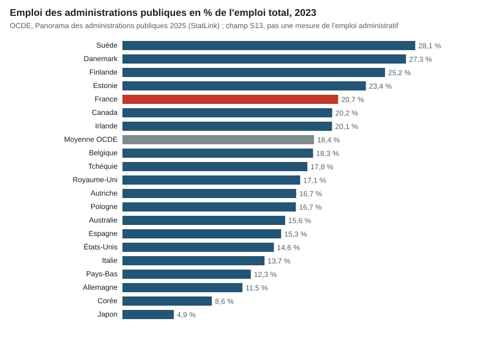

# 4. Comparaison internationale étendue

Détail : [note 03](../recherche/03_comparaison_harmonisee.md), base de 3 859 lignes et 44 pays (`data/international/03_base_comparative.csv`).

## 4.1 La France emploie-t-elle plus d'agents publics ?

*Valeurs du Panorama des administrations publiques 2025 de l'OCDE. Les séries de l'API OCDE d'octobre 2026, utilisées dans le texte, diffèrent légèrement pour la même année (France 20,86 %, Allemagne 11,80 %). Le Japon exclut les fonds de sécurité sociale.*

**[ESTIMATION]** En 2023, l'emploi des administrations publiques (S13) représente **20,86 % de l'emploi intérieur** en France, soit **92,4 personnes pour 1 000 habitants**. C'est plus que l'Allemagne (11,80 %), l'Italie (13,53 %), l'Espagne (15,77 %) ou le Royaume-Uni (17,0 %), mais moins que la Suède (28,1 %), le Danemark (27,3 %) ou la Finlande (25,4 %). La moyenne OCDE publiée est de 18,4 %.

**Ce chiffre ne mesure pas la suradministration.** Le champ S13 inclut les enseignants, soignants, policiers et agents techniques ; il dépend de ce que chaque pays fait produire par le secteur public plutôt que par des entreprises ou des associations financées sur fonds publics. L'Allemagne, par exemple, confie une grande partie de ses hôpitaux et de ses services sociaux à des organismes non publics.

## 4.2 Ce que coûte la production publique

| Pays, 2023 | Rémunérations D1 (% PIB) | Achats P2 + transferts en nature D632 (% PIB) | Total D1 + P2 + D632 (% PIB) |
|---|---:|---:|---:|
| France | 12,22 | 11,85 | **24,07** |
| Allemagne | 8,01 | 14,68 | **22,69** |
| Pays-Bas | 8,49 | 16,66 | **25,15** |

**[ESTIMATION]** La masse salariale publique française est élevée, mais l'écart se réduit fortement une fois ajoutés les achats et les prestations en nature financés par les administrations : **un pays qui achète au lieu d'employer n'est pas moins coûteux pour autant**. Les Pays-Bas dépensent davantage que la France sur ce sous-total.

**[FAIT]** Les services généraux des administrations (COFOG GF01) représentent 6,2 % du PIB en France en 2023, dont 1,6 % de rémunérations et 1,9 % d'intérêts et transferts ; la part des intérêts de la dette n'a pas pu être isolée **[NON TROUVÉ]**.

## 4.3 Fiabilité des données

- **[FAIT]** Les rapprochements OCDE / Eurostat portent sur 224 couples pays-année-indicateur, sans écart supérieur à 0,15 point de PIB. Les deux diffuseurs reprennent souvent les mêmes comptes nationaux : c'est un contrôle de cohérence, pas une double mesure.
- **[FAIT]** Sept divergences d'emploi S13 subsistent entre deux tables OCDE (jusqu'à 38 554 personnes pour le Portugal en 2024) ; la France est concordante.
- **[FAIT]** Les millésimes changent : 20,74 % pour la France dans le Panorama 2025, 20,86 % dans les données d'octobre 2026, pour la même année d'observation.

## 4.4 Ce que les comparaisons ne disent pas

Les corrections nécessaires pour passer d'un écart brut à un sureffectif — structure par métier (NACE, ISCO), heures travaillées, démographie, part privée de la santé et de l'enseignement, décentralisation, résultats des services — n'ont été réunies que fonction par fonction (chapitre 5), pas pour l'ensemble. **Aucun écart international n'est donc converti en nombre de postes à supprimer** dans ce rapport.

Les expériences étrangères de réforme sont analysées au chapitre 7 ; elles montrent surtout que les réductions d'effectifs observées ont souvent été suivies de rebonds, et que les économies vérifiées ont été bien inférieures aux annonces.
