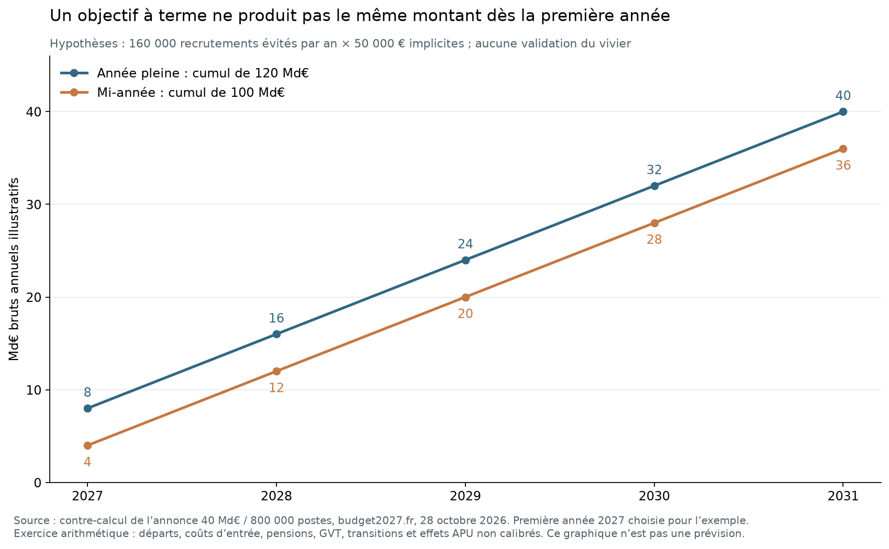

# 10. Évaluation des propositions de réforme existantes

Détail : [note 10](../recherche/10_audit_propositions.md), contre-vérification [10](../recherche/00_verification_10_lot3.md).

## 10.1 Le plan à 140 Md€ (budget2027.fr)

Le site budget2027.fr présente **24 mesures** pour un objectif de **140 Md€ d'économies par an**. Son instantané du 28 octobre 2026 a été archivé et relu.

| Constat | Valeur | Statut |
|---|---|---|
| Somme des bornes basses / hautes affichées | 138,366 / 145,366 Md€ | [ESTIMATION] |
| Mesure 1 : non-remplacement de 800 000 départs sur le quinquennat | 40 Md€ | [FAIT sur l'annonce] |
| Coût implicite par poste | **50 000 € par an** | [ESTIMATION] 40 Md€ / 800 000 |
| 800 000 rapportés aux 2,3 millions de départs annoncés | 34,78 % | [ESTIMATION] |
| Mesure 2 : productivité de l'IA « d'après le rapport IGF-IGAS 2025 » | 5 Md€ | Référence non identifiée |
| Bandeau du site | « Budget 2026 » sur une adresse « 2027 » | Date et exercice non explicités |

**Le plan additionne des objets de nature différente** : suppressions d'institutions, baisses de prestations (nationalité et aides, RSA, AME), arrêts d'interventions (énergie, politique de la ville, aide au développement), recettes de tarification (étudiants étrangers, visas) et une cession d'actifs. Un euro de prestation supprimée n'est pas un euro d'économie administrative. Treize recouvrements possibles entre mesures ont été repérés.

### Ce que l'audit de la mission établit

1. **Le vivier.** 800 000 non-remplacements en cinq ans représentent **5,1 fois** la capacité de départs à la retraite des fonctions administratives sur cette période (157 142), et **3,3 fois** leur capacité en ne remplaçant aucune sortie de fonctionnaire (243 487). Le plan suppose donc de ne pas remplacer aussi des enseignants, des soignants ou des agents de sécurité, ce qu'il exclut par ailleurs.
2. **Le coût par poste.** 50 000 € par an est proche du coût moyen hors pension de l'État (49 k€), mais un poste non remplacé économise d'abord son **coût d'entrée** (34 à 44 k€ selon le versant), et les postes territoriaux et hospitaliers coûtent moins.
3. **Le calendrier.** Avec 160 000 postes évités par an, l'économie n'atteint 40 Md€ qu'en cinquième année ; le cumul sur cinq ans vaut 100 à 120 Md€ selon la convention, et non 200 Md€.

4. **Les agences.** Les montants affichés pour l'Anah (6 Md€), l'Ademe (3,4 Md€) ou le placement de France Travail (4 Md€) sont du même ordre que leurs budgets d'**intervention** ou de **personnel de mission**, pas que leurs frais de structure : à l'Anah, le personnel coûte 25 M€.
5. **L'IA.** Les 5 Md€ ne sont pas ventilés et se superposent au vivier des 800 000.

## 10.2 Les plans gouvernementaux

| Plan | Contenu | Lecture |
|---|---|---|
| Plan Bayrou, juillet 2025 | Effort de 43,8 Md€ | [EXTRAIT] : source directe inaccessible |
| Loi de finances 2026 | Promulguée le 19 février 2026 (loi 2026-103) | Référence budgétaire |
| PLF 2027 (1er octobre 2026) | 54 Md€ d'effort total, dont 43 Md€ de mesures | Projet, non exécuté |
| Schémas d'emplois PLF 2027 | +8 025 ETP État, −1 209 opérateurs ; **−1 076 ETP** au total retraité | dont −812 en administration centrale, +404 numériques réinternalisés |

**[FAIT]** Le projet de budget 2027 retient un ordre de grandeur sans commune mesure avec 800 000 postes : une baisse nette d'environ un millier d'ETP, avec des créations dans certaines missions.

## 10.3 Les propositions antérieures

**[FAIT sur des positions]** L'Institut Montaigne rappelle les objectifs de la campagne 2017 : **120 000 emplois** pour Emmanuel Macron, **500 000** pour François Fillon. Il chiffrait le premier à 3,17 Md€ à terme. L'iFRAP avance 430 000 emplois publics automatisables, part publique (53,7 %) d'une estimation Roland Berger de 800 000 emplois automatisables : une position, pas une mesure.

## 10.4 Verdict

| Proposition | Verdict de la mission |
|---|---|
| 800 000 non-remplacements administratifs en cinq ans | **Incompatible** avec les départs administratifs disponibles |
| 40 Md€ par an à terme pour ces postes | Non démontré : vivier, coût d'entrée et calendrier non établis |
| 5 Md€ de gains d'IA | Non démontré : référence introuvable, aucune conversion de temps en postes observée |
| Fermeture d'agences à hauteur de leurs budgets | Confond suppression d'une structure et suppression de ses interventions |
| Schémas d'emplois du PLF 2027 | Cohérents avec les capacités ; intégrés à la trajectoire de référence |
