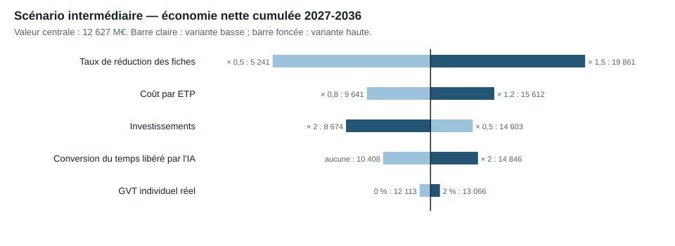

# 14. Risques, objections et analyses de sensibilité

Détail : [note 12](../recherche/12_scenarios_seuils.md) (sensibilités), [note 13](../recherche/13_contre_expertise.md) (contre-expertise), matrice complète `data/reformes/14_matrice_risques.csv` (9 risques transversaux, 30 risques par réforme).

## 14.1 Sensibilités

| Paramètre | Variante basse / haute | Intermédiaire : cumul net 2027-2036 (M€) | Radical : postes en 2036 |
|---|---|---|---|
| Taux de réduction des fiches | × 0,5 / × 1,5 | 5 241 / **12 627** / 19 861 | 114 425 / **194 476** / 247 300 |
| Investissements | × 0,5 / × 2 | 14 603 / 12 627 / 8 674 | inchangé |
| Coût par ETP | × 0,8 / × 1,2 | 9 641 / 12 627 / 15 612 | inchangé |
| Conversion du temps libéré par l'IA | aucune / × 2 | 10 408 / 12 627 / 14 846 | 161 961 / 194 476 / 226 991 |
| Départs mobilisables | retraites × 0,8 / toutes sorties | inchangé | 185 706 / 194 476 / 216 843 |
| GVT individuel réel | 0 % / 2 % | 12 113 / 12 627 / 13 066 | inchangé |
| Conservation APU | 0,50 / 0,80 | consolidé 5 164 / 7 403 / 9 642 | inchangé |

L'incertitude principale porte sur l'**existence des gisements** (taux des fiches, conversion de l'IA) ; les paramètres financiers déplacent les montants de ±25 % au plus. Aucune variante ne rapproche un scénario de 500 000 postes.

## 14.2 Réponses aux objections de l'équipe B

Le cahier des charges impose de répondre à dix objections. Chacune est traitée par des données ou par une révision du catalogue.

| Objection | Réponse et effet |
|---|---|
| **Comparaisons internationales trompeuses** | Aucun écart international n'est converti en postes (chapitres 4-5). Sur la fiscalité, la justice et la police, la France n'apparaît pas en excès. |
| **Emplois opérationnels classés comme administratifs** | Les viviers excluent enseignants, soignants, forces de sécurité, magistrats. Réserve : le vivier de l'État mêle personnels administratifs et techniques (contrôle V5-04). |
| **Contrôles et sécurité sous-estimés** | Les fonctions de contrôle fiscal et de recouvrement ne sont pas réduites (R03 en redéploiement) ; les indus sont traités par la fiabilisation en amont, sans réduction d'effectifs (R23). |
| **Économies qui déplacent des coûts vers le privé** | Aucun transfert n'est compté comme économie ; l'externalisation du placement (R27) est écartée ; le scénario HCAAM, qui transférerait 22,5 Md€ vers les finances publiques, n'est pas retenu. |
| **Transformations numériques génératrices de dépenses** | Investissements et coûts récurrents imputés à chaque fiche ; le doublement des investissements réduit d'un tiers le cumul intermédiaire ; risque Phénix en matrice (T4). |
| **Suppressions qui allongent les délais** | Indicateurs de délai dans chaque fiche ; non-remplacement seulement là où le temps libéré est mesuré ; règle descendante R12 limitée aux scénarios ambitieux et radical. |
| **Pertes de recettes liées à moins de contrôles** | Fonctions de contrôle préservées (risque T7). |
| **Capacités technologiques non démontrées** | Les six fiches IA sont toutes à confiance faible ; leur conversion nulle est testée (46 759 postes au lieu de 56 142 en intermédiaire). |
| **Coûts de transition et de formation** | Inclus dans la convention d'investissement ; sous-estimation probable, testée par la sensibilité × 2. |
| **Hypothèses irréalistes de départs naturels** | Taux de départ = retraites de fonctionnaires seulement, borne prudente ; contraint le scénario radical (22 000 ETP non réalisables) et fonde les verdicts de seuils. |

**Propositions reclassées.** Une proposition qui ne résiste pas à l'examen est écartée ou reclassée comme hypothèse exploratoire :

- l'externalisation de l'accompagnement des demandeurs d'emploi (R27) est **écartée** ;
- la règle d'un départ sur deux (R12) et la suppression d'un échelon territorial (R15) sont **exploratoires** : elles coûtent davantage qu'elles ne rapportent sur dix ans (note 13, O4) ;
- les six fiches d'IA sont des **hypothèses exploratoires** tant qu'aucune conversion de temps en postes n'est mesurée.

## 14.3 Pondération par la confiance

24 fiches sur 30 sont à confiance faible et portent 66 % des postes du scénario intermédiaire. **[HYPOTHÈSE]** En pondérant chaque fiche par une probabilité de réussite (0,3 en confiance faible, 0,6 en confiance moyenne), calée sur l'écart observé entre économies annoncées et vérifiées (19,7 % du potentiel pour Digital Post, 33 à 40 % de net pour la RGPP) :

| | Prudent | Intermédiaire | Ambitieux | Radical |
|---|---:|---:|---:|---:|
| Postes en 2036, catalogue | 11 106 | 56 142 | 120 250 | 194 476 |
| Postes en 2036, pondérés | **5 449** | **22 863** | 47 460 | 86 050 |
| Économie nette 2036 pondérée (M€) | **318** | **1 059** | 2 148 | 3 785 |

## 14.4 Matrice des risques transversaux

| Risque | Probabilité | Impact | Preuve | Atténuation |
|---|---|---|---|---|
| Les gisements ne se matérialisent pas | élevée | élevé | 66 % des postes sur des fiches à confiance faible | Pilotes mesurés avant généralisation |
| Rebond des effectifs | moyenne | élevé | Royaume-Uni +36,2 % après 2016 | Supprimer des missions, plafonds pluriannuels |
| Substitution par prestataires ou contractuels | moyenne | moyen | État territorial 2012-2020 | Suivi consolidé masse salariale + prestations |
| Dépassement des investissements numériques | moyenne | élevé | Phénix, Sirhen | Projets réversibles, budget de risque |
| Dégradation du service et de l'accès aux droits | moyenne | élevé | Illectronisme 7 % ; Robodebt, Toeslagen | Accueil humain garanti, mode dégradé |
| Risque juridique des décisions automatisées | moyenne | moyen | RGPD art. 22, CRPA, AI Act | Analyse d'impact par usage |
| Pertes de recettes par moindre contrôle | faible | moyen | Fonctions fiscales maintenues | Préserver le contrôle à rendement positif |
| Départs moins nombreux que prévu | faible | moyen | Pyramide des âges non publiée | Calendrier ajusté, pas de licenciement |
| Double compte avec la référence | moyenne | faible | Tendance DGFiP, PLF 2027 | Référence publiée avant chaque réforme |
