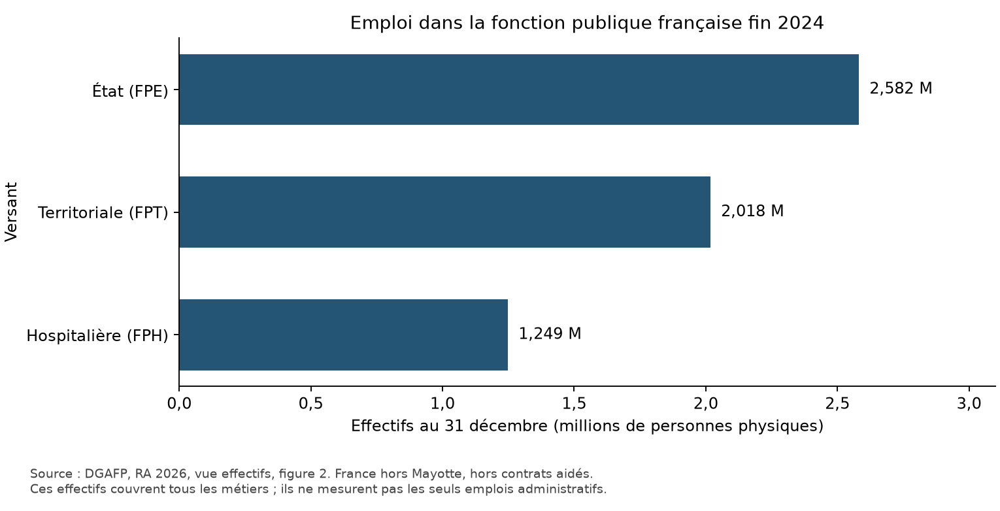
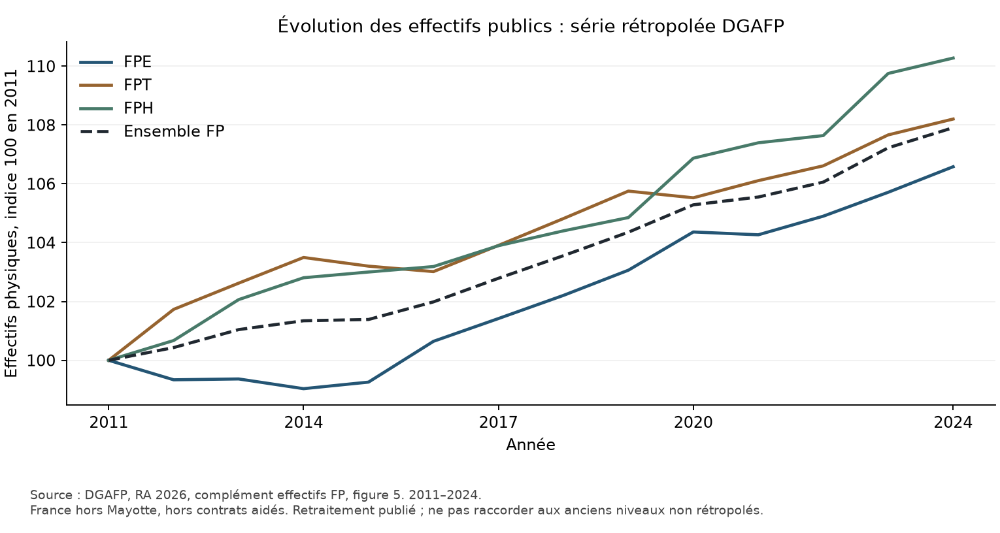

# 01 — Cartographie de l'emploi public français : stocks, champs et coûts

Date d'arrêt de la recherche : **28 octobre 2026**. Version : premier dossier statistique de la reprise Codex. Cette note établit la base française du diagnostic. Elle ne mesure pas encore des sureffectifs ni une économie nationale réalisable. Les flux et retraites font l'objet de [la note 01b](01b_flux_retraites.md) ; les coûts d'entrée sont traités dans le volet 01c.

## 1. Synthèse

1. **[FAIT] La DGAFP dénombre 5 848 291 personnes physiques fin 2024**, hors contrats aidés, en France hors Mayotte : **2 581 870 FPE**, **2 017 830 FPT**, **1 248 591 FPH**. Le chiffre de 5,9 millions est un arrondi, pas un nombre d'ETP administratifs. Source : RA 2026, vue effectifs, figure 2 C6:C9 ; rapport, p. imprimée 12, page PDF 13.
2. **[FAIT] Les contrats aidés ajoutent 25 797 personnes** dans cette version, portant l'ensemble à **5 874 088**. Source : complément effectifs FP, figure 4 P18/P22 et figure 6 S23.
3. **[FAIT] L'Insee Première 2094 publie un autre état des données : 5 876 700 personnes contrats aidés compris et 5 850 900 hors contrats aidés**, fin 2024. Les fichiers hérités ont été retéléchargés et rapprochés par SHA-256 ; l'écart ne résulte donc pas d'un fichier local altéré. Source : IP2094, figure 1 D9/E9 ; contrôle de provenance.
4. **[ESTIMATION] La différence de hausse entre +32 800 Insee et +37 036 DGAFP se décompose arithmétiquement** en **+3 000** liés au passage au champ hors contrats aidés de l'IP2094, puis **+1 236** d'écart entre les deux publications sur ce champ. La cause exacte de ce second écart reste **[NON TROUVÉ]**. Une explication par Mayotte, les militaires ou l'étranger n'est pas démontrée.
5. **[FAIT] Le volume annuel Insee atteint 5 781 800 EQTP hors contrats aidés et 5 804 200 avec eux**, en 2024, sur **tout poste actif dans l'année**. Ce volume ne doit pas être soustrait des personnes présentes au 31 décembre pour calculer des « postes vacants ». Source : IP2094, figure 1 D14/E14, note 2.
6. **[FAIT] Les statuts DGAFP se répartissent entre 3 745 836 fonctionnaires, 1 407 727 contractuels, 312 854 militaires et 381 874 autres catégories/statuts**. Ces catégories ne classent pas l'utilité ni le caractère administratif des tâches. Source : vue caractéristiques des postes, figure 1 D19:D23.
7. **[FAIT] Les « autres catégories » comprennent notamment les enseignants du privé sous contrat, des médecins hospitaliers, des ouvriers d'État et des apprentis.** Les ajouter comme des emplois nouveaux à l'effectif total de la FP provoquerait un double comptage. Source : même figure, note 1.
8. **[FAIT] La FPE comprend 2 058 555 agents employés par les ministères et 523 315 par les EPA** dans la nomenclature DGAFP. L'emploi des EPA n'est ni le seul emploi des agences, ni un ensemble exclusivement administratif. Source : vue effectifs, figure 4 C36:C37, note sur les EPA du complément FP, figure 5.
9. **[FAIT] L'ensemble Éducation nationale/Jeunesse/Sports/Enseignement supérieur/Recherche représente 1 501 101 personnes**, dont 1 142 548 au ministère et 358 553 dans les EPA rattachés. Ces agents ne sont pas tous enseignants, administratifs ou personnels de direction. Source : figure 4 C6:C8.
10. **[FAIT] Les organismes communaux emploient 1 146 464 personnes et les organismes intercommunaux 401 402**, dans la FPT en 2024. Les deux ensembles interviennent dans des missions comprenant de nombreux services opérationnels. Leur existence ne prouve pas un doublon d'emploi. Source : figure 6 C6/C9.
11. **[FAIT] La FPH comprend 1 118 560 personnes dans les hôpitaux, 92 510 dans les Ehpad non hospitaliers et 37 521 dans les autres établissements médico-sociaux**. Les 973 956 personnels hospitaliers non médicaux incluent des soignants ; ils ne sont pas tous administratifs. Source : figure 7 C6:C11.
12. **[FAIT] Le tableau DGAFP fondé sur les comptes nationaux dénombre 6 531 025 salariés à titre principal dans les APU fin 2024**, contrats aidés compris. Ce périmètre S13 diffère de la FP et comprend des employeurs de droit privé non marchands. Il ne se compare pas directement à un emploi S13 intérieur annuel d'une autre source. Source : complément effectifs FP, figure 2 L28.
13. **[FAIT] Les organismes publics hors FP comptent 188 011 personnes dans le tableau de périmètre**, dont 115 899 non marchandes et 72 112 marchandes. S'y ajoutent des ensembles présentés séparément : 627 947 dans les organismes privés à financement public prédominant, 512 501 dans les entreprises publiques marchandes. Ces champs ne s'ajoutent pas tous au S13. Source : complément FP, figure 3 U16/U19/U20/U25/U28.
14. **[FAIT] Les organismes privés de protection sociale de ce tableau emploient 162 623 personnes**, fin 2024. Il ne faut ni les appeler fonctionnaires, ni les exclure d'une comparaison économique des coûts de gestion publics. Source : figure 3 U22.
15. **[FAIT] Les rémunérations D1 des APU atteignent 370,012 Md€ courants en 2025**, provisoires : 184,8776 APUC, 96,9526 APUL et 88,1818 ASSO. D1 inclut les cotisations sociales employeur, effectives et imputées, et dépasse le seul salaire brut. Source : Insee, comptes nationaux base 2020, tableau dépenses des APU, figure 1 B8:F8.
16. **[FAIT] Les consommations intermédiaires P2 atteignent 163,4965 Md€ en 2025**. Elles comprennent bien davantage que la sous-traitance administrative ou le conseil. Ce montant ne permet pas de dénombrer des consultants. Source : même tableau, F7.
17. **[FAIT] Le titre 2 exécuté du budget général de l'État atteint 156,241675 Md€ en 2025**, dont **49,219294 Md€** à la ligne des contributions d'équilibre au CAS Pensions. Ce périmètre n'est pas la rémunération de toute la FPE, ni le D1 des APUC. Source : complément rémunérations, dépenses, figure 2 T35/T14.
18. **[ESTIMATION] Retirer cette ligne CAS au titre 2 donne 107,022381 Md€**. Ce calcul n'est pas encore un agrégat « hors toute retraite », car d'autres lignes concernent la RAFP, le FSPOEIE ou d'autres cotisations vieillesse. Source : même tableau, T19:T21 ; formule `T35 − T14`.
19. **[FAIT] Les salaires bruts mensuels moyens hors contrats aidés sont de 3 738,28 € en FPE, 2 857,75 € en FPT et 3 559,79 € en FPH** en 2024, sur le champ de salaire en EQTP mensualisé défini par la source. Ils n'incluent pas les charges employeur et ne sont pas des coûts d'entrée. Source : complément rémunérations, figure 1 B11/B28/B45 et champ A55.
20. **[FAIT] La durée annuelle effective déclarée des agents à temps complet hors enseignants est de 1 623,116 heures en 2025**, contre 1 680,234 pour le privé dans le même tableau. L'écart n'est pas corrigé des professions, sujétions ou absences ; il ne justifie pas une conversion directe en postes supprimables. Source : vue temps de travail, figure 1 F6/G6 et champ B17.
21. **[FAIT] Dix rapprochements arithmétiques sont satisfaits** : sommes par versant, statut et employeur, puis D1 Insee/DGAFP. **Dix-neuf XLSX hérités sont identiques à leurs distributions primaires** retéléchargées. Ce contrôle de transcription n'est pas une validation indépendante de la méthode SIASP. Sources : `01_controles.csv`, `01_controle_provenance.csv`.

## 2. Tableau des indicateurs

Tous les nombres de personnes ci-dessous se rapportent aux postes principaux au 31 décembre 2024, France hors Mayotte, hors contrats aidés, sauf mention explicite.

| Indicateur | Valeur | Unité | Année | Champ / définition | Source | Page ou tableau | Statut | Note |
|---|---:|---|---|---|---|---|---|---|
| Fonction publique, version DGAFP | 5 848 291 | PP | 2024 | Hors contrats aidés | [DGAFP, données effectifs][E] | Vue figure 2 C9 | [FAIT] | Base de travail nationale |
| État | 2 581 870 | PP | 2024 | FPE | [DGAFP][E] | C6 | [FAIT] | Inclut militaires et enseignement privé sous contrat |
| Territoriale | 2 017 830 | PP | 2024 | FPT | [DGAFP][E] | C7 | [FAIT] | Nombreux métiers opérationnels |
| Hospitalière | 1 248 591 | PP | 2024 | FPH | [DGAFP][E] | C8 | [FAIT] | Médecins inclus |
| Fonction publique, version Insee | 5 850 900 | PP | 2024 | Hors contrats aidés | [Insee IP2094][I] | Figure 1 E9 | [FAIT] | Autre version conservée |
| Volume annuel | 5 781 800 | EQTP annuels | 2024 | Tout poste actif, hors contrats aidés | [Insee][I] | Figure 1 E14 | [FAIT] | Pas un stock instantané |
| Fonctionnaires | 3 745 836 | PP | 2024 | Trois versants | [DGAFP postes][P] | Vue figure 1 D19 | [FAIT] | Militaires FPT regroupés selon note |
| Contractuels | 1 407 727 | PP | 2024 | Trois versants | [DGAFP postes][P] | D20 | [FAIT] | Médecins hors catégorie contractuels SIASP |
| Militaires FPE | 312 854 | PP | 2024 | FPE | [DGAFP postes][P] | D21 | [FAIT] | Gendarmerie à examiner au chantier 02 |
| Autres catégories | 381 874 | PP | 2024 | Trois versants | [DGAFP postes][P] | D22 | [FAIT] | Déjà incluses au total |
| APU, classification nationale | 6 531 025 | PP | 2024 | S13, salariés principaux, contrats aidés inclus | [DGAFP effectifs][E] | Complément FP figure 2 L28 | [FAIT] | Pas le champ FP |
| Organismes privés de protection sociale | 162 623 | PP | 2024 | Hors FP, financement public prédominant | [DGAFP effectifs][E] | Complément FP figure 3 U22 | [FAIT] | Sous-ensemble des organismes privés |
| Rémunérations des salariés | 370,012 | Md€ courants | 2025 | S13, données provisoires | [Insee comptes nationaux][C] | Figure 1 F8 | [FAIT] | Pensions/cotisations à distinguer |
| Consommations intermédiaires | 163,4965 | Md€ courants | 2025 | S13, données provisoires | [Insee][C] | Figure 1 F7 | [FAIT] | Pas les seuls prestataires administratifs |
| Titre 2 exécuté | 156,241675 | Md€ courants | 2025 | Budget général État | [DGAFP rémunérations][R] | Dépenses figure 2 T35 | [FAIT] | Différent de FPE/S13 |
| Contributions CAS de la ligne dédiée | 49,219294 | Md€ courants | 2025 | Budget général État | [DGAFP][R] | T14 | [FAIT] | Financement, pas droits futurs économisés |
| Durée annuelle effective | 1 623,116 | heures | 2025 | Temps complet, hors enseignants | [DGAFP temps de travail][T] | Vue figure 1 F6 | [FAIT] | Déclaratif Enquête Emploi |

[E]: https://www.fonction-publique.gouv.fr/files/files/publications/vue-rapport-annuel/2026/ra_2026_effectifs.zip
[I]: https://www.insee.fr/fr/statistiques/fichier/8732435/IP2094.xlsx
[P]: https://www.fonction-publique.gouv.fr/files/files/publications/vue-rapport-annuel/2026/ra_2026_postes.zip
[C]: https://www.insee.fr/fr/statistiques/fichier/2381404/econ-fin-pub-dep-adm-pub-secteur.xlsx
[R]: https://www.fonction-publique.gouv.fr/files/files/publications/vue-rapport-annuel/2026/ra_2026_remu_niveaux.zip
[T]: https://www.fonction-publique.gouv.fr/files/files/publications/vue-rapport-annuel/2026/ra_2026_tps_organisation_tps_travail.zip

## 3. Analyse détaillée

### 3.1 Ce que mesure le stock de référence

L'unité « personne physique au 31 décembre » correspond à une personne et son poste principal, actif et non annexe. Ce poste est généralement le plus rémunérateur lorsqu'un agent en occupe plusieurs. Le poste principal est déterminé en tenant compte du public et du privé. Une personne cumulant plusieurs employeurs ne doit donc pas être multipliée par le nombre de contrats.

Le volume annuel Insee pondère les postes par durée et quotité sur l'année. Des contrats intégralement terminés avant le 31 décembre contribuent au volume annuel sans figurer dans le stock de fin d'année. Inversement, une personne recrutée en décembre compte dans le stock mais très peu dans le volume annuel. Il n'existe aucune identité `personnes − EQTP annuels = emplois à supprimer`.

Le taux d'administration civil territorial de la DGAFP emploie encore un autre concept : des ETP localisés au 31 décembre, hors militaires. Il ne doit pas être substitué à l'EQTP annuel. Les champs propres aux rémunérations excluent notamment les militaires, les apprentis, les assistants maternels/familiaux et les internes/externes hospitaliers. Le dénominateur d'un coût doit être celui de son numérateur.

### 3.2 Rapprochement des versions Insee et DGAFP

| Publication et champ | Fin 2023, PP | Fin 2024, PP | Variation calculée, PP |
|---|---:|---:|---:|
| Insee IP2094, contrats aidés compris | 5 843 900 | 5 876 700 | +32 800 |
| Insee IP2094, hors contrats aidés | 5 815 100 | 5 850 900 | +35 800 |
| DGAFP RA2026, contrats aidés compris | 5 840 039 | 5 874 088 | +34 049 |
| DGAFP RA2026, hors contrats aidés | 5 811 255 | 5 848 291 | +37 036 |

**[ESTIMATION]** Les variations sont calculées par soustraction des cellules des deux années dans chaque publication. La précision Insee est ici la centaine de personnes. L'écart DGAFP-Insee hors contrats aidés vaut −2 609 personnes fin 2024 et −3 845 fin 2023, donc +1 236 sur la variation. Des différences allant jusqu'à environ 100 personnes dans la somme des versants Insee proviennent de l'arrondi des tableaux ; les totaux publiés sont conservés.

Le rapport DGAFP explicite, p. imprimée 21/page PDF 22, des changements méthodologiques et la révision de 7 400 personnes sur le millésime 2023 par rapport au rapport annuel antérieur. Il cite aussi l'IP2094. **Ce passage ne fournit pas un pont chiffré exact entre l'IP2094 et le RA2026**. L'IP2094 décrit notamment la meilleure identification des réservistes et la correction des quotités de contrats courts. Ces avertissements motivent de conserver deux versions, pas d'attribuer sans preuve la différence résiduelle à un seul ajustement.

La base nationale retient le RA2026, publication plus récente, pour la structure détaillée. Les comparaisons nécessitant des EQTP annuels utilisent la série Insee identifiée comme telle. Aucun calcul ne rapproche automatiquement le numérateur d'une version au dénominateur d'une autre.

### 3.3 Évolution longue et transferts entre employeurs

La série DGAFP 2011–2024 utilisée ici est explicitement rétropolée. Le tableau contient des nombres à décimales, issus de ce retraitement, avant retour aux décomptes récents. Ils doivent être arrondis pour la présentation sans être interprétés comme des fractions de personne directement observées. Les 56 observations des trois versants et du total sont dans `01_effectifs_serie_2011_2024.csv`.

Les changements de rattachement des AESH des EPA vers les ministères expliquent une part des mouvements opposés des deux catégories d'employeur entre 2022 et 2024. Supprimer un EPA de la nomenclature ou déplacer sa paie vers le ministère ne constitue pas une économie d'emploi. Les futures fiches de réforme devront séparer changement de tutelle, changement d'employeur, transfert et suppression effective de mission ou de poste.

### 3.4 Les cercles FP, APU, entreprises publiques et sous-traitance

La fonction publique est principalement définie par la nature juridique de l'employeur et le droit de recrutement. Les comptes nationaux classent les APU selon une logique de secteur institutionnel et de production non marchande. Des organismes de droit privé y figurent ; des employeurs publics marchands restent hors S13. Une entreprise détenue par l'État n'est donc pas automatiquement une administration publique.

Le tableau DGAFP des organismes hors FP est une carte des champs, pas une liste d'effectifs à additionner à S13. Il distingue organismes publics non marchands, marchands, organismes privés à financement public prédominant et entreprises publiques. La Sécurité sociale, les hôpitaux privés non lucratifs et les associations financées publiquement ne sont pas des « agents administratifs cachés » par définition : leurs emplois incluent aussi des activités directement opérationnelles.

France Travail doit être identifié une fois dans le champ correspondant à sa catégorie juridique et à son régime de recrutement, puis relié à ses comptes et effectifs propres. L'ajouter forfaitairement à toute la FP sans vérifier son traitement dans les EPA peut le compter deux fois. Même précaution pour les enseignants privés sous contrat, déjà inclus dans la catégorie « autres » de la FPE.

Les salariés de prestataires intervenant pour des administrations ne sont pas dénombrés dans les XLSX comme un ensemble statistique d'ETP. L'agrégat P2 couvre notamment achats de biens, services, énergie, entretien et prestations ; D632 couvre certaines prestations sociales en nature achetées. Un ratio de masse salariale sans ces postes peut avantager artificiellement un pays qui externalise. Convertir tout P2 en « personnels administratifs privés » serait tout aussi erroné. Le chantier international doit comparer la fonction rendue et les deux lectures demandées, personnel propre et coût économique élargi.

### 3.5 Masse salariale, coût évitable et pensions

Le D1 de 370,012 Md€ se rapporte à 2025 et au S13 France. Le diviser par les 5,848 millions de personnes SIASP de fin 2024 donnerait un ratio combinant années, unités et champs différents. Ce ratio n'est pas utilisé pour valoriser les économies.

Le non-remplacement évite le recrutement d'un entrant contrefactuel. Le coût pertinent dépend du métier, du grade, de la quotité et de la date du recrutement qui aurait été réalisé. Le salaire moyen du partant et le coût moyen D1 ne peuvent s'y substituer. Une catégorie de moins de 30 ans contient aussi des agents déjà anciens et n'est pas un groupe d'entrants. La documentation PAP et les coûts hors CAS doivent être conservés par programme/catégorie avant toute pondération nationale.

La contribution au CAS Pensions finance un régime en répartition déjà chargé de pensions. Une réduction de la contribution d'un employeur ne fait pas disparaître les pensions dues. La lecture employeur peut constater un flux de cotisation moindre, tandis que le besoin de financement consolidé du régime demeure. Les droits futurs non acquis nécessitent un autre modèle actuariel, hors de l'économie annuelle immédiate. Le retrait des 49,219 Md€ du titre 2 n'élimine pas toutes les lignes vieillesse ; les cotisations additionnelles et autres régimes sont identifiées séparément dans le CSV.

La consolidation APU exige également de traiter recettes fiscales et sociales perdues, effets d'un éventuel emploi privé de remplacement, allocations de chômage, achats de remplacement et effet des contrôles sur les recettes. Le moteur peut illustrer une hypothèse statique ou un retour à l'emploi, mais aucun taux de conservation net n'est actuellement présenté comme une observation nationale.

### 3.6 Temps de travail et départs

Les 1 623 heures effectives moyennes ne sont pas les 1 607 heures de référence légale. Une durée effective issue d'enquête intègre absences, congés, heures supplémentaires et situations individuelles. La comparaison au privé exige des corrections de composition des métiers, d'âge, de sujétions et de santé au travail. La source exclut ici tous les enseignants. Elle ne permet pas de multiplier un écart moyen par l'ensemble des effectifs publics.

La note 01b distingue sorties entre deux 31 décembre, mouvements interversants, postes courts dans l'année et nouvelles pensions. Pour le modèle, le paramètre de départ ne doit pas être une reprise aveugle du taux de toutes les sorties civiles : il faut le documenter dans chaque vivier de métiers, après retrait des mobilités internes et des emplois qui doivent être renouvelés pour assurer le service. Les projections fournies à ce stade sont des tests mécaniques, pas une prévision des départs administratifs 2027–2031.

## 4. Limites, données manquantes et contradictions

- **[NON TROUVÉ] Pont officiel complet Insee–DGAFP** expliquant les −2 609 personnes hors contrats aidés fin 2024. La réconciliation arithmétique est disponible ; l'attribution causale ne l'est pas.
- **[NON TROUVÉ] Partition nationale exhaustive A/B/C/D par tâches réelles et en ETP** : un ministère ou une filière statutaire n'est pas un métier administratif. Le chantier 02 traite cette limite.
- **[NON TROUVÉ] Effectif des prestataires privés affectés aux fonctions administratives publiques**, par mission et ETP. La totalité de P2 n'est pas un substitut.
- **[NON TROUVÉ] Coût d'entrée national administratif par versant**, hors pension, pondéré selon les recrutements évités. Les PAP par programme servent de points documentés et non de moyenne nationale automatique.
- **[NON TROUVÉ] Projection de sorties définitives 2027–2031 par vivier administratif**, exprimée dans l'unité du registre des réformes.
- **[NON TROUVÉ] Pont de consolidation entièrement calibré**, incluant fiscalité, cotisations, chômage et retour à l'emploi. À distinguer du simple affichage hors CAS.
- **[FAIT] L'accès terminal à une page de la Cour des comptes a expiré après 30 secondes** ; Insee, DGAFP, Eurostat et le flux de structure OCDE testé ont répondu. Il s'agit d'une limite d'accès ponctuelle, pas de la preuve que toute la Cour ou toute l'API serait indisponible.
- Les tableaux Insee et DGAFP partagent la source SIASP. Leur accord est un contrôle de publication, pas deux mesures statistiques indépendantes. Les contrôles SRE du volet 01b recourent eux aussi aux sources de régime sous-jacentes communes.

## 5. Sources consultées et reproductibilité

Les URL exactes, dates de consultation et empreintes sont dans `sources/registre_01.csv`, `sources/01_manifest_telechargements.json` et `data/france/01_manifest_fichiers.csv`. Les pages de publication consultées sont :

- [DGAFP, rapport annuel 2026, 15 octobre 2026](https://www.fonction-publique.gouv.fr/toutes-les-publications/rapport-annuel-sur-letat-de-la-fonction-publique-edition-2026), rapport intégral de 204 pages téléchargé ; pour cette note, lecture ciblée des sections sources/emploi/coûts, sans revendiquer la lecture intégrale de tous les chapitres.
- [DGAFP, évolution des effectifs 2024](https://www.fonction-publique.gouv.fr/toutes-les-publications/levolution-des-effectifs-de-la-fonction-publique-en-2024-0), données XLSX ouvertes et rapprochées de l'archive officielle.
- [Insee Première 2094, 10 février 2026](https://www.insee.fr/fr/statistiques/8732435), page, méthodes et classeur lus.
- [Insee, série par versant et ministère, 10 février 2026](https://www.insee.fr/fr/statistiques/2493501), version de publication conservée ; ne pas substituer ses niveaux à ceux de la série rétropolée DGAFP.
- [Insee, dépenses des administrations publiques 2025, 28 août 2026](https://www.insee.fr/fr/statistiques/2381404), page et classeur lus.
- [DGAFP, caractéristiques des postes](https://www.fonction-publique.gouv.fr/toutes-les-publications/caracteristiques-et-localisation-des-postes-de-la-fonction-publique-en-2024-0), [rémunérations](https://www.fonction-publique.gouv.fr/toutes-les-publications/les-remunerations-dans-la-fonction-publique-en-2024), [temps de travail](https://www.fonction-publique.gouv.fr/toutes-les-publications/le-temps-et-organisation-du-temps-de-travail-dans-la-fonction-publique-en-2025), pages et tableaux cités consultés.

Exécution depuis la racine : `python -I scripts/01_cartographie.py`, puis `python -I scripts/01_provenance.py`. L'extraction ne modifie aucun brut. Les CSV conservent cellule, valeur d'origine, multiplicateur et unité. L'outil `scripts/fetch.py` rétablit l'archivage des sources ; `html2text` est utilisé lorsqu'installé, le PDF utilise `pdftotext -layout` ou un repli `pypdf` explicitement indiqué. Les PDF lourds restent hors Git dans `data/cache/`.
