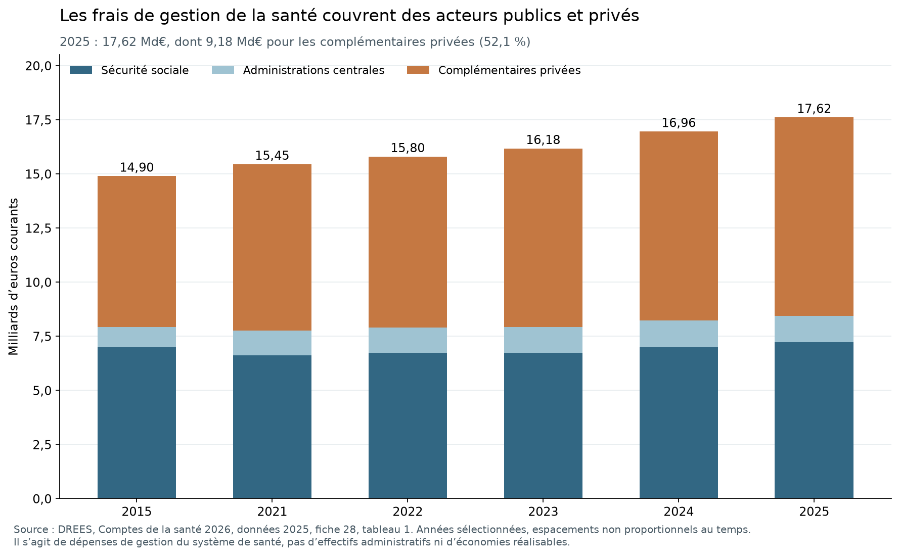

# Comparer les fonctions avant de chiffrer les réformes

**Lot 2 — Recherche arrêtée au 28 octobre 2026.** Ce dossier apporte un premier diagnostic par fonction et des corrections de périmètre chiffrées lorsque les sources le permettent. Il ne clôt ni les ajustements internationaux aux besoins, ni la calibration des économies nationales. Les quatre notes détaillées et leurs données permettent de reprendre chaque calcul.

## 1. Résultats qui changent le diagnostic

**La comparaison globale de l'emploi public ne suffit pas à désigner un excès administratif.** Les différences observées changent selon la fonction, le secteur, l'unité et les missions. Plusieurs regroupements usuels — non-enseignants, non-juges, régimes obligatoires, agences — réunissent des activités très différentes. Leur ouverture est une étape empirique, pas une précaution abstraite.

**Fiscalité.** ISORA déclare pour la France **38 406 ETP fiscaux annuels en 2023** et **93 789 agents de l'organisme en fin d'exercice**. Le premier chiffre est un périmètre de ressources consacré à l'impôt ; le second est un stock plus large en personnes. Le quotient des coûts aux recettes se reproduit à **0,67145 %**, mais il faut résoudre les conventions monétaires de l'export, et ce ratio dépend aussi des impôts administrés. Les sept fonctions fiscales déclarées séparent service aux usagers, contrôles, recouvrement, contentieux, RH, informatique et autres fonctions. La totalité de l'organisme ne peut être traitée comme un seul métier administratif. Voir [note 04a et sources ISORA](04a_fiscalite_emploi.md).

**Emploi et chômage.** Les dépenses LMP ne permettent pas d'isoler simplement un « coût de placement supprimable ». En France en 2023, **1,712 Md€** sont classés en placement et activités apparentées, et **5,187 Md€** en autres services/non ventilés. Une modalité non ventilée ne signifie pas une activité sans utilité. Les comptes nationaux des organismes allemand et néerlandais montrent aussi que les profils internationaux « staff » ne couvrent pas nécessairement l'organisme entier ni la même unité. L'externalisation doit être comptée dans les coûts et les résultats. Voir [note 04a](04a_fiscalite_emploi.md).

**École.** En 2024, le primaire français compte **17,87 élèves ETP par enseignant ETP**, contre **13,71** OCDE ; au second cycle secondaire, **11,48 contre 12,78**. Le sens de l'écart varie donc suivant le niveau. Parmi les **320 779 non-enseignants payés par le MEN en novembre 2025**, **224 785 travaillent dans la vie scolaire** et **52 432 dans la filière administrative**. Le personnel non enseignant n'est pas une mesure des seuls supports. Dans TALIS, les enseignants à temps plein du premier cycle secondaire déclarent **1,5 heure hebdomadaire de tâches administratives contre 3,0 OCDE** ; ce résultat ne mesure ni tous les métiers ni toutes les formes de complexité. Voir [note 04b](04b_education_securite_justice.md), [DEPP](https://www.education.gouv.fr/sites/default/files/document/chapitre-3-les-personnels-non-enseignants-520477.xlsx) et [TALIS France, PDF p.11](https://www.oecd.org/content/dam/oecd/en/publications/reports/2025/10/results-from-talis-2024-country-notes_eafd703e/france_714d7439/50507701-en.pdf).

**Police et justice.** Les **245 983 policiers français de 2022** de la série Eurostat excluent les secrétaires et autres personnels de soutien ; ils ne fournissent donc pas un nombre d'administratifs. La CEPEJ compte **37,3 ETP non-juges pour 100 000 habitants** en France, contre **62,8 en Allemagne** et une médiane Conseil de l'Europe de **57,9**. Les non-juges français comprennent surtout l'assistance judiciaire ; la catégorie administrative représente **3 424 des 25 388 ETP** de la réponse Q52. Les délais et la charge d'affaires empêchent de lire un ratio de personnel comme une réserve de suppressions. Voir [note 04b](04b_education_securite_justice.md), [Eurostat](https://ec.europa.eu/eurostat/cache/metadata/en/crim_sims.htm) et [questionnaire CEPEJ France, PDF p.30](https://rm.coe.int/france-2024-2022-/1680b1f6cd).

**Santé.** Le ratio HC7 de 2023 atteint **5,022 % de la dépense de santé en France, contre 4,414 % en Allemagne**. Après décomposition par régime, la composante gouvernement/assurance sociale représente **2,448 % contre 3,428 %**, et la composante assurances privées **2,574 % contre 0,986 %**. Le signe du premier écart ne décrit donc pas, à lui seul, la gestion publique. Cette décomposition par régime ne remplace pas un compte institutionnel S13, ni un ajustement aux prestations et à la qualité. L'administration interne des hôpitaux est en outre hors HC7. Voir [note 04c](04c_sante_protection_sociale.md) et [données OCDE SHA](https://sdmx.oecd.org/public/rest/data/OECD.ELS.HD,DSD_SHA@DF_SHA,1.1/FRA+DEU.A.EXP_HEALTH.PT_EXP_HLTH._T+HF11+HF121+HF122+HF21._Z.HC7._T._T._Z._Z._Z?startPeriod=2023&endPeriod=2023).

Les derniers comptes nationaux DREES portent sur **2025, édition 2026** : **17,616 Md€** de frais de gestion de la santé, dont **9,176 Md€ pour les organismes complémentaires privés, soit 52,09 %**. Une baisse de ces frais privés n'est pas automatiquement une économie de budget public. Un transfert de remboursements vers l'assurance maladie modifie simultanément dépenses, financement, taxes et emplois. Les scénarios HCAAM historiques sont conservés avec leurs hypothèses, et non actualisés par une simple multiplication. [DREES, fiche 28, tableau 1](https://drees.solidarites-sante.gouv.fr/sites/default/files/2026-09/CNS2026%20-%20Partie%203%20DCSi%20par%20composante.xlsx).

**Protection sociale.** En ESSPROS, les frais de gestion représentent **3,83 %** de la protection sociale en France en 2023, contre **3,60 % en Allemagne, 4,24 % au Danemark et 5,35 % aux Pays-Bas**. Cette autre base couvre plusieurs risques et chevauche la santé : elle ne s'ajoute pas à HC7. Les conventions nationales d'imputation empêchent de retenir automatiquement le pays au plus faible ratio comme cible. Voir [note 04c](04c_sante_protection_sociale.md) et [Eurostat](https://ec.europa.eu/eurostat/api/dissemination/statistics/1.0/data/spr_exp_type?format=JSON&lang=en&geo=FR&geo=DE&geo=DK&geo=NL&spdeps=ADM&unit=PC_EXP&time=2023).

**Territoires et supports.** Les données DGCL 2026 confirment **34 875 communes**, mais aussi une intercommunalité très largement déployée. Les **7,444 Md€** de coordination valorisée par Ravignon, les **540 M€** hypothétiques sur les supports d'opérateurs, les **412,53 M€** d'économies achats calculées par la DAE et le **1 Md€** annuel projeté pour l'immobilier sont quatre objets différents. Ils ne forment pas un total d'économies nettes. La foncière bénéficie déjà d'un cadre législatif promulgué en août 2026 : sa trajectoire doit entrer dans la référence. Voir [note 04d](04d_territoires_fonctions_support.md).

## 2. État des quatre niveaux

| Fonction | 1 — Constat brut documenté | 2 — Périmètre | 3 — Besoins et service | 4 — Potentiel net réalisable |
|---|---|---|---|---|
| Fiscalité | ETP, populations, recettes, dépenses et sept fonctions | ETP fiscaux distincts du stock de l'organisme ; missions nationales documentées | Pas de charge harmonisée ni de résultat fiscal comparable complet | Non identifié ; pas de conversion de l'écart en suppressions |
| Services de l'emploi | Dépenses LMP, profils et comptes d'organismes | Placement, assurance-chômage, autres prestations et externalisation distincts | Usagers, distance à l'emploi, conjoncture et effets causaux non ajustés | Non identifié ; contractualisation à évaluer en coût et emploi durable |
| Éducation | Ratios, dépenses PPA, rémunérations et temps déclaré | Public/privé, niveau CITE, soutien et administration séparés | Besoins éducatifs, dispersion, temps d'enseignement et résultats à apparier | Non identifié ; minutes réellement libérées à mesurer |
| Police | Agents et ratios à année commune | Soutiens exclus ; dates et périmètres nationaux différents | Missions, interventions et sécurité non standardisées | Le jeu ne mesure pas le vivier administratif |
| Justice | ETP, catégories Q52, budgets, affaires et délais | Assistance judiciaire distincte de l'administration | Charge, complexité et organisation judiciaire non neutralisées | Non identifié ; moyens et qualité à analyser conjointement |
| Gestion de santé | HC7, fonctions et unités PPA | Régimes disjoints ; privé obligatoire isolé ; hôpitaux hors HC7 | Panier, contrats, dossier et contrôle non ajustés | Scénarios historiques explicités ; aucun gain APU actuel calibré |
| Protection sociale | ESSPROS, régimes et dénominateurs | HC7 chevauchant ; coûts non imputés selon pays | Droits, risques et qualité non comparables à coût seul | Non identifié ; recouvrement et frais de gestion à distinguer |
| Territoires | Structures, coordination et RH | EPCI déjà présents ; temps nécessaire et sous-totaux séparés | Compétences, densité et accès non appariés | Hypothèses externes, sans potentiel net confirmé |
| Agences, achats, immobilier, SI | Bases support, achats exécutés et objectifs | Budgets d'aide, gains prix, loyers et ventes séparés | Missions et qualité, migrations et investissement à instruire | Hypothèses conditionnelles ; recouvrements et référence à corriger |

Les matrices calculables se trouvent dans `04a_quatre_niveaux.csv`, `04b_quatre_niveaux.csv`, `04c_ecarts_et_corrections.csv` et `04d_quatre_niveaux.csv`. Leur structure est propre à la nature du jeu : des lignes de comparaison ne représentent pas autant de fonctions indépendantes. **Une cellule vide signifie non identifié, jamais une économie ou un besoin nul.**

## 3. Conséquences pour le catalogue de réformes

Les problèmes documentés ouvrent des pistes : simplification d'une procédure fiscale, évaluation d'un parcours de placement, réduction d'une demande de reporting scolaire, allègement d'un acte policier ou judiciaire précisément identifié, simplification AMO–AMC, outils de recouvrement, clarification d'une responsabilité territoriale, paie partagée, supports communs d'opérateurs, achats au coût complet et optimisation immobilière. Leur effet dépend de leur mise en œuvre ; leur existence ne vaut pas validation d'une réduction d'effectif.

Chaque future fiche doit donner la chaîne suivante, avec preuves ou hypothèses explicites :

1. **Activité transformée** : acte, fréquence, volumes, institutions et métiers concernés ; règles supprimées ou outil modifié.
2. **Ressources réellement libérables** : temps mesuré, couverture, reprises et contrôles maintenus ; distinction entre temps disponible, redéploiement et postes entiers.
3. **Départs et coût évitable** : ETP et cohortes disjoints, départs définitifs par année et métier, coût d'entrée évité, GVT et lectures des pensions déjà définies dans le moteur.
4. **Coûts et transferts** : développement, migration, formation, coexistence, prestataires et tâches reprises par une autre entité, coûts récurrents du service commun.
5. **Résultat net et qualité** : trajectoire annuelle, montée en charge, comparaison à une référence intégrant les réformes engagées, erreurs, délais, accès et effets distributifs.

Les réductions d'un budget d'aide ou d'une prestation, les économies de gestion et les recettes supplémentaires de contrôle seront enregistrées séparément. Une suppression d'institution qui transfère la même mission peut déplacer une dépense. La réduction d'un coût privé n'est pas intégralement une économie d'APU. Une baisse de loyer interne s'annule sous consolidation lorsque les deux entités sont dans le même périmètre.

Le registre de recouvrements devra notamment relier **RH–paie–SI**, **supports d'agences–immobilier–achats**, **DGFiP–comptabilité locale–coordination**, **HC7–ESSPROS–AMO/AMC**, et **temps métier simplifié–automatisation–IA**. On attribuera une même heure ou facture à une seule mesure, ou on publiera explicitement l'interaction. Les matrices de ce lot ne sont donc pas additionnées entre elles.

## 4. Ce qui est vérifié et ce qui reste ouvert

Les scripts de chaque volet reconstruisent les extractions et des contrôles de cohérence ; une seconde lecture menée par un autre auteur relit les cellules et passages primaires. Le détail et les éventuelles réserves sont dans [la note de contre-vérification du lot](00_verification_lot2.md). Les tests portent sur les chiffres et conventions du diagnostic fonctionnel. Ils ne constituent pas encore la contre-expertise des économies et scénarios demandée en phase 5.

Des anomalies de source restent ouvertes, notamment un résidu de deux ETP dans la ventilation CEPEJ française, un million de monnaie nationale dans une identité SHA allemande 2024 et une sous-ligne Santé incohérente dans le tableau Ravignon. Les millésimes DREES et SHA diffèrent aussi. Les valeurs sont conservées avec leurs réserves ; les causes non établies ne sont pas inventées.

La suite de la recherche doit documenter les évaluations de réformes étrangères, les expériences françaises, la simplification, l'IA et les propositions politiques avant la calibration des 25 fiches, du registre des viviers et des quatre scénarios. Il manque encore des coûts marginaux actualisés, des volumes et des départs par processus, ainsi que des résultats comparables à besoins constants. **Ce lot resserre les périmètres de travail ; aucun total national d'économies n'en est déduit.**
