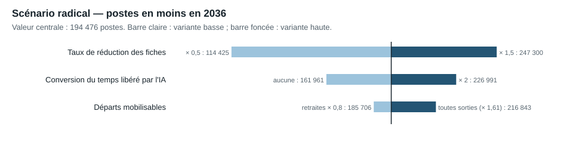

# 12 — Scénarios, seuils et sensibilités

Phase 4 arrêtée au **30 octobre 2026**. Cette note teste formellement les seuils de 500 000, 800 000, 1 million et 1,5 million de postes, et mesure la sensibilité des résultats aux hypothèses. Elle accompagne le classeur modifiable `modele/modele_financier.xlsx`. Les quatre scénarios sont construits de façon ascendante à partir des trente fiches de la [note 11](11_catalogue_reformes.md) ; aucun objectif de suppressions n'a servi de point de départ.

## 1. Synthèse

1. **[ESTIMATION]** Le catalogue retire **11 106 / 56 142 / 120 250 / 194 476 postes en 2036** (prudent / intermédiaire / ambitieux / radical), pour une économie nette annuelle de **0,62 / 2,52 / 5,28 / 8,43 Md€** en 2036.
2. **[ESTIMATION]** Si **aucun** départ à la retraite n'était remplacé dans les sept viviers administratifs (1 151 911 ETP), on atteindrait **157 142 postes en cinq ans** et **292 596 en dix ans**. Même en ne remplaçant aucune sortie définitive de fonctionnaire, toutes causes confondues, on plafonnerait à **243 487 en cinq ans** et **434 949 en dix ans**.
3. **Seuils.** 50 000 et 100 000 postes sont **conditionnels** ; 200 000 est **non démontré** ; **500 000, 800 000, 1 million et 1,5 million sont incompatibles** avec les données dans le périmètre administratif, faute de départs suffisants, même sans aucun remplacement. Les atteindre exigerait des licenciements de fonctionnaires (non prévus par le statut) ou des réductions dans des métiers non administratifs (enseignants, soignants, forces de sécurité).
4. **[ESTIMATION]** Les 800 000 non-remplacements du plan audité (note 10), prévus sur cinq ans, représentent **5,1 fois** la capacité de départs à la retraite des viviers administratifs sur cette période (157 142), et **3,3 fois** leur capacité toutes sorties confondues (243 487).
5. Les deux paramètres qui pèsent le plus sont les **taux de réduction des fiches** et le **coût des investissements**. Sur le scénario intermédiaire, l'économie nette cumulée 2027-2036 varie de **5,2 à 19,9 Md€** selon les taux de réduction (× 0,5 à × 1,5), et de **8,7 à 14,6 Md€** selon les investissements (× 2 à × 0,5).
6. Les **départs mobilisables** ne limitent que le scénario radical : de 185 706 à 216 843 postes en 2036 selon qu'on retient 80 % des retraites ou toutes les sorties de fonctionnaires.

## 2. Les quatre scénarios

Valeurs du moteur (`modele/resultats/synthese_scenarios.csv`), en M€ 2026 constants, par écart à une référence qui remplace tous les départs.

| Indicateur | Prudent | Intermédiaire | Ambitieux | Radical |
|---|---:|---:|---:|---:|
| ETP initiaux des viviers concernés | 1 151 911 | 1 151 911 | 1 151 911 | 1 151 911 |
| Postes en moins en 2031 (non-remplacement) | 9 553 | 45 578 | 85 930 | 123 103 |
| Postes en moins en 2036 (non-remplacement) | 11 106 | 56 142 | 120 250 | 194 476 |
| Postes supprimés par licenciement | 0 | 0 | 0 | 0 |
| Agents redéployés, cumul 2027-2036 | 232 | 1 625 | 3 225 | 9 765 |
| Recrutements rendus nécessaires ailleurs | 0 | 0 | 0 | 0 |
| Économie brute en 2031 | 398 | 1 712 | 3 280 | 4 697 |
| Économie nette en 2031 | 498 | 1 805 | 3 372 | 3 927 |
| Économie nette en 2036 (régime proche du permanent) | 618 | 2 517 | 5 280 | 8 430 |
| Économie consolidée APU en 2036 | 458 | 1 710 | 3 539 | 5 726 |
| Cumul net 2027-2031 | 448 | 533 | 1 162 | −1 564 |
| Cumul net 2027-2036 | 3 464 | 12 627 | 25 701 | 35 448 |
| Cumul consolidé APU 2027-2036 | 2 385 | 7 403 | 15 179 | 20 012 |
| Investissements 2027-2036 | 857 | 3 953 | 7 202 | 13 505 |

**Lecture.** L'économie nette de 2031 dépasse l'économie brute dans les trois premiers scénarios : elle inclut les 100 M€ de recettes de la fiche R23 (indus), qui ne sont pas une économie de dépense. Les cumuls sur cinq ans sont faibles, voire négatifs en radical : les investissements précèdent les économies, qui n'arrivent qu'au rythme des départs à la retraite. En lecture consolidée des administrations publiques, l'économie est environ un tiers plus faible, parce que cotisations sociales, CSG et retenues prélevées sur les salaires reviennent aux APU.

**Coût annuel moyen complet par poste**, hors pension (`modele/hypotheses.json`) : entrée **44,05 k€** et moyen **48,99 k€** dans la FPE ; **40,55 / 45,41 k€** à la DGFiP ; proxys de **33,67 / 37,45 k€** pour la FPT et la FPH. Ce sont des coûts hors contribution aux pensions.

**Pensions.** La contribution employeur au CAS Pensions ou à la CNRACL finance des pensions déjà liquidées : elle ne disparaît pas avec le poste et n'est pas comptée dans les économies. L'effet sur les pensions futures (droits non acquis par des agents non recrutés) n'apparaît qu'au-delà de 25 ans ; il est hors horizon et n'est pas chiffré ici.

**Sous-traitance.** Aucune fiche ne transfère d'activité au privé : l'externalisation de l'accompagnement des demandeurs d'emploi (R27) n'est pas retenue. Le risque de substitution par des contractuels ou des prestataires, observé dans l'État territorial après 2012 et en Nouvelle-Zélande (+7,18 % de dépenses externes), n'est pas modélisé ; il réduirait les économies.

**Recettes.** Seule la fiche R23 porte un effet de recettes (100 M€ par an, borne basse de la Cour des comptes). Le gain de recettes que pourrait apporter un meilleur ciblage du contrôle fiscal (R03) n'est pas chiffré.

**Indicateurs de service.** Chaque fiche donne ses risques de dégradation et son indicateur de validation à 2-3 ans. Les scénarios ne les agrègent pas en un indice unique : les délais, les erreurs et l'accessibilité doivent être suivis réforme par réforme.

## 3. Test des seuils

Méthode (`scripts/12_sensibilites.py`, `data/reformes/12_seuils.csv`) :

- **conditionnel** : atteint par le catalogue dans au moins un scénario, sur des taux hypothétiques ;
- **non démontré** : atteint seulement en cumulant des hypothèses favorables (taux × 1,5 et non-remplacement de toutes les sorties de fonctionnaires), sans réforme documentée qui le justifie ;
- **incompatible** : supérieur à tous les départs administratifs possibles en dix ans, même sans aucun remplacement.

Capacité de départs : `B × (1 − (1 − r)^n)` par vivier. `r` est le taux de départs à la retraite des fonctionnaires civils de chaque versant ; la variante haute le multiplie par **1,605**, rapport entre les 174 655 sorties définitives de fonctionnaires de 2024 et les 108 796 pensions civiles de 2025 (note 01b).

| Seuil | Catalogue intermédiaire 2036 | Catalogue radical 2036 | Radical favorable 2036 | Capacité retraites 5 / 10 ans | Capacité toutes sorties 5 / 10 ans | Verdict |
|---:|---:|---:|---:|---|---|---|
| 50 000 | 56 142 | 194 476 | 283 427 | 157 142 / 292 596 | 243 487 / 434 949 | **Conditionnel** |
| 100 000 | 56 142 | 194 476 | 283 427 | idem | idem | **Conditionnel** |
| 200 000 | 56 142 | 194 476 | 283 427 | idem | idem | **Non démontré** |
| 500 000 | 56 142 | 194 476 | 283 427 | idem | idem | **Incompatible** |
| 800 000 | 56 142 | 194 476 | 283 427 | idem | idem | **Incompatible** |
| 1 000 000 | 56 142 | 194 476 | 283 427 | idem | idem | **Incompatible** |
| 1 500 000 | 56 142 | 194 476 | 283 427 | idem | idem | **Incompatible** |

1,5 million dépasse même l'effectif total des sept viviers administratifs (1 151 911 ETP).

**Aucun scénario solide n'atteint 500 000 postes.** Le seuil de 200 000 n'est atteint que par le scénario radical sous hypothèses favorables, avec 283 427 postes et 12,0 Md€ d'économie nette en 2036. Il suppose une transformation sans précédent observé : taux de réduction relevés de 50 % et aucune sortie de fonctionnaire remplacée.

**Limite du verdict.** « Incompatible » porte sur le périmètre administratif défini par les viviers (filières et corps administratifs, organismes de protection sociale, France Travail). Il ne dit pas qu'il serait impossible de réduire l'emploi public total de 500 000 postes ; il dit que les fonctions administratives n'en libèrent pas assez en dix ans, et qu'il faudrait donc toucher d'autres métiers. Les 2,34 millions de sorties civiles de 2020-2024 (note 01b) incluent enseignants, soignants et contractuels remplacés : elles ne constituent pas un vivier administratif.

## 4. Sensibilités

Chaque variante modifie un seul paramètre et relance le moteur annuel (`data/reformes/12_sensibilites.csv`, 4 scénarios × 15 cas).

| Paramètre | Bas | Haut | Intermédiaire : cumul net 2027-2036 (M€), bas / central / haut | Radical : postes 2036, bas / central / haut |
|---|---|---|---|---|
| Taux de réduction des fiches | × 0,5 | × 1,5 | 5 241 / 12 627 / 19 861 | 114 425 / 194 476 / 247 300 |
| Investissements | × 0,5 | × 2 | 14 603 / 12 627 / 8 674 | inchangé |
| Coût par ETP | × 0,8 | × 1,2 | 9 641 / 12 627 / 15 612 | inchangé |
| Conversion du temps libéré par l'IA | aucune | × 2 | 10 408 / 12 627 / 14 846 | 161 961 / 194 476 / 226 991 |
| Départs mobilisables | retraites × 0,8 | toutes sorties (× 1,605) | inchangé | 185 706 / 194 476 / 216 843 |
| GVT individuel réel | 0 % | 2 % | 12 113 / 12 627 / 13 066 | inchangé |
| Conservation APU | 0,50 | 0,80 | net inchangé ; consolidé 5 164 / 7 403 / 9 642 | inchangé |




**Lecture.** L'incertitude principale porte sur l'existence même des gisements : taux de réduction des fiches, conversion du temps libéré en postes. Les paramètres financiers (coût par ETP, GVT) déplacent les montants de ±25 % au plus, sans changer les ordres de grandeur. Doubler les investissements ampute d'un tiers l'économie cumulée sur dix ans en scénario intermédiaire. Aucune variante ne rapproche un scénario du seuil de 500 000 postes.

## 5. Le classeur modifiable

`modele/modele_financier.xlsx` reprend le catalogue sous forme de formules :

- **Hypotheses** : horizon, GVT, conservation APU, coûts par versant et quatre multiplicateurs de sensibilité (taux, départs, coûts, investissements), en cellules jaunes ;
- **Viviers** : effectifs, taux de départ, plafonds et capacité de départs sur l'horizon ;
- **Reformes** : les 30 fiches, avec taux par scénario, investissements et coûts modifiables ;
- **Calcul_prudent** à **Calcul_radical** : cibles successives par vivier, plafonnement par les départs, économie en régime permanent ;
- **Synthese** : totaux du tableur, valeurs du moteur, écart entre les deux et test des seuils recalculé ;
- **Sensibilites** : les 60 résultats du moteur.

Le tableur calcule un régime permanent sans cohortes annuelles. Recalculé avec `pycel`, il reproduit exactement les postes du moteur dans les scénarios prudent, intermédiaire et ambitieux, et s'en écarte de 1,3 % en radical (197 002 contre 194 476), où l'approximation de la capacité de départs joue. L'économie nette s'écarte de 0,7 à 2,4 % selon le scénario. Les verdicts des seuils sont identiques. Le moteur annuel reste la référence.

## 6. Limites

- Les taux de réduction restent des hypothèses ; la sensibilité × 0,5 à × 1,5 ne couvre pas l'éventualité qu'une réforme ne produise rien.
- Les viviers mesurent des filières statutaires, pas des tâches : une partie des agents administratifs exerce des fonctions directement utiles aux usagers.
- Le taux de départ est supposé constant et homogène dans chaque vivier ; la pyramide des âges propre aux filières administratives n'est pas publiée dans les sources lues.
- Les effets de second tour (nouvelles missions, contentieux, recrutements de contractuels) ne sont pas modélisés.
- La phase 5 contre-vérifiera au moins 40 chiffres décisifs du catalogue et de ces scénarios.

## 7. Reproduction

```powershell
python -I scripts/11_catalogue.py
python -I scripts/12_sensibilites.py
python -I scripts/12_classeur.py
```

Le premier script reconstruit le catalogue et relance le moteur ; le deuxième produit les sensibilités, les seuils et les deux graphiques ; le troisième écrit le classeur. Les tests du moteur : `python -I -m unittest discover -s tests -p "test_modele.py"`.
